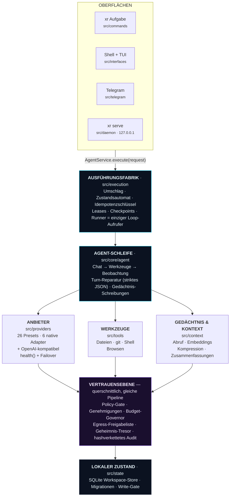
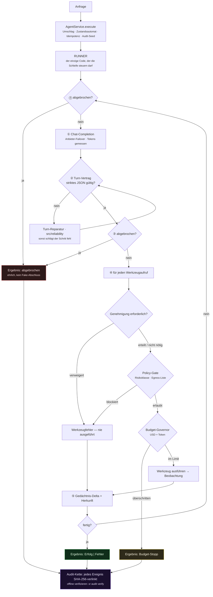

<div align="center">


# XR

**Eine KI-Agent-Laufzeit, die Sie tatsächlich auditieren können.**

*Geben Sie ihr eine Aufgabe. Sie plant, nutzt Werkzeuge und verändert echte Dinge auf Ihrer
Maschine — unter einem Policy-Gate, Ihrer Freigabe, einer Ausgabendecke und einem
hashverketteten Protokoll, das Sie offline verifizieren können.*

[](https://github.com/ahmadrrrtx/xr/actions/workflows/ci.yml)
[](https://www.npmjs.com/package/@rrrtx/xr)
[](LICENSE)
[](docs/release/SUPPORT_MATRIX.md)

📄 **Sprachen:** [English](README.md) (kanonischer Text) · [اردو](README-ur.md) · [Español](README-es.md) · [Français](README-fr.md) · [Deutsch](README-de.md) · [Português](README-pt-BR.md) · [中文](README-zh-CN.md) · [日本語](README-ja.md) · [हिन्दी](README-hi.md)

[Schnellstart](#schnellstart) · [Was XR ist](#was-xr-ist--und-was-nicht) · [Funktionsweise](#wie-xr-funktioniert) · [Anbieter](#anbieter) · [Sicherheit](#sicherheit--die-vertrauensebene)

</div>

**Version:** `1.1.0 (Graphite)` · **Paket:** [@rrrtx/xr](https://www.npmjs.com/package/@rrrtx/xr) · **Lizenz:** MIT

XR — eine local-first, provider-neutrale KI-Agent-Laufzeit. BYOK, Ausgabenbegrenzung,
manipulationssichere Auditierung, Plugin/MCP-Erweiterbarkeit.

**Mitgelieferte Fähigkeiten:** 65 (bei Veröffentlichung aus `skills/` gezählt).

---

<div align="center">


**Die Desktop-Shell, echter Build.** Jede Aktion durchläuft dieselben Genehmigungs-, Policy- und
Budget-Gates — unabhängig davon, welche Oberfläche Sie nutzen.

</div>

---

## Was ist XR, in einfacher Sprache?

Sie tippen eine Aufgabe ins Terminal. XR ermittelt die Schritte, ruft ein Sprachmodell und
verwendet Werkzeuge — Dateien lesen und schreiben, Befehle ausführen, browsen, APIs aufrufen —
bis die Aufgabe erledigt ist oder es ehrlich einen Misserfolg meldet.

Der Unterschied liegt in **dem, was diese Schleife umgibt**:

| | |
|---|---|
| 🔑 **Sie bringen den Schlüssel mit** | XR liefert keinen API-Schlüssel und kein Cloud-Konto mit. Es läuft mit *Ihrem* Anbieter-Schlüssel oder einem Modell auf *Ihrer* Maschine. |
| 🛑 **Es fragt, bevor es handelt** | Konsequente Aktionen halten an und warten auf Ihre Freigabe. Ein Nein wird im Ausführungspfad erzwungen, nicht im Prompt vorgeschlagen. |
| 💸 **Es verfolgt Ausgaben und Grenzen** | USD/Token-Grenzen werden während der Schleife geprüft. USD-Kosten sind Schätzungen: Eine Antwort kann das Limit überschreiten, und bei unbekannten Preisen lässt sich keine USD-Obergrenze erzwingen. |
| 🔗 **Es schreibt auf, was es tat** | Jedes Ereignis ist per SHA-256 in eine lokale Kette verlinkt, die Sie mit einem Befehl offline verifizieren. |
| 💻 **Es läuft auf Ihrer Maschine** | Eine SQLite-Datenbank, keine Telemetrie, kein erzwungenes Netzwerk. Zehn lokale Modell-Laufzeiten sind erstklassige Bürger. |
| 🆓 **Jede lokale Funktion ist kostenlos** | Sprache, Gedächtnis, Themes, CLI, Bots, Editor-Oberfläche, Recherche, Agenten, Skills und MCP permanent — [kein Paywall, per Test belegt](#preise). |

```bash
xr "fasse die offenen TODOs in diesem Repo zusammen und entwirf einen Aufräumplan"
```

> **Sicherheitsgrenzen der Entwicklungsvorschau:** Der Code-CLI simuliert Datei-Schreibzugriffe
> und Shell-Ausführung unter `--dry-run`, aber Modell-/Lese-/Netz-Anfragen und Audit-/State-
> Aktualisierungen können weiterhin erfolgen. Nicht als Isolation für nicht vertrauenswürdige
> Repositories oder als absolute Abrechnungsobergrenze verwenden. Siehe
> [CLI-Verträge und bekannte Grenzen](docs/cli/CODING_CONTRACTS.md).

**Für wen gemacht:** Entwickler, die echte Arbeit auf echten Maschinen automatisieren; Teams,
denen Agent-Aktionen nachträglich überprüfbar sein müssen; alle, die einen vollständig offline
laufenden Agenten wollen.

---

## Was XR ist — und was nicht

**XR ist:** eine selbst gehostete Agent-Laufzeit; provider-neutral (26 Voreinstellungen);
gouvermentiert (Policy, Genehmigungen, Budget und Audit werden im Ausführungspfad erzwungen);
erweiterbar (Skills, Plugins, MCP); in der Lieferkette signiert; MIT-lizenziert und von
Anfang bis Ende lesbar.

**XR ist nicht:** nicht nach SOC 2 / ISO 27001 / HIPAA / PCI-DSS zertifiziert; keine Sandbox
(In-Prozess-Policy, keine Kernel-/VM-Isolation); kein Pflichtdienst; kein Ersatz für menschliche
Prüfung konsequenter Aktionen; und nicht fertig — das
[Register bekannter Grenzen](docs/security/KNOWN_LIMITATIONS.md) ist erstklassiges
Release-Artefakt.

---

## Schnellstart

### 1. Installation

| Kanal | Plattform | Befehl |
|---|---|---|
| **npm** (stabile `latest`) | Linux · macOS · Windows · Termux | `npm i -g @rrrtx/xr` |
| **Binär** | Linux · macOS · Termux · WSL | `curl -fsSL https://raw.githubusercontent.com/ahmadrrrtx/xr/main/install.sh \| bash` |
| **Binär** | Windows PowerShell 5.1 / 7+ | `iex (irm https://raw.githubusercontent.com/ahmadrrrtx/xr/main/install.ps1)` |
| **Homebrew** | macOS · Linux | `brew install ahmadrrrtx/tap/xr` |
| **WinGet** | Windows | `winget install ahmadrrrtx.XR` |
| **Scoop** | Windows | `scoop/xr.json` aus der Release laden · `scoop install ./xr.json` |
| **.deb** | Debian · Ubuntu | `sudo dpkg -i xr_*_amd64.deb` |
| **Docker** | alle | `docker run ghcr.io/ahmadrrrtx/xr:latest` |
| **Aus Quellcode** | alle | `git clone https://github.com/ahmadrrrtx/xr && cd xr && bun install` |

### 2. Erster Start

```bash
xr onboarding        # geführte Einrichtung (Anbieter + Gedächtnis + optionale Sprache)
xr doctor            # Gesundheitscheck — Exit-Code ungleich null, wenn XR nicht wirklich arbeiten kann
```

### 3. Ihre erste Aufgabe

```bash
xr "hallo, XR"                 # einmalige Aufgabe
xr                             # interaktive Vollbild-Shell
xr serve                       # Dashboard + Chat unter http://localhost:3141 (127.0.0.1, Token-auth)
```

Neu hier? Folgen Sie dem goldenen Weg bis zum Ende:
[`docs/development/GETTING_STARTED.md`](docs/development/GETTING_STARTED.md).

### Vollständig offline

```bash
ollama serve && ollama pull qwen2.5:7b   # jede der 10 unterstützten lokalen Laufzeiten
xr providers set ollama qwen2.5:7b
xr "refaktorisiere diese Funktion"       # kein Netzwerk erforderlich
```

---

## Wie XR funktioniert

Jede Oberfläche — CLI, Shell, Telegram, Daemon-Chat — mündet in **einem Aufruf**. Keine
Hintertür: Policy, Genehmigungen, Budget, Abbruch und Audit sind Eigenschaften der Pipeline,
keine Schnittstelle kann sie überspringen.



### Was mit einer Aufgabe passiert



### Design-Prinzipien

1. **Eine Rechenautorität pro Frage.** Was eine Frage beantwortet, gilt für jede Oberfläche und
   für CI — Doctors Readiness-Engine ist der Fähigkeitsscan des Onboardings; die
   plattformübergreifende Suite ist eine Dateiliste pro OS.
2. **Kein Bypass um den Runner.** Jeder Turn läuft über Umschlag → Runner → Schleife.
3. **Ehrliche Ergebnisse.** Nie ein vorgetäuschter Abschluss.
4. **Prüfbarer Zustand.** Eine SQLite-Datenbank, hashverkettete Audit-Ereignisse,
   exportierbare Sitzungen, reproduzierbares Inventar.
5. **Der schnelle Pfad bleibt schnell.** Null synchrone FS-/Prozess-I/O im Hot Path
   (lint-erzwungen) und Budgets von CI abgeschottet.

---

## Anbieter

**26 eingebaute Presets — 16 gehostet und 10 lokale Laufzeiten.** Jederzeit wechselbar, ohne
Neustart.

Sechs gehostete Anbieter verwenden dedizierte native Adapter (Anthropic, Cerebras, Cohere,
Google, Mistral, AWS Bedrock — `src/providers/native/`). Der Rest — die übrigen gehosteten und
die zehn lokalen Laufzeiten — spricht das OpenAI-kompatible Protokoll über einen Transport, und
ein benutzerdefiniertes Preset kann auf jede kompatible Basis-URL zeigen.

```bash
xr providers list                    # 26 Presets · Standardmodell + Fähigkeiten
xr providers set openai gpt-4o-mini
xr providers add claude              # Schlüssel maskiert → OS-Schlüsselbund, sonst AES-256-GCM-versiegelte Datei
xr providers test                    # Live-Probe der konfigurierten Anbieter
```

Der Modellwechsel führt eine **Preflight → Canary → Swap → Verify**-Zustandsmaschine aus, die bei
unerreichbarem Modell automatisch zurückrollt (`--force` überspringt die Probe).

---

## Sicherheit — die Vertrauensebene

### XR Shield — die Durchsetzungsgrenze

**XR Shield** heißen die sieben Komponenten, durch die jede konsequente Aktion läuft. Es ist
kein Produkt-Tier und kein Scanner: Es ist der Code, der *nein* sagen kann. In einem Import
auflistbar — `src/xr-shield/index.ts`.

| # | Komponente | Wo | Beantwortete Frage | Kann ablehnen? |
|---|---|---|---|---|
| 1 | **Fähigkeits-Policy** | `src/capabilities/policy.ts` | Ist diese Fähigkeit für diesen Workspace und Modus erlaubt? | ✅ |
| 2 | **Aktions-Wächter** | `src/security/guard.ts` | Ist die Aktion nach vollständigem Dekodieren und Kanonisieren gefährlich? | ✅ |
| 3 | **Trust-Gitter + Platzierung** | `src/runtime/trust/` | Welche Risikostufe und wo darf sie laufen? | ✅ |
| 4 | **Einverständnis / Genehmigungen** | `src/control/approval-store.ts` | Hat ein Mensch zugestimmt? (dauerhaft, TTL Default-Deny) | ✅ |
| 5 | **Netzwerk-Egress** | `src/security/egress-proxy.ts` | Ist dieses Ziel erlaubt? | ✅ |
| 6 | **Ausführungs- + Ausgabe-Integrität** | `src/security/exec-integrity.ts`, `tool-output.ts`, `secret-broker.ts` | Ist die Binärdatei erlaubt? Wird Werkzeug-Ausgabe als Daten zurückgeführt? Werden Geheimnisse vermittelt, nicht weitergegeben? | ✅ |
| 7 | **Signierte Audit-Belege** | `src/security/audit-signer.ts`, `audit-verify.ts` | Lässt es sich nachträglich beweisen? Würde Manipulation auffallen? | ➖ zeichnet auf |

Die Tabelle wird aus `XR_SHIELD_COMPONENTS` generiert, und
`test/architecture/xr-shield-facade.test.ts` schlägt fehl, wenn ein gelistetes Modul verschwindet
— die Dokumente können nicht vom Code abweichen.

> **Ehrlichkeits-Hinweis:** XR erzwingt **In-Prozess-Policy**, keine Kernel-/VM-Isolation — ein
> Geländer, kein Einschluss und kein Ersatz für menschliche Prüfung. Die Lücken sind
> niedergeschrieben: [`docs/security/KNOWN_LIMITATIONS.md`](docs/security/KNOWN_LIMITATIONS.md).

Sicherheitsarchitektur, Bedrohungsmodell und Schwachstellen-Offenlegung: [`SECURITY.md`](SECURITY.md).

---

## Lieferkette — signiert, mit Herkunft, verifiziert

Jeder Tag-Push durchläuft eine Pipeline, die baut, signiert, veröffentlicht und sich selbst
verifiziert. npm-Publishing erfolgt über *OIDC Trusted Publishing* (kein langlebiger npm-Token
im Release-Pfad).

- **Binärkanäle** (GitHub Releases, Homebrew, WinGet, Scoop, `.deb`, Docker): cosign-*keyless*
  Signaturen über `SHA256SUMS`, CycloneDX-SBOM und SLSA3-Herkunft — Verifikation nach
  [`docs/release/VERIFYING_RELEASES.md`](docs/release/VERIFYING_RELEASES.md). Der
  Asset-Bestand variiert je Release-Strang; alles Veröffentlichte wird beim Tag signiert.
- **npm**: mit **Provenance-Attestierung** veröffentlicht, an den Tag-Commit gebunden.
- **CI-Hygiene:** `--ignore-scripts`, osv-scanner + `bun audit`, gitleaks-Secret-Scan,
  Lizenzscan und SBOM-Drift-Gates bei jedem Lauf.
- **Kanäle können nicht hinterherhinken:** Konfigurationen werden aus dem Release-Manifest
  **generiert** und drift-gated (`bun run channel:check`); die Tag ⇔ npm-Invariante wird in CI
  geprüft.

---

## Fähigkeiten

- **Skills** (`skills/`): 65 mitgeliefert (`xr-skill.json`-Manifeste).
- **Plugins** (`src/plugins/`): explizite Berechtigungen, Hash-Prüfung, vollständiger
  Lebenszyklus.
- **MCP** (`src/mcp/`): Client + Manager + Registry — stdio, SSE, HTTP, Freigabelisten.
- **Gedächtnis** (`src/context/`): einwilligungsbasierte Erfassung, erklärbarer Abruf, TTL.
- **Recherche** (`src/research/`): standardmäßig offline; öffentliches Web nur Opt-in.
- **Sprache** und **Computer-Control**: lokale-first Adapter, hinter denselben
  Genehmigungsgates.
- **Multi-Agent-Workflows**: deterministischer Plan + begrenzte Parallelspuren +
  Artefakt-Verifizierer; ein einziger, von der Wurzel finanzierter Budgetbaum.

---

## Die Oberflächen

**Desktop-Shell** (`desktop/`, Tauri v2 + React — derselbe Agent mit Fenster):

| | |
|---|---|
| 🛰 **Immer lebendig** | Tray hält Engine, Shortcuts und Genehmigungs-Badge nach Fenster-Schließen am Leben. |
| ⌨️ **Global, ehrlich** | HUD, Push-to-Talk und Bereich-aufnehmen-und-fragen funktionieren ohne Fokus; Akkorde weichen zurück, wenn das OS sie besitzt. |
| 🔄 **Signierte Selbstaktualisierung** | Stable/Beta/Nightly-Kanäle, Ed25519-verifizierte Payloads; ohne Release-Schlüssel wird kein Update geladen. |
| 🧯 **Wahrheitsgemäße Crash-Wiederherstellung** | Marker-Datei-Erkennung; abgebrochene Läufe werden `killed` markiert, nie „abgeschlossen“. |
| 🪟 **Nativ, wo es zählt** | macOS-HIG-Menü, Windows-MSIX mit Deep Links + Toast-Aktivierung, Flathub-fertige Flatpak. |

**Mobile-Begleiter** (`mobile/`): im eigenen WLAN — `xr serve --lan`, QR + 6-stelliger
Einmal-Pairing-Code, TLS beim ersten Gebrauch angepinnt (Fingerabdruckvergleich), mobile
Sitzungen werden bei `/files`, `/terminal`, `/git`, `/mcp` abgelehnt, ehrliche Offline-Outbox.
Siehe [`docs/mobile/PWA.md`](docs/mobile/PWA.md).

**Bots (Telegram, Discord, WhatsApp)**: Der Bot läuft in Ihrem Daemon — ohne Cloud-Relay — und
leitet nur erlaubte Arbeit weiter. Unbekannte Absender erhalten **keine** Antwort. Details:
[`docs/phases/26-bots-discord-whatsapp.md`](docs/phases/26-bots-discord-whatsapp.md).

**VS Code** (`extensions/vscode/`): derselbe Agent im Editor, gleiche kontrollierte Pipeline.

---

## Leistung — Budgets, keine Prahlerei

Jede Leistungsaussage ist ein **veröffentlichtes Budget mit gemessener Baseline und einem
CI-Regressions-Gate** (`docs/perf/PERF-BUDGETS.md`):

| Oberfläche | Budget | Gemessen (Baseline 1.0.0) |
|---|---|---|
| `--version` / `--help` warm p95 | < 150 ms | 39.8 / 40.5 ms |
| `--version` / `--help` kalt p95 | < 300 ms | 40.8 / 42.5 ms |
| `doctor` | < 1 s | 586 ms p95 |
| Routenentscheidung | < 20 ms | sub-ms |
| Dashboard-Erstrender | < 1 s | 12.1 ms |

---

## Wie XR sich beweist

Das Unterscheidungsmerkmal: Behauptungen werden bei jedem PR von Maschinen geprüft — volle
Suite, Versions-Identitäts-Gates, Claim-Gates, Baseline-Inventar, Schichten, Baumgröße,
API-Schemas, Release-Kanäle und die Supply-Chain-Batterie. Die exakten Zahlen und die
LOC-Obergrenze veröffentlicht die kanonische (englische) README mit gemessener Baseline
([`docs/release/TEST-BASELINE.json`](docs/release/TEST-BASELINE.json)).

---

## Dokumentationskarte

| Dokument | Zweck |
|---|---|
| [`docs/CONSTITUTION.md`](docs/CONSTITUTION.md) | Das Gesetz, das der Code zitiert (30 Artikel + Gebote) |
| [`AGENTS.md`](AGENTS.md) · [`CONTRIBUTING.md`](CONTRIBUTING.md) · [`SECURITY.md`](SECURITY.md) | Betreiber-Briefing · Beitragsleitfaden · Sicherheitsrichtlinie |
| [`docs/development/GETTING_STARTED.md`](docs/development/GETTING_STARTED.md) | Der goldene Weg von Anfang bis Ende |
| [`docs/security/KNOWN_LIMITATIONS.md`](docs/security/KNOWN_LIMITATIONS.md) | Kanonisches Register bekannter Grenzen |
| [`docs/release/SUPPORT_MATRIX.md`](docs/release/SUPPORT_MATRIX.md) | Support-Wahrheit pro Plattform/Kanal |
| [`docs/HISTORY.md`](docs/HISTORY.md) | Die Versionsleiter |
| [`docs/`](docs/README.md) | Vollständiger Dokumentationsindex |

---

## Beitragen

Lesen Sie zuerst [`CONTRIBUTING.md`](CONTRIBUTING.md) und die
[Sicherheitsrichtlinie](SECURITY.md); Agenten starten bei [`AGENTS.md`](AGENTS.md). Die Messlatte
gilt gleichermaßen für Menschen und Agenten: jede Änderung kommt mit Tests, besteht die lokale
Gate-Batterie und hält Claims ehrlich.

```bash
git clone https://github.com/ahmadrrrtx/xr && cd xr
bun install --frozen-lockfile
bun run ci
```

Eine unzutreffende Behauptung gefunden? Dafür gibt es eine eigene Issue-Vorlage
([false claim](.github/ISSUE_TEMPLATE/false_claim.yml)).

---

## Preise

**XR Personal ist für immer kostenlos, mit jeder Funktion aus diesem Repository.** Keine
Telemetrie, keine Seats, kein Zeitlimit. Nur acht *gehostete Dienste* sind lizenziert
(`BUSINESS_FEATURES` in [`src/cloud/license.ts`](src/cloud/license.ts)) — keiner läuft auf
Ihrer Maschine. **XR Business: 15 $ pro Nutzer und Monat** (30-Tage-Test ohne Karte);
Enterprise wird vertraglich offeriert. Zwei nicht verhandelbare, per Test erzwungene Regeln:
**keine lokale Funktion wird je paywalled** und **BYOK bleibt kostenlos und direkt**.

---

## Lizenz

[MIT](LICENSE) · XR — eine local-first Agent-Laufzeit, die Sie auditieren können.

> *Deutsche Übersetzung; die englische README ist der kanonische Text. Befehle, Pfade und
> Codeblöcke bleiben unübersetzt.*
