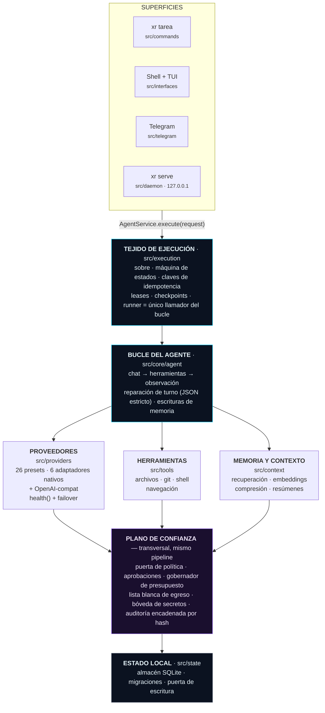
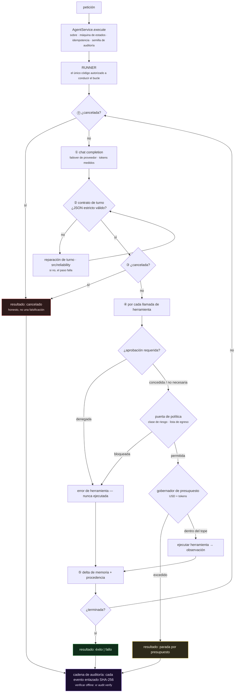

<div align="center">


# XR

**Un motor de agente de IA que realmente puedes auditar.**

*Dale una tarea. Planifica, usa herramientas y cambia cosas reales en tu máquina — bajo una
puerta de política, tu aprobación, un techo de gasto y un registro encadenado por hash que
puedes verificar sin conexión.*

[](https://github.com/ahmadrrrtx/xr/actions/workflows/ci.yml)
[](https://www.npmjs.com/package/@rrrtx/xr)
[](LICENSE)
[](docs/release/SUPPORT_MATRIX.md)

📄 **Idiomas:** [English](README.md) (fuente canónica) · [اردو](README-ur.md) · [Español](README-es.md) · [Français](README-fr.md) · [Deutsch](README-de.md) · [Português](README-pt-BR.md) · [中文](README-zh-CN.md) · [日本語](README-ja.md) · [हिन्दी](README-hi.md)

[Inicio rápido](#inicio-rápido) · [Qué es XR](#qué-xr-es--y-qué-no-es) · [Cómo funciona](#cómo-funciona-xr) · [Proveedores](#proveedores) · [Seguridad](#seguridad--el-plano-de-confianza) · [Documentación](#mapa-de-documentación)

</div>

**Versión:** `1.1.0 (Graphite)` · **Paquete:** [@rrrtx/xr](https://www.npmjs.com/package/@rrrtx/xr) · **Licencia:** MIT

XR — un motor de agente de IA local-first y neutral respecto al proveedor. BYOK, techo de gasto, auditoría a prueba de manipulaciones y extensibilidad mediante plugins/MCP.

**Habilidades incluidas:** 65 (contadas desde `skills/` al publicar la versión).

---

<div align="center">


**El shell de escritorio, build real.** Cada acción pasa las mismas puertas de aprobación,
política y presupuesto — sin importar la superficie que uses.

</div>

---

## ¿Qué es XR, en lenguaje sencillo?

Escribes una tarea en tu terminal. XR averigua los pasos, llama a un modelo de lenguaje y usa
herramientas — leer y escribir archivos, ejecutar comandos, navegar, llamar APIs — hasta que la
tarea está hecha o informa honestamente de que falló.

La diferencia está en **lo que rodea a ese bucle**:

| | |
|---|---|
| 🔑 **Tú traes la clave** | XR no incluye ninguna API key ni cuenta cloud. Funciona con *tu* clave de proveedor o un modelo en *tu* máquina. |
| 🛑 **Pregunta antes de actuar** | Las acciones con consecuencias se detienen y esperan tu aprobación. La denegación se aplica en la ruta de ejecución, no se sugiere en un prompt. |
| 💸 **Vigila el gasto y los límites** | Los límites de USD/tokens se comprueban durante el bucle. Los costes USD son estimaciones: una respuesta puede exceder el límite pedido, y sin precios conocidos no hay tope USD imponible. |
| 🔗 **Anota lo que hizo** | Cada evento queda enlazado con SHA-256 en una cadena local que puedes verificar sin conexión con un solo comando. |
| 💻 **Funciona en tu máquina** | Una base SQLite, sin telemetría, sin red obligatoria. Diez runtimes de modelos locales son ciudadanos de primera clase. |
| 🆓 **Toda función local es gratis** | Voz, memoria, temas, CLI, bots, la superficie del editor, investigación, agentes, skills y MCP son gratis para siempre — [sin paywall, verificado por test](#precios). |

```bash
xr "resume los TODO abiertos de este repositorio y redacta un plan de limpieza"
```

> **Límites de seguridad de la vista previa de desarrollo:** el CLI de código simula escrituras
> de archivos y ejecución de shell bajo `--dry-run`, pero las peticiones de modelo/lectura/red y
> las actualizaciones de auditoría/estado pueden seguir ocurriendo. No lo uses como aislamiento
> para repositorios no confiables ni como tope de facturación absoluto. Consulta
> [los contratos del CLI de código y límites conocidos](docs/cli/CODING_CONTRACTS.md).

**¿Para quién es?** Desarrolladores que automatizan trabajo real en máquinas reales; equipos que
necesitan que las acciones del agente sean revisables a posteriori; cualquiera que quiera un
agente 100 % offline.

---

## Qué XR es — y qué no es

**XR es:** un motor de agente autoalojado; neutral respecto al proveedor (26 presets); gobernado
(política, aprobaciones, presupuesto y auditoría aplicados en la ruta de ejecución); extensible
(skills, plugins, MCP); firmado en la cadena de suministro; MIT y legible de punta a punta.

**XR no es:** no está certificado contra SOC 2 / ISO 27001 / HIPAA / PCI-DSS; no es un sandbox
(aplicación de política en proceso, no aislamiento de kernel/VM); no te obliga a usar ningún
servicio; no sustituye la revisión humana de acciones consecuentes; y no está terminado — su
[registro de limitaciones conocidas](docs/security/KNOWN_LIMITATIONS.md) es un artefacto de
primera clase.

---

## Inicio rápido

### 1. Instalar

| Canal | Plataforma | Comando |
|---|---|---|
| **npm** (`latest` estable) | Linux · macOS · Windows · Termux | `npm i -g @rrrtx/xr` |
| **Binario** | Linux · macOS · Termux · WSL | `curl -fsSL https://raw.githubusercontent.com/ahmadrrrtx/xr/main/install.sh \| bash` |
| **Binario** | Windows PowerShell 5.1 / 7+ | `iex (irm https://raw.githubusercontent.com/ahmadrrrtx/xr/main/install.ps1)` |
| **Homebrew** | macOS · Linux | `brew install ahmadrrrtx/tap/xr` |
| **WinGet** | Windows | `winget install ahmadrrrtx.XR` |
| **Scoop** | Windows | descarga `scoop/xr.json` de la release · `scoop install ./xr.json` |
| **.deb** | Debian · Ubuntu | `sudo dpkg -i xr_*_amd64.deb` |
| **Docker** | cualquiera | `docker run ghcr.io/ahmadrrrtx/xr:latest` |
| **Desde código fuente** | cualquiera | `git clone https://github.com/ahmadrrrtx/xr && cd xr && bun install` |

### 2. Primera ejecución

```bash
xr onboarding        # configuración guiada (proveedor + memoria + voz opcional)
xr doctor            # chequeo de salud — sale con error si XR no puede trabajar de verdad
```

### 3. Tu primera tarea

```bash
xr "hola, XR"                  # tarea única
xr                             # shell interactivo a pantalla completa
xr serve                       # panel + chat en http://localhost:3141 (127.0.0.1, con token)
```

¿Nuevo aquí? Sigue el camino dorado: [`docs/development/GETTING_STARTED.md`](docs/development/GETTING_STARTED.md).

### Todo offline

```bash
ollama serve && ollama pull qwen2.5:7b   # cualquiera de los 10 runtimes locales soportados
xr providers set ollama qwen2.5:7b
xr "refactoriza esta función"            # no necesita red
```

---

## Cómo funciona XR

Toda superficie — el CLI, el shell, Telegram, el chat del daemon — desemboca en **una
llamada**. No hay puerta trasera: política, aprobaciones, presupuesto, cancelación y auditoría
son propiedades del pipeline, así que ninguna interfaz puede saltárselos.



### Qué le ocurre a una tarea



### Principios de diseño

1. **Una autoridad de cálculo por pregunta.** Lo que responde una pregunta lo hace para toda
   superficie y para CI — el motor de readiness del doctor es el escaneo de capacidades del
   onboarding; la suite multiplataforma es una única lista de ficheros por SO.
2. **Sin atajo alrededor del runner.** Cada turno pasa por sobre → runner → bucle.
3. **Resultados honestos.** Nunca una finalización falsa.
4. **Estado inspeccionable.** Un SQLite, eventos de auditoría encadenados por hash, sesiones
   exportables, inventario reproducible.
5. **La vía rápida sigue rápida.** Cero E/S de FS/procesos síncrona en el hot path (forzado por
   lint) y presupuestos cerrados por CI.

---

## Proveedores

**26 presets integrados — 16 alojados y 10 runtimes locales.** Cambia cuando quieras, sin reiniciar.

Seis proveedores alojados usan adaptadores nativos dedicados (Anthropic, Cerebras, Cohere,
Google, Mistral, AWS Bedrock — `src/providers/native/`). El resto — los demás alojados y los
diez runtimes locales — hablan el protocolo OpenAI-compatible por un único transporte, y un
preset personalizado puede apuntar a cualquier base URL compatible.

```bash
xr providers list                    # 26 presets · modelo por defecto + capacidades
xr providers set openai gpt-4o-mini
xr providers add claude              # clave enmascarada → keychain del SO, si no, fichero sellado AES-256-GCM
xr providers test                    # sonda en vivo de los proveedores configurados
```

Cambiar de modelo ejecuta una máquina de estados **preflight → canary → swap → verify** que
revierte automáticamente si el nuevo modelo no responde (`--force` omite la sonda).

---

## Seguridad — el plano de confianza

### XR Shield — la frontera de aplicación

**XR Shield** es el nombre de los siete componentes por los que pasa cada acción con
consecuencias. No es un nivel de producto ni un escáner: es el código que puede decir *no*.
Enumerable con un solo import — `src/xr-shield/index.ts`.

| # | Componente | Dónde | Pregunta que responde | ¿Puede negarse? |
|---|---|---|---|---|
| 1 | **Política de capacidades** | `src/capabilities/policy.ts` | ¿Está permitida esta capacidad en este workspace y modo? | ✅ |
| 2 | **Guarda de acción** | `src/security/guard.ts` | ¿Es peligrosa la acción una vez decodificada y canonicalizada? | ✅ |
| 3 | **Retícula de confianza + ubicación** | `src/runtime/trust/` | ¿Qué nivel de riesgo es y dónde puede ejecutarse? | ✅ |
| 4 | **Consentimiento / aprobaciones** | `src/control/approval-store.ts` | ¿Un humano lo aprobó? (duradero, TTL con denegación por defecto) | ✅ |
| 5 | **Egreso de red** | `src/security/egress-proxy.ts` | ¿Está permitido este destino? | ✅ |
| 6 | **Integridad de ejecución + salida** | `src/security/exec-integrity.ts`, `tool-output.ts`, `secret-broker.ts` | ¿Está permitido el binario? ¿La salida se trata como datos? ¿Los secretos se brokered y no se entregan? | ✅ |
| 7 | **Evidencia de auditoría firmada** | `src/security/audit-signer.ts`, `audit-verify.ts` | ¿Se puede probar después? ¿Se notaría una manipulación? | ➖ registra |

La tabla se genera de `XR_SHIELD_COMPONENTS` y `test/architecture/xr-shield-facade.test.ts`
falla si un módulo listado deja de existir — los documentos no pueden divergir del código.

> **Caja de honestidad:** XR aplica **política en proceso**, no aislamiento de kernel/VM — es una
> barrera, no un confinamiento, ni sustituto de la revisión humana. Las brechas están escritas:
> [`docs/security/KNOWN_LIMITATIONS.md`](docs/security/KNOWN_LIMITATIONS.md).

Arquitectura, modelo de amenazas y divulgación de vulnerabilidades: [`SECURITY.md`](SECURITY.md).

---

## Cadena de suministro — firmada, con procedencia, verificada

Cada push de tag ejecuta un único pipeline que construye, firma, publica y se auto-verifica.
npm se publica con *OIDC trusted publishing* (sin token de larga vida).

- **Canales binarios** (GitHub Releases, Homebrew, WinGet, Scoop, `.deb`, Docker): firmas cosign
  *keyless* sobre `SHA256SUMS`, SBOM CycloneDX y procedencia SLSA3 — verifica con
  [`docs/release/VERIFYING_RELEASES.md`](docs/release/VERIFYING_RELEASES.md). El conjunto de
  activos varía por carril de release; todo lo publicado se firma al etiquetar.
- **npm**: publicado con **atestación de procedencia** ligada al commit del tag.
- **Higiene de CI:** `--ignore-scripts`, osv-scanner + `bun audit`, gitleaks, escaneo de
  licencias y gates de deriva del SBOM en cada ejecución.
- **Los canales no pueden quedarse atrás:** las configuraciones se **generan** del manifiesto y
  las valida `bun run channel:check`; el invariante tag ⇔ npm se comprueba en CI.

---

## Capacidades

- **Habilidades** (`skills/`): 65 incluidas (manifiestos `xr-skill.json`).
- **Plugins** (`src/plugins/`): permisos explícitos, verificación por hash y ciclo de vida
  completo (discover → install → enable → update → rollback → quarantine → uninstall).
- **MCP** (`src/mcp/`): cliente + gestor + registro — stdio, SSE, HTTP, con lista blanca.
- **Memoria** (`src/context/`): captura consentida, recuperación explicable, TTL.
- **Investigación** (`src/research/`): offline por defecto; web pública solo opt-in.
- **Voz** y **control del ordenador**: adaptadores locales-first, detrás de las mismas
  aprobaciones.
- **Workflows multiagente**: plan determinista + carriles de concurrencia acotada + verificador
  de artefactos; un solo árbol presupuestario financiado por la raíz.
- Operación multi-LLM — health probes, failover, métricas por modelo.

---

## Las superficies

**Shell de escritorio** (`desktop/`, Tauri v2 + React — el mismo agente con ventana):

| | |
|---|---|
| 🛰 **Siempre vivo** | La bandeja mantiene motor, atajos e insignia de aprobaciones al cerrar la ventana. |
| ⌨️ **Global, con honestidad** | HUD, push-to-talk y capturar-región por atajo funcionan sin foco; los acordes ceden cuando el SO los posee. |
| 🔄 **Auto-actualización firmada** | Canales Stable/Beta/Nightly, cargas Ed25519 verificadas; sin clave de release, se niega a actualizar. |
| 🧯 **Recuperación de fallos sin mentiras** | Detección por fichero marcador; las ejecuciones cortadas se marcan `killed`, nunca "completadas". |
| 🪟 **Nativo donde importa** | Menú macOS HIG, MSIX en Windows con enlaces profundos, Flatpak listo para Flathub. |

**Compañero móvil** (`mobile/`): misma red, QR + código de emparejamiento de un solo uso, TLS
fijado al primer uso, sesiones móviles rechazadas en `/files`, `/terminal`, `/git`, `/mcp`,
outbox offline honesto. Ver [`docs/mobile/PWA.md`](docs/mobile/PWA.md).

**Bots (Telegram, Discord, WhatsApp)**: el bot corre dentro de tu daemon — sin relay cloud —
y solo enruta trabajo permitido. Un emisor desconocido no recibe **ninguna** respuesta.
Detalles: [`docs/phases/26-bots-discord-whatsapp.md`](docs/phases/26-bots-discord-whatsapp.md).

**VS Code** (`extensions/vscode/`): el agente dentro del editor con el mismo pipeline gobernado.

---

## Rendimiento — presupuestos, no fanfarronadas

Cada afirmación de rendimiento es un **presupuesto publicado con una base medida y un gate de
regresión en CI** (`docs/perf/PERF-BUDGETS.md`):

| Superficie | Presupuesto | Medido (base 1.0.0) |
|---|---|---|
| `--version` / `--help` warm p95 | < 150 ms | 39.8 / 40.5 ms |
| `--version` / `--help` cold p95 | < 300 ms | 40.8 / 42.5 ms |
| `doctor` | < 1 s | 586 ms p95 |
| decisión de ruta | < 20 ms | sub-ms |
| primer render del panel | < 1 s | 12.1 ms |

---

## Cómo XR se demuestra

Su diferenciador: las afirmaciones las verifican máquinas en cada PR — la suite completa, gates
de identidad de versión, gates de claims, inventario base, límites de arquitectura, tamaño del
árbol, esquemas de API, canales de release y la batería de cadena de suministro. Los números
exactos de la suite y del tope de LOC se publican en el README canónico (en inglés) con su base
medida ([`docs/release/TEST-BASELINE.json`](docs/release/TEST-BASELINE.json)).

---

## Documentación

| Doc | Propósito |
|---|---|
| [`docs/CONSTITUTION.md`](docs/CONSTITUTION.md) | La ley que cita el código (30 Artículos + Mandamientos) |
| [`AGENTS.md`](AGENTS.md) · [`CONTRIBUTING.md`](CONTRIBUTING.md) · [`SECURITY.md`](SECURITY.md) | Briefing de operadores · guía de contribución · política de seguridad |
| [`docs/development/GETTING_STARTED.md`](docs/development/GETTING_STARTED.md) | El camino dorado de punta a punta |
| [`docs/security/KNOWN_LIMITATIONS.md`](docs/security/KNOWN_LIMITATIONS.md) | Registro canónico de limitaciones |
| [`docs/release/SUPPORT_MATRIX.md`](docs/release/SUPPORT_MATRIX.md) | Soporte por plataforma/canal |
| [`docs/HISTORY.md`](docs/HISTORY.md) | Escalera de versiones |
| [`docs/`](docs/README.md) | Índice completo |

---

## Contribuir

Lee [`CONTRIBUTING.md`](CONTRIBUTING.md) y la [política de seguridad](SECURITY.md); los agentes
empiezan en [`AGENTS.md`](AGENTS.md). El baremo es idéntico para humanos y agentes: cada cambio
llega con tests, supera la batería de gates y mantiene las afirmaciones honestas.

```bash
git clone https://github.com/ahmadrrrtx/xr && cd xr
bun install --frozen-lockfile
bun run ci
```

¿Encontraste un claim inexacto? Hay una plantilla de issue para ello
([false claim](.github/ISSUE_TEMPLATE/false_claim.yml)).

---

## Precios

**XR Personal es gratis para siempre, con cada función de este repositorio incluida.** Sin
telemetría, sin asientos, sin límite temporal. Solo ocho *servicios alojados* están
licenciados (`BUSINESS_FEATURES` en [`src/cloud/license.ts`](src/cloud/license.ts)) y ninguno
corre en tu máquina. **XR Business: $15 por usuario/mes** (prueba de 30 días sin tarjeta);
Enterprise se cotiza por contrato. Reglas innegociables y forzadas por tests: **ninguna función
local se paywallea jamás** y **BYOK siempre queda gratis y directo**.

---

## Licencia

[MIT](LICENSE) · XR — un motor de agente local-first que puedes auditar.

> *Traducción al español; el README en inglés es la fuente canónica. Comandos, rutas y bloques
> de código no se traducen.*
