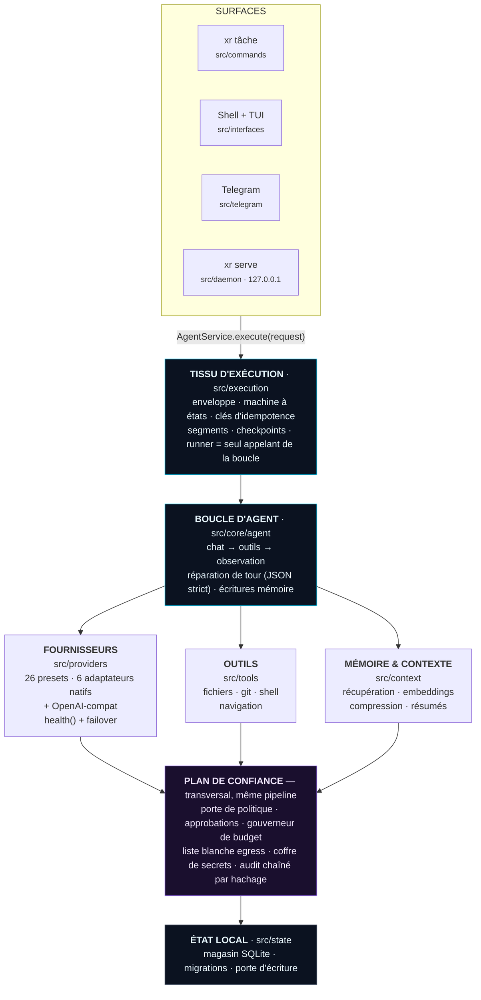
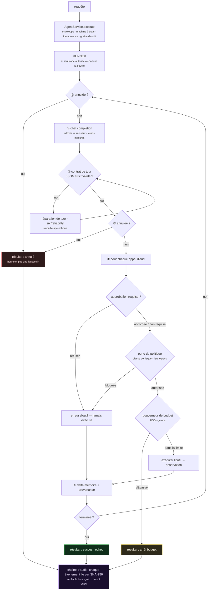

<div align="center">


# XR

**Un moteur d'agent IA que vous pouvez vraiment auditer.**

*Donnez-lui une tâche. Il planifie, utilise des outils et modifie des choses réelles sur votre
machine — sous une porte de politique, votre approbation, un plafond de dépense et un journal
chaîné par hachage vérifiable hors ligne.*

[](https://github.com/ahmadrrrtx/xr/actions/workflows/ci.yml)
[](https://www.npmjs.com/package/@rrrtx/xr)
[](LICENSE)
[](docs/release/SUPPORT_MATRIX.md)

📄 **Langues :** [English](README.md) (texte de référence) · [اردو](README-ur.md) · [Español](README-es.md) · [Français](README-fr.md) · [Deutsch](README-de.md) · [Português](README-pt-BR.md) · [中文](README-zh-CN.md) · [日本語](README-ja.md) · [हिन्दी](README-hi.md)

[Démarrage rapide](#démarrage-rapide) · [Ce que XR est](#ce-que-xr-est--et-ce-quil-nest-pas) · [Fonctionnement](#comment-xr-fonctionne) · [Fournisseurs](#fournisseurs) · [Sécurité](#sécurité--le-plan-de-confiance)

</div>

**Version :** `1.1.0 (Graphite)` · **Paquet :** [@rrrtx/xr](https://www.npmjs.com/package/@rrrtx/xr) · **Licence :** MIT

XR — un moteur d'agent IA local-first et neutre vis-à-vis des fournisseurs. BYOK, plafond de
dépense, audit inviolable, extensibilité plugins/MCP.

**Skills incluses :** 65 (comptées depuis `skills/` au moment de la publication).

---

<div align="center">


**Le shell desktop, build réelle.** Chaque action passe les mêmes portes d'approbation, de
politique et de budget — quelle que soit la surface utilisée.

</div>

---

## Qu'est-ce que XR, en langage simple ?

Vous tapez une tâche dans votre terminal. XR calcule les étapes, appelle un modèle de langage
et utilise des outils — lire et écrire des fichiers, exécuter des commandes, naviguer, appeler
des API — jusqu'à ce que la tâche soit terminée ou qu'il signale honnêtement son échec.

La différence tient à **ce qui entoure cette boucle** :

| | |
|---|---|
| 🔑 **Vous apportez la clé** | XR ne livre ni API key ni compte cloud. Il tourne avec *votre* clé fournisseur ou un modèle sur *votre* machine. |
| 🛑 **Il demande avant d'agir** | Les actions à conséquences attendent votre approbation. Le refus est appliqué dans le chemin d'exécution, pas suggéré dans un prompt. |
| 💸 **Il surveille les dépenses et les limites** | Les plafonds USD/jetons sont vérifiés pendant la boucle. Les coûts USD sont des estimations : une réponse peut dépasser la limite demandée et une tarification inconnue ne permet pas d'imposer un plafond. |
| 🔗 **Il note ce qu'il a fait** | Chaque événement est lié par SHA-256 dans une chaîne locale, vérifiable hors ligne avec une seule commande. |
| 💻 **Il tourne sur votre machine** | Une base SQLite, aucune télémétrie, aucun réseau obligatoire. Dix runtimes de modèles locaux sont citoyens de première classe. |
| 🆓 **Chaque fonction locale est gratuite** | Voix, mémoire, thèmes, CLI, bots, surface d'édition, recherche, agents, skills et MCP à jamais — [sans paywall, prouvé par test](#tarifs). |

```bash
xr "résume les TODO ouverts de ce dépôt et rédige un plan de nettoyage"
```

> **Limites de sécurité de la préversion :** le CLI de code simule les écritures et l'exécution
> shell sous `--dry-run`, mais des requêtes modèle/lecture/réseau et mises à jour d'audit/état
> peuvent toujours se produire. Ne l'utilisez pas comme isolation pour des dépôts non fiables
> ni comme plafond de facturation absolu. Voir [les contrats du CLI et limites connues](docs/cli/CODING_CONTRACTS.md).

**Pour qui ?** Les développeurs qui automatisent du travail réel sur des machines réelles ; les
équipes qui veulent des actions d'agent revus après coup ; quiconque veut un agent 100 % hors
ligne.

---

## Ce que XR est — et ce qu'il n'est pas

**XR est :** un moteur d'agent auto-hébergé ; neutre vis-à-vis du fournisseur (26 presets) ;
gouverné (politique, approbations, budget et audit appliqués dans le chemin d'exécution) ;
extensible (skills, plugins, MCP) ; signé dans la chaîne d'approvisionnement ; MIT et lisible de
bout en bout.

**XR n'est pas :** pas certifié SOC 2 / ISO 27001 / HIPAA / PCI-DSS ; pas un bac à sable
(application de politique en processus, pas d'isolation kernel/VM) ; pas un service obligatoire ;
pas un substitut à la revue humaine des actions à conséquences ; et pas fini — son
[registre de limites connues](docs/security/KNOWN_LIMITATIONS.md) est un artefact de
première classe.

---

## Démarrage rapide

### 1. Installer

| Canal | Plateforme | Commande |
|---|---|---|
| **npm** (`latest` stable) | Linux · macOS · Windows · Termux | `npm i -g @rrrtx/xr` |
| **Binaire** | Linux · macOS · Termux · WSL | `curl -fsSL https://raw.githubusercontent.com/ahmadrrrtx/xr/main/install.sh \| bash` |
| **Binaire** | Windows PowerShell 5.1 / 7+ | `iex (irm https://raw.githubusercontent.com/ahmadrrrtx/xr/main/install.ps1)` |
| **Homebrew** | macOS · Linux | `brew install ahmadrrrtx/tap/xr` |
| **WinGet** | Windows | `winget install ahmadrrrtx.XR` |
| **Scoop** | Windows | téléchargez `scoop/xr.json` depuis la release · `scoop install ./xr.json` |
| **.deb** | Debian · Ubuntu | `sudo dpkg -i xr_*_amd64.deb` |
| **Docker** | toutes | `docker run ghcr.io/ahmadrrrtx/xr:latest` |
| **Depuis la source** | toutes | `git clone https://github.com/ahmadrrrtx/xr && cd xr && bun install` |

### 2. Premier lancement

```bash
xr onboarding        # configuration guidée (fournisseur + mémoire + voix optionnelle)
xr doctor            # bilan de santé — sortie non nulle si XR ne peut pas vraiment travailler
```

### 3. Votre première tâche

```bash
xr "bonjour, XR"               # tâche ponctuelle
xr                             # shell interactif plein écran
xr serve                       # tableau de bord + chat sur http://localhost:3141 (127.0.0.1, avec jeton)
```

Nouveau venu ? Suivez le chemin doré : [`docs/development/GETTING_STARTED.md`](docs/development/GETTING_STARTED.md).

### Entièrement hors ligne

```bash
ollama serve && ollama pull qwen2.5:7b   # l'un des 10 runtimes locaux pris en charge
xr providers set ollama qwen2.5:7b
xr "refactorise cette fonction"          # aucun réseau requis
```

---

## Comment XR fonctionne

Chaque surface — le CLI, le shell, Telegram, le chat du daemon — débouche dans **un seul
appel**. Pas de porte dérobée : politique, approbations, budget, annulation et audit sont des
propriétés du pipeline, qu'aucune interface ne peut contourner.



### Ce qui arrive à une tâche



### Principes de conception

1. **Une autorité de calcul par question.** La réponse à une question vaut pour toute surface
   et pour la CI — le moteur de readiness du doctor est le scan de capacités de l'onboarding ;
   la suite multiplateforme est une seule liste de fichiers exécutée par OS.
2. **Pas de contournement du runner.** Chaque tour suit enveloppe → runner → boucle.
3. **Des résultats honnêtes.** Jamais de fausse exécution.
4. **Un état inspectable.** Une base SQLite, événements d'audit chaînés par hachage, sessions
   exportables, inventaire reproductible.
5. **Le chemin rapide reste rapide.** Zéro E/S synchrone de FS/processus sur le hot path
   (lint) et budgets fermés par la CI.

---

## Fournisseurs

**26 presets intégrés — 16 hébergés et 10 runtimes locaux.** Basculez quand vous voulez, sans
redémarrage.

Six fournisseurs hébergés utilisent des adaptateurs natifs dédiés (Anthropic, Cerebras, Cohere,
Google, Mistral, AWS Bedrock — `src/providers/native/`). Tous les autres — les autres hébergés
et les dix runtimes locaux — parlent le protocole compatible OpenAI via un seul transport, et un
preset personnalisé peut pointer vers n'importe quelle base URL compatible.

```bash
xr providers list                    # 26 presets · modèle par défaut + capacités
xr providers set openai gpt-4o-mini
xr providers add claude              # clé masquée → trousseau OS, sinon fichier scellé AES-256-GCM
xr providers test                    # sonde en direct des fournisseurs configurés
```

Le changement de modèle exécute une machine d'états **preflight → canary → swap → verify** avec
rollback automatique si le nouveau modèle est injoignable (`--force` ignore la sonde).

---

## Sécurité — le plan de confiance

### XR Shield — la frontière d'application

**XR Shield** désigne les sept composants par lesquels passe toute action à conséquences. Ce
n'est ni un niveau produit ni un scanner : c'est le code qui peut dire *non*. Énumérable en un
seul import — `src/xr-shield/index.ts`.

| # | Composant | Où | Question posée | Peut refuser ? |
|---|---|---|---|---|
| 1 | **Politique de capacité** | `src/capabilities/policy.ts` | Cette capacité est-elle permise dans ce workspace et ce mode ? | ✅ |
| 2 | **Garde d'action** | `src/security/guard.ts` | L'action est-elle dangereuse une fois décodée et canonisée ? | ✅ |
| 3 | **Treillis de confiance + placement** | `src/runtime/trust/` | Quel niveau de risque et où peut-elle s'exécuter ? | ✅ |
| 4 | **Consentement / approbations** | `src/control/approval-store.ts` | Une personne l'a-t-elle approuvée ? (durable, TTL défaut-refus) | ✅ |
| 5 | **Égress réseau** | `src/security/egress-proxy.ts` | Cette destination est-elle permise ? | ✅ |
| 6 | **Intégrité exécution + sortie** | `src/security/exec-integrity.ts`, `tool-output.ts`, `secret-broker.ts` | Le binaire est-il autorisé ? La sortie est-elle retraitée comme données ? Les secrets sont-ils intermédiaires, non livrés ? | ✅ |
| 7 | **Preuve d'audit signée** | `src/security/audit-signer.ts`, `audit-verify.ts` | Peut-on le prouver après coup ? Une altération se verrait-elle ? | ➖ enregistre |

Le tableau est généré depuis `XR_SHIELD_COMPONENTS` et
`test/architecture/xr-shield-facade.test.ts` échoue si un module listé disparaît — les documents
ne peuvent pas diverger du code.

> **Boîte d'honnêteté :** XR applique une **politique en processus**, pas une isolation
> kernel/VM — une rambarde, pas un confinement, ni un substitut à la revue humaine. Les lacunes
> sont écrites : [`docs/security/KNOWN_LIMITATIONS.md`](docs/security/KNOWN_LIMITATIONS.md).

Architecture de sécurité, modèle de menace et divulgation : [`SECURITY.md`](SECURITY.md).

---

## Chaîne d'approvisionnement — signée, attestée, vérifiable

Chaque push de tag exécute un seul pipeline qui construit, signe, publie et s'auto-vérifie. npm
utilise l'*OIDC trusted publishing* (aucun jeton npm de longue durée dans le chemin de release).

- **Canaux binaires** (GitHub Releases, Homebrew, WinGet, Scoop, `.deb`, Docker) : signatures
  cosign *keyless* sur `SHA256SUMS`, SBOM CycloneDX et provenance SLSA3 — vérification via
  [`docs/release/VERIFYING_RELEASES.md`](docs/release/VERIFYING_RELEASES.md). L'ensemble des
  assets diffère selon les lignes de release ; tout ce qui est publié est signé lors du tag.
- **npm** : publié avec **attestation de provenance** liée au commit du tag.
- **Hygiène CI :** `--ignore-scripts`, osv-scanner + `bun audit`, gitleaks, scan de licences et
  gates de dérive SBOM à chaque exécution.
- **Les canaux ne peuvent pas traîner :** les configurations sont **générées** depuis le
  manifeste et validées (`bun run channel:check`); l'invariant tag ⇔ npm est vérifié en CI.

---

## Capacités

- **Skills** (`skills/`) : 65 incluses (manifestes `xr-skill.json`).
- **Plugins** (`src/plugins/`) : permissions explicites, vérification par hachage, cycle de vie
  complet.
- **MCP** (`src/mcp/`) : client + gestionnaire + registre — stdio, SSE, HTTP, liste blanche.
- **Mémoire** (`src/context/`) : capture consentie, récupération explicable, TTL.
- **Recherche** (`src/research/`) : hors ligne par défaut ; web public en opt-in uniquement.
- **Voix** et **contrôle d'ordinateur** : adaptateurs local-first, derrière les mêmes portes
  d'approbation.
- **Workflows multi-agents** : plan déterministe + voies de concurrence bornées + vérificateur
  d'artefacts ; une seule racine budgétaire financée.

---

## Les surfaces

**Shell desktop** (`desktop/`, Tauri v2 + React — le même agent dans une fenêtre) :

| | |
|---|---|
| 🛰 **Toujours vivant** | Le bac système garde moteur, raccourcis et badge d'approbations après fermeture de la fenêtre. |
| ⌨️ **Global, honnêtement** | HUD, push-to-talk et capture-de-région-question fonctionnent sans le focus ; les accords cèdent quand l'OS les détient. |
| 🔄 **Mise à jour signée** | Canaux Stable/Beta/Nightly, charges Ed25519 vérifiées ; sans clé de release, refus de se mettre à jour. |
| 🧯 **Reprise de crash honnête** | Détection par fichier marqueur ; les exécutions coupées sont marquées `killed`, jamais « terminées ». |
| 🪟 **Natif là où ça compte** | Menu macOS HIG, MSIX Windows avec liens profonds + toast, Flatpak prêt pour Flathub. |

**Compagnon mobile** (`mobile/`) : sur votre propre WiFi — `xr serve --lan`, QR + code de
pairage à usage unique à 6 chiffres, TLS épinglé à la première utilisation (comparaison
d'empreinte), sessions mobiles refusées sur `/files`, `/terminal`, `/git`, `/mcp`, boîte
d'envoi hors ligne honnête. Voir [`docs/mobile/PWA.md`](docs/mobile/PWA.md).

**Bots (Telegram, Discord, WhatsApp)** : le bot vit dans votre daemon — sans relais cloud — et
ne route que le travail autorisé. Un émetteur inconnu n'obtient **aucune** réponse. Détails :
[`docs/phases/26-bots-discord-whatsapp.md`](docs/phases/26-bots-discord-whatsapp.md).

**VS Code** (`extensions/vscode/`) : le même agent dans votre éditeur, même pipeline gouverné.

---

## Performance — des budgets, pas de fanfaronnades

Chaque affirmation de performance est un **budget publié avec une mesure de base et un gate de
régression CI** (`docs/perf/PERF-BUDGETS.md`) :

| Surface | Budget | Mesure (base 1.0.0) |
|---|---|---|
| `--version` / `--help` chaud p95 | < 150 ms | 39.8 / 40.5 ms |
| `--version` / `--help` à froid p95 | < 300 ms | 40.8 / 42.5 ms |
| `doctor` | < 1 s | 586 ms p95 |
| décision de route | < 20 ms | sous-ms |
| premier rendu du dashboard | < 1 s | 12.1 ms |

---

## Comment XR se prouve

Son différenciateur : les affirmations sont vérifiées par des machines à chaque PR — suite
complète, gates d'identité de version, gates de claims, inventaire de base, couches, taille
d'arbre, schémas API, canaux de release et batterie de chaîne d'approvisionnement. Les valeurs
exactes et le plafond de LOC sont publiés dans le README canonique (anglais) avec la mesure de
base ([`docs/release/TEST-BASELINE.json`](docs/release/TEST-BASELINE.json)).

---

## Carte de la documentation

| Document | But |
|---|---|
| [`docs/CONSTITUTION.md`](docs/CONSTITUTION.md) | La loi que cite le code (30 Articles + Commandements) |
| [`AGENTS.md`](AGENTS.md) · [`CONTRIBUTING.md`](CONTRIBUTING.md) · [`SECURITY.md`](SECURITY.md) | Briefing opérateurs · guide contributeur · politique de sécurité |
| [`docs/development/GETTING_STARTED.md`](docs/development/GETTING_STARTED.md) | Le chemin doré de bout en bout |
| [`docs/security/KNOWN_LIMITATIONS.md`](docs/security/KNOWN_LIMITATIONS.md) | Registre canonique des limites connues |
| [`docs/release/SUPPORT_MATRIX.md`](docs/release/SUPPORT_MATRIX.md) | Vérité du support plateforme/canal |
| [`docs/HISTORY.md`](docs/HISTORY.md) | L'échelle des versions |
| [`docs/`](docs/README.md) | Index complet de la documentation |

---

## Contribuer

Lisez [`CONTRIBUTING.md`](CONTRIBUTING.md) et la [politique de sécurité](SECURITY.md) ; les
agents commencent par [`AGENTS.md`](AGENTS.md). La barre est identique pour humains et agents :
chaque changement arrive avec des tests, passe la batterie de gates locale et garde les claims
honnêtes.

```bash
git clone https://github.com/ahmadrrrtx/xr && cd xr
bun install --frozen-lockfile
bun run ci
```

Un claim inexact ? C'est un bug, avec son propre modèle d'issue
([false claim](.github/ISSUE_TEMPLATE/false_claim.yml)).

---

## Tarifs

**XR Personal est gratuit pour toujours, avec chaque fonction de ce dépôt incluse.** Pas de
télémétrie, pas de sièges, pas de limite de temps. Seuls huit *services hébergés* sont
licenciés (`BUSINESS_FEATURES` dans [`src/cloud/license.ts`](src/cloud/license.ts)) et aucun ne
tourne sur votre machine. **XR Business : 15 $ par utilisateur et par mois** (essai 30 jours
sans carte) ; Enterprise sur devis. Deux règles non négociables, appliquées par les tests :
**aucune fonction locale n'est jamais paywalled** et **BYOK reste gratuit et direct**.

---

## Licence

[MIT](LICENSE) · XR — un moteur d'agent local-first que vous pouvez auditer.

> *Traduction française ; le README anglais fait foi. Les commandes, chemins et blocs de code ne
> sont pas traduits.*
