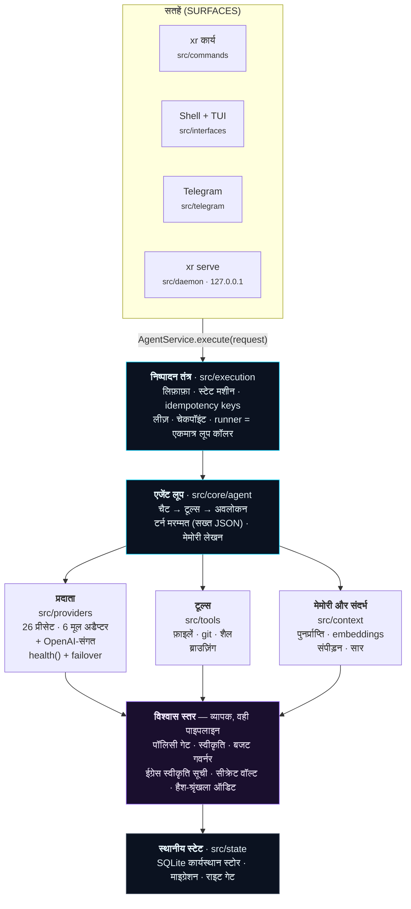
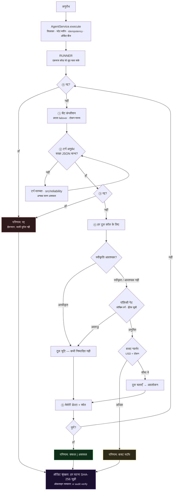

<div align="center">


# XR

**एक AI एजेंट रनटाइम जिसका आप सचमुच ऑडिट कर सकते हैं।**

*इसे कोई काम दीजिए। यह योजना बनाता है, टूल्स इस्तेमाल करता है, और आपकी मशीन पर असली बदलाव करता है — पॉलिसी गेट, आपकी स्वीकृति, खर्च की सीमा, और एक हैश-श्रृंखलित लॉग के साथ जिसे आप ऑफ़लाइन सत्यापित कर सकते हैं।*

[](https://github.com/ahmadrrrtx/xr/actions/workflows/ci.yml)
[](https://www.npmjs.com/package/@rrrtx/xr)
[](LICENSE)
[](docs/release/SUPPORT_MATRIX.md)

📄 **भाषाएँ:** [English](README.md) (प्रमाणिक पाठ) · [اردو](README-ur.md) · [Español](README-es.md) · [Français](README-fr.md) · [Deutsch](README-de.md) · [Português](README-pt-BR.md) · [中文](README-zh-CN.md) · [日本語](README-ja.md) · [हिन्दी](README-hi.md)

[त्वरित शुरुआत](#त्वरित-शुरुआत) · [XR क्या है](#xr-क्या-है--और-क्या-नहीं) · [कैसे काम करता है](#xr-कैसे-काम-करता-है) · [प्रदाता](#प्रदाता) · [सुरक्षा](#सुरक्षा---विश्वास-स्तर)

</div>

**संस्करण:** `1.1.0 (Graphite)` · **पैकेज:** [@rrrtx/xr](https://www.npmjs.com/package/@rrrtx/xr) · **लाइसेंस:** MIT

XR — लोकल-फर्स्ट, प्रदाता-तटस्थ AI एजेंट रनटाइम। BYOK, खर्च सीमा, छेड़छाड़-रहित ऑडिट, plugin/MCP विस्तार।

**बंडल स्किल्स:** 65 (रिलीज़ समय पर `skills/` से गिनी गईं)।

---

<div align="center">


**डेस्कटॉप शेल, वास्तविक बिल्ड।** चाहे कोई भी सतह उपयोग करें, हर क्रिया उन्हीं स्वीकृति, पॉलिसी और बजट गेट्स से गुजरती है।

</div>

---

## XR सरल भाषा में क्या है?

आप टर्मिनल में कोई काम टाइप करते हैं। XR चरण निकालता है, लैंग्वेज मॉडल को बुलाता है, और टूल्स चलाता है — फ़ाइलें पढ़ना/लिखना, कमांड चलाना, ब्राउज़ करना, API कॉल — जब तक काम पूरा न हो जाए या वह ईमानदारी से विफलता न बता दे।

अंतर है **इस लूप के चारों ओर मौजूद चीज़ों में**:

| | |
|---|---|
| 🔑 **कुंजी आप लाते हैं** | XR कोई API कुंजी या क्लाउड खाता नहीं देता। यह *आपकी* प्रदाता कुंजी या *आपकी* मशीन के स्थानीय मॉडल पर चलता है। |
| 🛑 **काम करने से पहले पूछता है** | परिणामसूचक क्रियाएँ रुककर आपकी स्वीकृति की प्रतीक्षा करती हैं। अस्वीकार निष्पादन पथ पर लागू होता है, प्रॉम्प्ट में सुझाव नहीं माना जाता। |
| 💸 **खर्च और सीमाएँ देखता है** | USD/टोकन सीमाएँ लूप के दौरान जाँची जाती हैं। USD लागत अनुमान है: कोई प्रतिक्रिया सीमा से बढ़ सकती है, और अज्ञात मूल्य पर USD कैप लागू नहीं हो सकता। |
| 🔗 **क्या किया वह लिखता रहता है** | हर घटना SHA-256 से स्थानीय श्रृंखला में जुड़ती है — एक कमांड से ऑफ़लाइन सत्यापित करें। |
| 💻 **आपकी मशीन पर चलता है** | एक SQLite डेटाबेस, शून्य टेलीमेट्री, कोई अनिवार्य नेटवर्क नहीं। दस स्थानीय मॉडल रनटाइम प्रथम श्रेणी के नागरिक हैं। |
| 🆓 **हर स्थानीय सुविधा मुफ़्त** | वॉयस, मेमोरी, थीम, CLI, बॉट्स, एडिटर सतह, रिसर्च, एजेंट्स, स्किल्स और MCP हमेशा के लिए — [कोई paywall नहीं, टेस्ट से सिद्ध](#मूल्य)। |

```bash
xr "इस रेपो के खुले TODOs का सार बताओ और सफ़ाई की योजना लिखो"
```

> **डेवलपमेंट प्रीव्यू सुरक्षा सीमाएँ:** कोडिंग CLI `--dry-run` में फ़ाइल लेखन और शैल निष्पादन का अनुकरण करता है, पर मॉडल/रीड/नेटवर्क अनुरोध तथा ऑडिट/स्टेट अपडेट हो सकते हैं। इसे अविश्वसनीय रेपों के लिए अलगाव या संपूर्ण बिलिंग कैप न समझें।
> [CLI कॉन्ट्रैक्ट्स और ज्ञात सीमाएँ](docs/cli/CODING_CONTRACTS.md) देखें।

**किसके लिए?** वास्तविक मशीनों पर वास्तविक काम स्वचालित करने वाले डेवलपर्स; जिन टीमों को एजेंट की कार्रवाई बाद में समीक्षा योग्य चाहिए; हर वह व्यक्ति जो पूरी तरह ऑफ़लाइन एजेंट चाहता है।

---

## XR क्या है — और क्या नहीं

**XR है:** स्वयं-होस्टेड एजेंट रनटाइम; प्रदाता-तटस्थ (26 प्रीसेट); शासित (पॉलिसी, स्वीकृति, बजट, ऑडिट निष्पादन पथ पर लागू); विस्तारयोग्य (स्किल्स, प्लगइन्स, MCP); सप्लाई चेन में हस्ताक्षरित; MIT और शुरुआत से अंत तक पठनीय।

**XR नहीं है:** SOC 2 / ISO 27001 / HIPAA / PCI-DSS प्रमाणित नहीं; सैंडबॉक्स नहीं (इन-प्रोसेस पॉलिसी, कर्नल/VM अलगाव नहीं); कोई अनिवार्य सेवा नहीं; परिणामसूचक क्रियाओं की मानव समीक्षा का विकल्प नहीं; और अधूरा भी नहीं — इसका [ज्ञात सीमाओं का रजिस्टर](docs/security/KNOWN_LIMITATIONS.md) प्रथम श्रेणी की रिलीज़ कलाकृति है।

---

## त्वरित शुरुआत

### 1. इंस्टॉल

| चैनल | प्लेटफ़ॉर्म | कमांड |
|---|---|---|
| **npm** (स्थिर `latest`) | Linux · macOS · Windows · Termux | `npm i -g @rrrtx/xr` |
| **बाइनरी** | Linux · macOS · Termux · WSL | `curl -fsSL https://raw.githubusercontent.com/ahmadrrrtx/xr/main/install.sh \| bash` |
| **बाइनरी** | Windows PowerShell 5.1 / 7+ | `iex (irm https://raw.githubusercontent.com/ahmadrrrtx/xr/main/install.ps1)` |
| **Homebrew** | macOS · Linux | `brew install ahmadrrrtx/tap/xr` |
| **WinGet** | Windows | `winget install ahmadrrrtx.XR` |
| **Scoop** | Windows | रिलीज़ से `scoop/xr.json` डाउनलोड करें · `scoop install ./xr.json` |
| **.deb** | Debian · Ubuntu | `sudo dpkg -i xr_*_amd64.deb` |
| **Docker** | सभी | `docker run ghcr.io/ahmadrrrtx/xr:latest` |
| **स्रोत से** | सभी | `git clone https://github.com/ahmadrrrtx/xr && cd xr && bun install` |

### 2. पहली बार चलाएँ

```bash
xr onboarding        # निर्देशित सेटअप (प्रदाता + मेमोरी + वैकल्पिक वॉयस)
xr doctor            # स्वास्थ्य जाँच — XR सचमुच काम न कर सके तो ग़ैर-शून्य निकास
```

### 3. आपका पहला काम

```bash
xr "हैलो XR"                    # एक-बार का काम
xr                              # फ़ुल-स्क्रीन इंटरैक्टिव शैल
xr serve                        # डैशबोर्ड + चैट http://localhost:3141 पर (127.0.0.1, टोकन-प्रमाणित)
```

नए हैं? गोल्डन पाथ अंत तक: [`docs/development/GETTING_STARTED.md`](docs/development/GETTING_STARTED.md).

### पूरी तरह ऑफ़लाइन

```bash
ollama serve && ollama pull qwen2.5:7b   # 10 समर्थित स्थानीय रनटाइम में से कोई
xr providers set ollama qwen2.5:7b
xr "इस फ़ंक्शन को refactor करो"            # नेटवर्क की ज़रूरत नहीं
```

---

## XR कैसे काम करता है

हर सतह — CLI, शैल, Telegram, डीमन चैट — **एक ही कॉल** में समाहित होती है। कोई छिपा रास्ता नहीं: पॉलिसी, स्वीकृति, बजट, रद्दीकरण और ऑडिट पाइपलाइन के गुण हैं, इसलिए कोई इंटरफ़ेस उन्हें छोड़ नहीं सकता।



### एक काम के साथ क्या होता है



### डिज़ाइन सिद्धांत

1. **हर प्रश्न के लिए एक गणना अधिकारी।** जो आपके प्रश्न का उत्तर देता है वही हर सतह और CI के लिए देता है — doctor का readiness इंजन ही onboarding का क्षमता-स्कैन है।
2. **runner के इर्द-गिर्द कोई रास्ता नहीं।** हर टर्न लिफ़ाफ़ा → runner → लूप से गुज़रता है।
3. **ईमानदार परिणाम।** कभी जाली पूर्णता नहीं।
4. **जाँचने योग्य स्टेट।** एक SQLite, हैश-श्रृंखला ऑडिट घटनाएँ, निर्यात-योग्य सत्र, पुनरुत्पादन योग्य सूची।
5. **तेज़ रास्ता तेज़ रहे।** हॉट पथ शून्य सिंक्रोनस FS/प्रोसेस I/O (lint-लागू) और बजट CI-गेटेड।

---

## प्रदाता

**26 बिल्ट-इन प्रीसेट — 16 होस्टेड और 10 स्थानीय रनटाइम।** कभी भी बदलें, न रीस्टार्ट, न पुनः-कॉन्फ़िग।

छह होस्टेड प्रदाता समर्पित नेटिव अडैप्टर इस्तेमाल करते हैं (Anthropic, Cerebras, Cohere, Google, Mistral, AWS Bedrock — `src/providers/native/`)। बाक़ी — अन्य होस्टेड और सभी दस स्थानीय रनटाइम — एक ही ट्रांसपोर्ट से OpenAI-संगत प्रोटोकॉल बोलते हैं, और कस्टम प्रीसेट किसी भी संगत base URL की ओर इशारा कर सकता है।

```bash
xr providers list                    # 26 प्रीसेट · डिफ़ॉल्ट मॉडल + क्षमताएँ
xr providers set openai gpt-4o-mini
xr providers add claude              # कुंजी मास्क से → OS कीचेन, अन्यथा AES-256-GCM सील फ़ाइल
xr providers test                    # कॉन्फ़िगर किए गए प्रदाताओं की लाइव जाँच
```

मॉडल बदलना **प्रीफ़्लाइट → केनरी → स्वैप → वेरिफ़ाई** स्टेट मशीन से होता है — नया मॉडल अनुपलब्ध रहे तो स्वतः रोलबैक (`--force` जाँच छोड़ देता है)।

---

## सुरक्षा — विश्वास स्तर

### XR Shield — प्रवर्तन सीमा

**XR Shield** उन सात घटकों का नाम है जिनसे हर परिणामसूचक क्रिया गुज़रती है। न प्रॉडक्ट टियर, न स्कैनर: यह वह कोड है जो *नहीं* कह सकता। एक इम्पोर्ट से गिनती — `src/xr-shield/index.ts`。

| # | घटक | कहाँ | किस प्रश्न का उत्तर | अस्वीकार? |
|---|---|---|---|---|
| 1 | **क्षमता पॉलिसी** | `src/capabilities/policy.ts` | क्या यह क्षमता इस कार्यस्थान और मोड में अनुमत है? | ✅ |
| 2 | **क्रिया गार्ड** | `src/security/guard.ts` | पूर्ण डिकोड और मानकीकरण के बाद क्या क्रिया ख़तरनाक है? | ✅ |
| 3 | **विश्वास जाली + स्थान** | `src/runtime/trust/` | जोखिम कौन-सा स्तर और कहाँ चल सकता है? | ✅ |
| 4 | **सहमति / स्वीकृति** | `src/control/approval-store.ts` | क्या मानव ने स्वीकृत किया? (टिकाऊ, TTL डिफ़ॉल्ट-अस्वीकार) | ✅ |
| 5 | **नेटवर्क ईग्रेस** | `src/security/egress-proxy.ts` | क्या यह गंतव्य अनुमत है? | ✅ |
| 6 | **निष्पादन + आउटपुट अखंडता** | `src/security/exec-integrity.ts`, `tool-output.ts`, `secret-broker.ts` | क्या बाइनरी स्वीकृत है? क्या टूल आउटपुट डेटा के रूप में लौटता है? क्या सीक्रेट्स मध्यस्थ होते हैं, सौंपे नहीं जाते? | ✅ |
| 7 | **हस्ताक्षरित ऑडिट प्रमाण** | `src/security/audit-signer.ts`, `audit-verify.ts` | क्या बाद में सिद्ध होगा? छेड़छाड़ दिखेगी? | ➖ रिकॉर्ड |

यह तालिका `XR_SHIELD_COMPONENTS` से बनती है और `test/architecture/xr-shield-facade.test.ts` सूचीबद्ध मॉड्यूल ग़ायब होने पर असफल होता है — दस्तावेज़ कोड से अलग नहीं हो सकते।

> **ईमानदारी का बक्सा:** XR **इन-प्रोसेस पॉलिसी** लागू करता है, कर्नल/VM अलगाव नहीं — एक रेलिंग, न कैदख़ाना, न मानव समीक्षा का विकल्प। कमियाँ लिखी हुई हैं: [`docs/security/KNOWN_LIMITATIONS.md`](docs/security/KNOWN_LIMITATIONS.md)।

सुरक्षा आर्किटेक्चर, थ्रेट मॉडल और भेद्यता प्रकटीकरण: [`SECURITY.md`](SECURITY.md)।

---

## सप्लाई चेन — हस्ताक्षरित, उद्भव के साथ, सत्यापन योग्य

हर टैग पुश एक ही पाइपलाइन से गुज़रता है जो बिल्ड, हस्ताक्षर, प्रकाशन और स्व-सत्यापन करती है। npm प्रकाशन *OIDC trusted publishing* से होता है (रिलीज़ पथ में कोई दीर्घकालिक npm टोकन नहीं)।

- **बाइनरी चैनल** (GitHub Releases, Homebrew, WinGet, Scoop, `.deb`, Docker): `SHA256SUMS` पर cosign *keyless* हस्ताक्षर, CycloneDX SBOM और SLSA3 उद्भव — सत्यापन मार्गदर्शिका [`docs/release/VERIFYING_RELEASES.md`](docs/release/VERIFYING_RELEASES.md)। एसेट सेट रिलीज़ लेन के अनुसार बदलता है; जो भी प्रकाशित हो, टैग समय पर हस्ताक्षरित।
- **npm**: टैग कमिट से बंधी **provenance attestation** के साथ प्रकाशित।
- **CI स्वच्छता:** `--ignore-scripts` इंस्टॉल, osv-scanner + `bun audit`, gitleaks सीक्रेट स्कैन, लाइसेंस स्कैन, और SBOM ड्रिफ़्ट गेट हर रन पर।
- **चैनल पीछे नहीं रह सकते:** कॉन्फ़िग्रेशन रिलीज़ मैनिफ़ेस्ट से **उत्पन्न** होती हैं और ड्रिफ़्ट-गेटेड (`bun run channel:check`); tag ⇔ npm इन्वेरिएंट CI में जाँचा जाता है।

---

## क्षमताएँ

- **स्किल्स** (`skills/`): 65 बंडल (`xr-skill.json` मैनिफ़ेस्ट)।
- **प्लगइन्स** (`src/plugins/`): स्पष्ट अनुमतियाँ, हैश सत्यापन, पूर्ण जीवनचक्र।
- **MCP** (`src/mcp/`): क्लाइंट + प्रबंधक + रजिस्ट्री — stdio, SSE, HTTP, स्वीकृति-सूची।
- **मेमोरी** (`src/context/`): सहमति-प्रथम कैप्चर, समझाने योग्य पुनर्प्राप्ति, TTL।
- **रिसर्च** (`src/research/`): डिफ़ॉल्ट ऑफ़लाइन; सार्वजनिक वेब केवल opt-in।
- **वॉयस** और **कंप्यूटर कंट्रोल**: लोकल-फर्स्ट अडैप्टर, उन्हीं स्वीकृति गेट्स के पीछे।
- **मल्टी-एजेंट वर्कफ़्लो**: नियत योजना + सीमित समवर्ती लेन + आर्टिफ़ैक्ट सत्यापनकर्ता; जड़ से वित्तपोषित एक बजट वृक्ष।

---

## सतहें

**डेस्कटॉप शैल** (`desktop/`, Tauri v2 + React — वही एजेंट खिड़की के साथ):

| | |
|---|---|
| 🛰 **हमेशा ज़िंदा** | खिड़की बंद होने पर ट्रे इंजन, शॉर्टकट और स्वीकृति बैज जारी रखती है। |
| ⌨️ **ग्लोबल, ईमानदारी से** | HUD, पुश-टू-टॉक और क्षेत्र-कैप्चर-प्रश्न बिना फ़ोकस काम करते हैं; OS के मालिक वाले कॉर्ड वापस छुट्टी लेकर बताते हैं। |
| 🔄 **हस्ताक्षरित स्व-अपडेट** | Stable/Beta/Nightly चैनल, Ed25519 सत्यापित पेलोड; रिलीज़ कुंजी न हो तो अपडेट अस्वीकार। |
| 🧯 **सच्ची क्रैश रिकवरी** | मार्कर फ़ाइल पहचान; बीच में कटे रन `killed` चिन्हित — कभी "पूर्ण" नहीं। |
| 🪟 **जहाँ ज़रूर वहाँ नेटिव** | macOS HIG मेनू, Windows MSIX डीप लिंक + टोस्ट सक्रियण, Linux के लिए Flathub-तैयार Flatpak। |

**मोबाइल साथी** (`mobile/`): आपके अपने WiFi पर — `xr serve --lan`, QR + 6 अंकों का एक-बार जोड़ी कोड, पहले उपयोग पर TLS पिन (फ़िंगरप्रिंट तुलना), मोबाइल सत्र `/files`, `/terminal`, `/git`, `/mcp` पर 403, ईमानदार ऑफ़लाइन आउटबॉक्स। देखें [`docs/mobile/PWA.md`](docs/mobile/PWA.md)।

**बॉट्स (Telegram, Discord, WhatsApp)**: बॉट आपके डीमन के भीतर — क्लाउड रिले के बिना — केवल अनुमत काम आगे भेजता है। अज्ञात प्रेषक को **कोई उत्तर नहीं**। विवरण: [`docs/phases/26-bots-discord-whatsapp.md`](docs/phases/26-bots-discord-whatsapp.md)।

**VS Code** (`extensions/vscode/`): वही एजेंट आपके एडिटर में, वही शासित पाइपलाइन।

---

## प्रदर्शन — बजट, बढ़ाई नहीं

हर प्रदर्शन दावा एक **प्रकाशित बजट + मापी गई बेसलाइन + CI रिग्रेशन गेट** के साथ आता है (`docs/perf/PERF-BUDGETS.md`):

| सतह | बजट | मापा (>1.0.0 बेसलाइन) |
|---|---|---|
| `--version` / `--help` वार्म p95 | < 150 ms | 39.8 / 40.5 ms |
| `--version` / `--help` कोल्ड p95 | < 300 ms | 40.8 / 42.5 ms |
| `doctor` | < 1 s | 586 ms p95 |
| रूट निर्णय | < 20 ms | उप-मिलीसेकंड |
| डैशबोर्ड प्रथम रेंडर | < 1 s | 12.1 ms |

---

## XR अपने आप को कैसे साबित करता है

अंतर यह है कि दावे हर PR पर मशीनों से जाँचे जाते हैं — पूर्ण सूट, संस्करण-पहचान गेट्स, क्लेम गेट्स, बेसलाइन इन्वेंटरी, स्तर-बंधन, ट्री आकार, API स्कीमा, रिलीज़ चैनल और सप्लाई चेन बैटरी। सटीक आँकड़े और LOC सीमा प्रमाणिक (अंग्रेज़ी) README में मापी बेसलाइन के साथ प्रकाशित हैं ([`docs/release/TEST-BASELINE.json`](docs/rel elease/TEST-BASELINE.json))।

---

## दस्तावेज़ मानचित्र

| दस्तावेज़ | उद्देश्य |
|---|---|
| [`docs/CONSTITUTION.md`](docs/CONSTITUTION.md) | कानून जिसे कोड उद्धृत करता है (30 अनुच्छेद + आज्ञाएँ) |
| [`AGENTS.md`](AGENTS.md) · [`CONTRIBUTING.md`](CONTRIBUTING.md) · [`SECURITY.md`](SECURITY.md) | ऑपरेटर ब्रीफ़िंग · योगदान मार्गदर्शिका · सुरक्षा नीति |
| [`docs/development/GETTING_STARTED.md`](docs/development/GETTING_STARTED.md) | आरंभ से अंत तक गोल्डन पाथ |
| [`docs/security/KNOWN_LIMITATIONS.md`](docs/security/KNOWN_LIMITATIONS.md) | ज्ञात सीमाओं का प्रमाणिक रजिस्टर |
| [`docs/release/SUPPORT_MATRIX.md`](docs/release/SUPPORT_MATRIX.md) | प्लेटफ़ॉर्म/चैनल समर्थन सत्यता |
| [`docs/HISTORY.md`](docs/HISTORY.md) | संस्करण सीढ़ी |
| [`docs/`](docs/README.md) | पूर्ण दस्तावेज़ अनुक्रमणिका |

---

## योगदान

पहले [`CONTRIBUTING.md`](CONTRIBUTING.md) और [सुरक्षा नीति](SECURITY.md) पढ़ें; एजेंट्स [`AGENTS.md`](AGENTS.md) से शुरू करें। मानव और एजेंट दोनों के लिए मानक समान: हर परिवर्तन टेस्ट के साथ, स्थानीय गेट बैटरी हरी, और दावे ईमानदार।

```bash
git clone https://github.com/ahmadrrrtx/xr && cd xr
bun install --frozen-lockfile
bun run ci
```

कोई गलत दावा मिला? उसका अपना टेम्पलेट है ([false claim](.github/ISSUE_TEMPLATE/false_claim.yml))।

---

## मूल्य

**XR Personal हमेशा मुफ़्त है, इस रेपो की हर सुविधा सहित।** कोई टेलीमेट्री नहीं, कोई सीट नहीं, कोई समय सीमा नहीं। केवल आठ *होस्टेड सेवाएँ* लाइसेंसित हैं ([`src/cloud/license.ts`](src/cloud/license.ts) में `BUSINESS_FEATURES`) और उनमें कोई भी आपकी मशीन पर नहीं चलती। **XR Business: $15 प्रति उपयोगकर्ता प्रतिमाह** (30 दिन ट्रायल, कार्ड के बिना); Enterprise अनुबंध से। दो अ-परक्राम्य नियम टेस्ट से लागू: **कोई स्थानीय फ़ीचर कभी paywall नहीं** और **BYOK हमेशा मुफ़्त और सीधा रहता है**।

---

## लाइसेंस

[MIT](LICENSE) · XR — एक लोकल-फर्स्ट एजेंट रनटाइम जिसका आप ऑडिट कर सकते हैं।

> *हिन्दी अनुवाद; प्रमाणिक पाठ अंग्रेज़ी README है। कमांड, पथ और कोड ब्लॉक्स का अनुवाद नहीं किया गया।*
