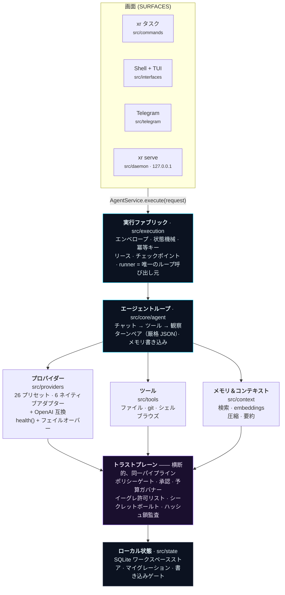
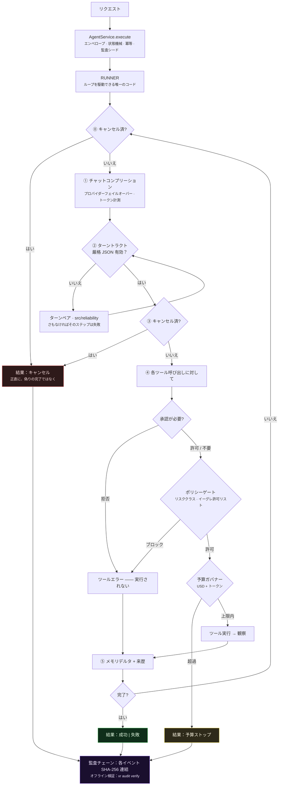

<div align="center">


# XR

**本当に監査できる AI エージェントランタイム。**

*タスクを与えるだけ。計画を立て、ツールを使い、あなたのマシン上で実際の変更を実行します —— ポリシーゲート、あなたの承認、支出上限、そしてオフラインで検証可能なハッシュ鎖ログのもと。*

[](https://github.com/ahmadrrrtx/xr/actions/workflows/ci.yml)
[](https://www.npmjs.com/package/@rrrtx/xr)
[](LICENSE)
[](docs/release/SUPPORT_MATRIX.md)

📄 **言語:** [English](README.md)（正準テキスト）· [اردو](README-ur.md) · [Español](README-es.md) · [Français](README-fr.md) · [Deutsch](README-de.md) · [Português](README-pt-BR.md) · [中文](README-zh-CN.md) · [日本語](README-ja.md) · [हिन्दी](README-hi.md)

[クイックスタート](#クイックスタート) · [XR とは](#xr-とは--そして何でないか) · [仕組み](#xr-の仕組み) · [プロバイダー](#プロバイダー) · [セキュリティ](#セキュリティ--トラストプレーン)

</div>

**バージョン:** `1.1.0 (Graphite)` · **パッケージ:** [@rrrtx/xr](https://www.npmjs.com/package/@rrrtx/xr) · **ライセンス:** MIT

XR —— ローカルファーストでプロバイダー中立の AI エージェントランタイム。BYOK、支出上限、改竄検出可能な監査、プラグイン/MCP 拡張性。

**同梱スキル:** 65（リリース時に `skills/` から集計）。

---

<div align="center">


**デスクトップシェルの実ビルド。** どの画面を使っていても、すべてのアクションが同じ承認・ポリシー・予算ゲートを通ります。

</div>

---

## XR とは？ —— わかりやすく

ターミナルにタスクを入力。XR が手順を考え、言語モデルを呼び出し、ツール（ファイルの読み書き、コマンド実行、ブラウズ、API 呼び出し）を使って、完了するか正直に失敗を報告します。

違いは**そのループを取り囲むもの**にあります：

| | |
|---|---|
| 🔑 **鍵はあなたが持ってくる** | XR には API キーもクラウドアカウントも同梱されていません。*あなたの*プロバイダーキーか、*あなたの*マシン上のモデルで動きます。 |
| 🛑 **行動の前に聞いてくる** | 重要なアクションは承認を待って停止。拒否はプロンプトへの提案ではなく、実行経路上で強制されます。 |
| 💸 **支出と上限を監視** | USD/トークン上限をループ中にチェック。USD コストは推定値：応答が要求上限を超える可能性があり、価格不明時は USD キャップを強制できません。 |
| 🔗 **何をしたか記録する** | すべてのイベントが SHA-256 でローカルチェーンに連結され、1 コマンドでオフライン検証できます。 |
| 💻 **あなたのマシンで動く** | 単一 SQLite データベース、テレメトリなし、必須ネットワークなし。10 のローカルモデルランタイムが一等市民。 |
| 🆓 **すべてのローカル機能は無料** | 音声、メモリ、テーマ、CLI、ボット、エディタ画面、リサーチ、エージェント、スキル、MCP が永久に無料 —— [ペイウォールなし、テストで証明](#料金)。 |

```bash
xr "このリポジトリの未対応 TODO を要約し、クリーンアップ計画を起案して"
```

> **開発プレビューの安全制約：** コーディング CLI は `--dry-run` でファイル書き込みとシェル実行をシミュレートしますが、モデル/読み取り/ネットワークリクエストと監査/状態更新は発生し得ます。信頼できないリポジトリの隔離、絶対的な請求上限として扱わないでください。[CLI コントラクトと既知の制約](docs/cli/CODING_CONTRACTS.md)を参照。

**対象者：** 実機で実務を自動化する開発者、エージェントの行動を事後レビューする必要があるチーム、完全オフラインのエージェントを求めるすべての人。

---

## XR とは —— そして何でないか

**XR は：** セルフホスト型エージェントランタイム；プロバイダー中立（26 プリセット）；ガバナンス付き（ポリシー・承認・予算・監査が実行経路上で強制）；拡張可能（スキル・プラグイン・MCP）；サプライチェーン署名済み；MIT ライセンスで一貫して読める。

**XR でないもの：** SOC 2 / ISO 27001 / HIPAA / PCI-DSS の認証なし；サンドボックスではない（プロセス内ポリシー、カーネル/VM 分離ではない）；必須サービスではない；人間によるレビューの代替品でもない；そして未完成 —— [既知の制約レジスタ](docs/security/KNOWN_LIMITATIONS.md)が一等級のリリース成果物です。

---

## クイックスタート

### 1. インストール

| チャネル | プラットフォーム | コマンド |
|---|---|---|
| **npm**（安定 `latest`） | Linux · macOS · Windows · Termux | `npm i -g @rrrtx/xr` |
| **バイナリ** | Linux · macOS · Termux · WSL | `curl -fsSL https://raw.githubusercontent.com/ahmadrrrtx/xr/main/install.sh \| bash` |
| **バイナリ** | Windows PowerShell 5.1 / 7+ | `iex (irm https://raw.githubusercontent.com/ahmadrrrtx/xr/main/install.ps1)` |
| **Homebrew** | macOS · Linux | `brew install ahmadrrrtx/tap/xr` |
| **WinGet** | Windows | `winget install ahmadrrrtx.XR` |
| **Scoop** | Windows | リリースから `scoop/xr.json` をダウンロード · `scoop install ./xr.json` |
| **.deb** | Debian · Ubuntu | `sudo dpkg -i xr_*_amd64.deb` |
| **Docker** | すべて | `docker run ghcr.io/ahmadrrrtx/xr:latest` |
| **ソースから** | すべて | `git clone https://github.com/ahmadrrrtx/xr && cd xr && bun install` |

### 2. 初回実行

```bash
xr onboarding        # ガイド付きセットアップ（プロバイダー + メモリ + オプション音声）
xr doctor            # ヘルスチェック —— XR が本当に動作できない場合は非ゼロ終了
```

### 3. 最初のタスク

```bash
xr "hello, XR"                 # ワンショットタスク
xr                             # フルスクリーン対話シェル
xr serve                       # ダッシュボード + チャット http://localhost:3141 (127.0.0.1、トークン認証)
```

はじめてですか？ゴールデンパスを最後まで：[`docs/development/GETTING_STARTED.md`](docs/development/GETTING_STARTED.md)。

### 完全オフライン実行

```bash
ollama serve && ollama pull qwen2.5:7b   # 対応する 10 のローカルランタイムのいずれか
xr providers set ollama qwen2.5:7b
xr "この関数をリファクタリング"            # ネットワーク不要
```

---

## XR の仕組み

すべての画面 —— CLI、シェル、Telegram、デーモンのチャット —— は**1 つの呼び出し**に集約されます。横道なし：ポリシー・承認・予算・キャンセル・監査はパイプラインの属性であり、どのインターフェースもスキップできません。



### 1 つのタスクに何が起きるか



### 設計原則

1. **質問ごとに一つの計算権威。** あなたの質問に答えるモジュールは、すべての画面と CI にも答えます —— doctor の readiness エンジンは onboarding の能力スキャンそのもの；クロスプラットフォームスイートは OS ごとに実行される単一のファイルリスト。
2. **runner への迂回なし。** すべてのターンは エンベロープ → runner → ループ を通ります。
3. **正直な結果。** 偽りの完了は絶対にありません。
4. **検査可能な状態。** 単一 SQLite、ハッシュ鎖監査イベント、エクスポート可能なセッション、再現可能なインベントリ。
5. **速い経路は速いまま。** ホットパスで同期 FS/プロセス I/O ゼロ（lint 強制）、予算は CI でゲート。

---

## プロバイダー

**26 の組み込みプリセット —— ホスト 16、ローカルランタイム 10。** 再始動なしでいつでも切替。

6 つのホストプロバイダーが専用ネイティブアダプターを使用（Anthropic、Cerebras、Cohere、Google、Mistral、AWS Bedrock —— `src/providers/native/`）。残り —— 他のホストと全 10 のローカルランタイム —— は単一トランスポート経由で OpenAI 互換プロトコルを話し、カスタムプリセットは任意の互換 base URL を指せます。

```bash
xr providers list                    # 26 プリセット · デフォルトモデル + 能力
xr providers set openai gpt-4o-mini
xr providers add claude              # キーをマスク入力 → OS キーチェーン。なければ AES-256-GCM シールファイル
xr providers test                    # 設定済みプロバイダーをライブプローブ
```

モデル切替は **プリフライト → カナリア → スイッチ → 検証** の状態機械で行われ、新モデルが到達不能なら自動ロールバック（`--force` でプローブ省略）。

---

## セキュリティ —— トラストプレーン

### XR Shield —— エンフォースメント境界

**XR Shield** は、すべての重要なアクションが通過する 7 コンポーネントの名前。製品ティアでもスキャナーでもなく、*ノー*と言えるコードです。`src/xr-shield/index.ts` 一つで列挙可能。

| # | コンポーネント | 場所 | 応える質問 | 拒否可能？ |
|---|---|---|---|---|
| 1 | **能力ポリシー** | `src/capabilities/policy.ts` | この能力はこのワークスペースとモードで許可されているか？ | ✅ |
| 2 | **アクションガード** | `src/security/guard.ts` | 完全にデコード・正規化した後のアクションは危険か？ | ✅ |
| 3 | **トラストラティス + 配置** | `src/runtime/trust/` | リスク帯はどれで、どこで実行可能か？ | ✅ |
| 4 | **同意 / 承認** | `src/control/approval-store.ts` | 人間が承認したか？（永続、TTL デフォルト拒否） | ✅ |
| 5 | **ネットワークイーグレ** | `src/security/egress-proxy.ts` | この宛先は許可されているか？ | ✅ |
| 6 | **実行 + 出力の完全性** | `src/security/exec-integrity.ts`、`tool-output.ts`、`secret-broker.ts` | バイナリは許可されているか？ツール出力はデータとして戻されるか？シークレットは委ねず仲介されているか？ | ✅ |
| 7 | **署名済み監査証拠** | `src/security/audit-signer.ts`、`audit-verify.ts` | 事後証明できるか？改竄は見抜かれるか？ | ➖ 記録 |

この表は `XR_SHIELD_COMPONENTS` から生成され、列挙モジュールが消失すると
`test/architecture/xr-shield-facade.test.ts` が失敗します —— ドキュメントはコードから乖離できません。

> **正直ボックス：** XR は**プロセス内ポリシー**を強制します —— カーネル/VM 分離ではなく、ガードレールであり、サンドボックスではなく、人間レビューの代替でもありません。ギャップは書面化されています：[`docs/security/KNOWN_LIMITATIONS.md`](docs/security/KNOWN_LIMITATIONS.md)。

セキュリティアーキテクチャ、脅威モデル、脆弱性開示：[`SECURITY.md`](SECURITY.md)。

---

## サプライチェーン —— 署名・来歴・検証

タグのプッシュごとに、ビルド・署名・公開・自己検証の単一パイプラインが走ります。npm は *OIDC trusted publishing* で公開（リリース経路に永続 npm トークンなし）。

- **バイナリチャネル**（GitHub Releases、Homebrew、WinGet、Scoop、`.deb`、Docker）：`SHA256SUMS` への cosign *keyless* 署名、CycloneDX SBOM、SLSA3 来歴 —— 検証手順は [`docs/release/VERIFYING_RELEASES.md`](docs/release/VERIFYING_RELEASES.md)。資産セットはリリースレーンごとに異なり、公開されるものはすべてタグ時に署名されます。
- **npm**：**来歴アテステーション**で公開、タグコミットに紐づき。
- **CI 衛生：** `--ignore-scripts` インストール、osv-scanner + `bun audit`、gitleaks スキャン、ライセンススキャン、SBOM ドリフトゲートを毎回実行。
- **チャネルは遅れない：** チャネル設定はリリースマニフェストから**生成**、ドリフトゲート（`bun run channel:check`）；tag ⇔ npm 不変量は CI で検証。

---

## 能力

- **スキル**（`skills/`）：65 同梱（`xr-skill.json` マニフェスト）。
- **プラグイン**（`src/plugins/`）：明示的許可、ハッシュ検証、完全ライフサイクル。
- **MCP**（`src/mcp/`）：クライアント + マネージャー + レジストリ —— stdio、SSE、HTTP、許可リスト。
- **メモリ**（`src/context/`）：同意ファースト取得、説明可能な検索、TTL。
- **リサーチ**（`src/research/`）：デフォルトオフライン；公開ウェブはオプトインのみ。
- **音声**と**コンピュータコントロール**：ローカルファーストアダプター、同じ承認ゲートの下。
- **マルチエージェントワークフロー**：決定論的計画 + 制限付き並行レーン + アーティファクト検証器；ルートが資金供給する単一の予算ツリー。

---

## 各画面

**デスクトップシェル**（`desktop/`、Tauri v2 + React —— 同じエージェントにウィンドウ）：

| | |
|---|---|
| 🛰 **常時生存** | ウィンドウを閉じてもトレイがエンジン、ショートカット、承認バッジを維持。 |
| ⌨️ **グローバル、正直に** | HUD、プッシュトゥートーク、領域スクリーンショット質問は非フォーカスでも動作；OS 所有のコンビキーはフォールバックして表示。 |
| 🔄 **署名済み自動更新** | Stable/Beta/Nightly チャネル、Ed25519 検証済みペイロード；リリースキーがなければ更新を拒否。 |
| 🧯 **正直なクラッシュ回復** | マーカーファイル検出；中断された実行は `killed` マーク —— 「完了」にはならない。 |
| 🪟 **肝心をネイティブに** | macOS HIG フルメニュー、Windows MSIX ディープリンク + トースト起動、Flathub 対応 Flatpak。 |

**モバイルコンパニオン**（`mobile/`）：自分の Wi-Fi 上だけ —— `xr serve --lan`、QR + 6 桁使い捨てペアリングコード、初回 TLS ピン（フィンガープリント比較）、モバイルセッションは `/files`、`/terminal`、`/git`、`/mcp` を 403、正直なオフラインアウトボックス。[`docs/mobile/PWA.md`](docs/mobile/PWA.md) を参照。

**ボット（Telegram、Discord、WhatsApp）**：ボットはあなたのデーモン内で動作 —— クラウドリレーなし —— 許可した仕事だけをルーティング。不明な送信者には**一切**返信しません。詳細：[`docs/phases/26-bots-discord-whatsapp.md`](docs/phases/26-bots-discord-whatsapp.md)。

**VS Code**（`extensions/vscode/`）：同じエージェントがエディタ内に、同じガバナンスパイプラインで。

---

## パフォーマンス —— 誇大広告ではなく予算

すべての性能主張は**公開予算 + 測定ベースライン + CI リグレッションゲート**付き（`docs/perf/PERF-BUDGETS.md`）：

| 画面 | 予算 | 測定（1.0.0 ベースライン） |
|---|---|---|
| `--version` / `--help` ウォーム p95 | < 150 ms | 39.8 / 40.5 ms |
| `--version` / `--help` コールド p95 | < 300 ms | 40.8 / 42.5 ms |
| `doctor` | < 1 s | 586 ms p95 |
| ルート決定 | < 20 ms | ミリ秒未満 |
| ダッシュボード初回描画 | < 1 s | 12.1 ms |

---

## XR が自分を証明する方法

差別化は、主張が毎 PR でマシンによりチェックされること —— 完全スイート、バージョン同一性ゲート、クレームゲート、ベースラインインベントリ、レイヤリング、ツリーサイズ、API スキーマ、リリースチャネル、サプライチェーンバッテリー。正確な数値と LOC 上限は正準（英語）README にベースラインと共に公開（[`docs/release/TEST-BASELINE.json`](docs/release/TEST-BASELINE.json)）。

---

## ドキュメントマップ

| 文書 | 目的 |
|---|---|
| [`docs/CONSTITUTION.md`](docs/CONSTITUTION.md) | コードが引用する法（30 条項 + 戒律） |
| [`AGENTS.md`](AGENTS.md) · [`CONTRIBUTING.md`](CONTRIBUTING.md) · [`SECURITY.md`](SECURITY.md) | オペレータ動向 · 貢献ガイド · セキュリティポリシー |
| [`docs/development/GETTING_STARTED.md`](docs/development/GETTING_STARTED.md) | エンドツーエンドのゴールデンパス |
| [`docs/security/KNOWN_LIMITATIONS.md`](docs/security/KNOWN_LIMITATIONS.md) | 既知の制約の正準レジスタ |
| [`docs/release/SUPPORT_MATRIX.md`](docs/release/SUPPORT_MATRIX.md) | プラットフォーム/チャネル別サポート真相 |
| [`docs/HISTORY.md`](docs/HISTORY.md) | バージョンはしご |
| [`docs/`](docs/README.md) | 完全なドキュメント索引 |

---

## 貢献

[`CONTRIBUTING.md`](CONTRIBUTING.md) と [セキュリティポリシー](SECURITY.md) を先にお読みください；エージェントは [`AGENTS.md`](AGENTS.md) から。品質バーは人間もエージェントも同じ：すべての変更にテストが付き、ローカルゲートバッテリーを通り、クレームは正直に。

```bash
git clone https://github.com/ahmadrrrtx/xr && cd xr
bun install --frozen-lockfile
bun run ci
```

不正確なクレームを発見？専用の Issue テンプレートがあります（[false claim](.github/ISSUE_TEMPLATE/false_claim.yml)）。

---

## 料金

**XR Personal は永久に無料 —— このリポジトリのすべての機能を含みます。** テレメトリなし、シート制限なし、時間制限なし。ライセンス対象は 8 つの*ホスト型サービス*のみ（[`src/cloud/license.ts`](src/cloud/license.ts) の `BUSINESS_FEATURES`）、どれもあなたのマシンでは動きません。**XR Business：ユーザー月額 $15**（30 日トライアル、カード不要）；Enterprise は契約別。テストで強制される 2 つの絶対ルール：**ローカル機能にペイウォールは永遠に作らない**、**BYOK は永遠に無料・直結**。

---

## ライセンス

[MIT](LICENSE) · XR —— あなたが監査できる、ローカルファーストのエージェントランタイム。

> *日本語訳；正準テキストは英語 README。コマンド・パス・コードブロックは翻訳していません。*
