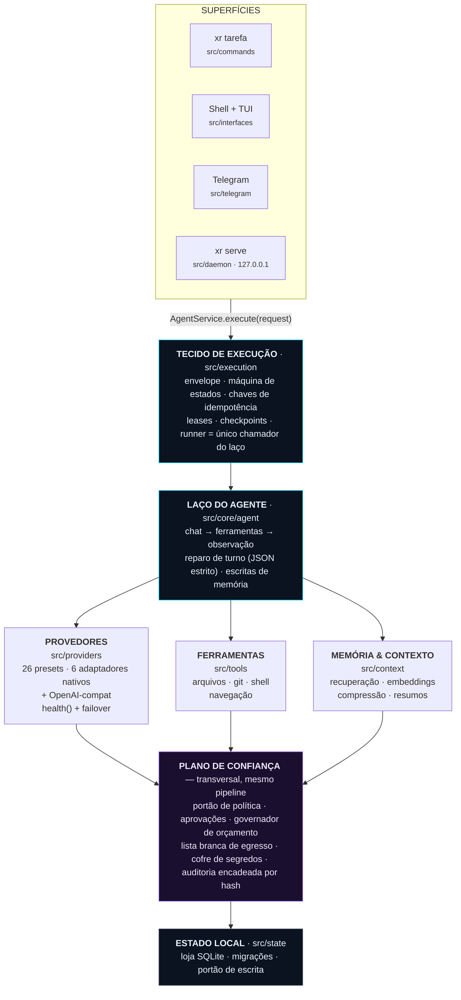
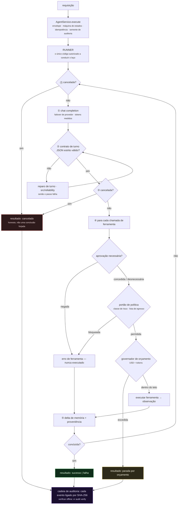

<div align="center">


# XR

**Um runtime de agente de IA que você pode realmente auditar.**

*Dê a ele uma tarefa. Ele planeja, usa ferramentas e altera coisas reais na sua máquina — sob um
portão de política, a sua aprovação, um teto de gasto e um registro encadeado por hash que você
pode verificar offline.*

[](https://github.com/ahmadrrrtx/xr/actions/workflows/ci.yml)
[](https://www.npmjs.com/package/@rrrtx/xr)
[](LICENSE)
[](docs/release/SUPPORT_MATRIX.md)

📄 **Idiomas:** [English](README.md) (fonte canônica) · [اردو](README-ur.md) · [Español](README-es.md) · [Français](README-fr.md) · [Deutsch](README-de.md) · [Português](README-pt-BR.md) · [中文](README-zh-CN.md) · [日本語](README-ja.md) · [हिन्दी](README-hi.md)

[Início rápido](#início-rápido) · [O que o XR é](#o-que-xr-é--e-o-que-não-é) · [Como funciona](#como-o-xr-funciona) · [Provedores](#provedores) · [Segurança](#segurança--o-plano-de-confiança)

</div>

**Versão:** `1.1.0 (Graphite)` · **Pacote:** [@rrrtx/xr](https://www.npmjs.com/package/@rrrtx/xr) · **Licença:** MIT

XR — runtime de agente de IA local-first e neutro quanto ao provedor. BYOK, teto de gasto,
auditoria à prova de adulterações e extensibilidade por plugins/MCP.

**Habilidades incluídas:** 65 (contadas em `skills/` no momento da publicação).

---

<div align="center">


**O shell de desktop, build real.** Cada ação passa pelos mesmos portões de aprovação, política
e orçamento — não importa a superfície usada.

</div>

---

## O que é o XR, em linguagem simples?

Você digita uma tarefa no terminal. O XR calcula os passos, chama um modelo de linguagem e usa
ferramentas — ler e escrever arquivos, executar comandos, navegar, chamar APIs — até a tarefa
estar pronta ou relatar honestamente que falhou.

A diferença é **o que cerca esse laço**:

| | |
|---|---|
| 🔑 **Você traz a chave** | O XR não traz nem chave de API nem conta de nuvem. Ele roda com a *sua* chave de provedor ou um modelo na *sua* máquina. |
| 🛑 **Ele pergunta antes de agir** | Ações com consequência param e esperam a sua aprovação. A negativa é aplicada no caminho de execução, não sugerida num prompt. |
| 💸 **Vigia gastos e limites** | Limites de USD/tokens são verificados durante o laço. Custos em USD são estimativas: uma resposta pode exceder o limite pedido, e sem preço conhecido não dá para impor teto de USD. |
| 🔗 **Anota o que fez** | Cada evento é ligado por SHA-256 a uma cadeia local que você verifica offline com um comando. |
| 💻 **Roda na sua máquina** | Um banco SQLite, zero telemetria, sem rede obrigatória. Dez runtimes de modelos locais são cidadãos de primeira classe. |
| 🆓 **Toda função local é gratuita** | Voz, memória, temas, CLI, bots, superfície de editor, pesquisa, agentes, skills e MCP para sempre — [sem paywall, provado por teste](#preços). |

```bash
xr "resuma os TODOs abertos neste repositório e elabore um plano de limpeza"
```

> **Limites de segurança da prévia de desenvolvimento:** o CLI de código simula escritas e
> execução shell sob `--dry-run`, mas requisições de modelo/leitura/rede e atualizações de
> auditoria/estado ainda podem acontecer. Não use como isolamento para repositórios não
> confiáveis nem como teto de faturamento absoluto. Veja
> [contratos do CLI e limites conhecidos](docs/cli/CODING_CONTRACTS.md).

**Para quem é:** desenvolvedores automatizando trabalho real em máquinas reais; equipes que
precisam rever as ações do agente depois; quem quer um agente 100 % offline.

---

## O que XR é — e o que não é

**O XR é:** um runtime de agente auto-hospedado; neutro quanto ao provedor (26 presets);
governado (política, aprovações, orçamento e auditoria aplicados no caminho de execução);
extensível (skills, plugins, MCP); assinado na cadeia de suprimento; MIT e legível de ponta a
ponta.

**O XR não é:** não é certificado SOC 2 / ISO 27001 / HIPAA / PCI-DSS; não é sandbox (política
em processo, não isolamento de kernel/VM); não é um serviço obrigatório; não substitui a revisão
humana de ações com consequências; e não está terminado — o
[registro de limites conhecidos](docs/security/KNOWN_LIMITATIONS.md) é artefato de
primeira classe.

---

## Início rápido

### 1. Instalação

| Canal | Plataforma | Comando |
|---|---|---|
| **npm** (`latest` estável) | Linux · macOS · Windows · Termux | `npm i -g @rrrtx/xr` |
| **Binário** | Linux · macOS · Termux · WSL | `curl -fsSL https://raw.githubusercontent.com/ahmadrrrtx/xr/main/install.sh \| bash` |
| **Binário** | Windows PowerShell 5.1 / 7+ | `iex (irm https://raw.githubusercontent.com/ahmadrrrtx/xr/main/install.ps1)` |
| **Homebrew** | macOS · Linux | `brew install ahmadrrrtx/tap/xr` |
| **WinGet** | Windows | `winget install ahmadrrrtx.XR` |
| **Scoop** | Windows | baixe `scoop/xr.json` da release · `scoop install ./xr.json` |
| **.deb** | Debian · Ubuntu | `sudo dpkg -i xr_*_amd64.deb` |
| **Docker** | qualquer | `docker run ghcr.io/ahmadrrrtx/xr:latest` |
| **Do código-fonte** | qualquer | `git clone https://github.com/ahmadrrrtx/xr && cd xr && bun install` |

### 2. Primeira execução

```bash
xr onboarding        # configuração guiada (provedor + memória + voz opcional)
xr doctor            # verificação de saúde — sai diferente de zero se o XR não puder trabalhar de verdade
```

### 3. Sua primeira tarefa

```bash
xr "olá, XR"                   # tarefa única
xr                             # shell interativo em tela cheia
xr serve                       # painel + chat em http://localhost:3141 (127.0.0.1, com token)
```

Novo por aqui? Siga o caminho dourado até o fim:
[`docs/development/GETTING_STARTED.md`](docs/development/GETTING_STARTED.md).

### Totalmente offline

```bash
ollama serve && ollama pull qwen2.5:7b   # qualquer um dos 10 runtimes locais suportados
xr providers set ollama qwen2.5:7b
xr "refatore esta função"                # sem rede
```

---

## Como o XR funciona

Toda superfície — CLI, shell, Telegram, chat do daemon — desemboca em **uma chamada**. Não há
atalho: política, aprovações, orçamento, cancelamento e auditoria são propriedades do pipeline,
que nenhuma interface consegue contornar.



### O que acontece com uma tarefa



### Princípios de projeto

1. **Uma autoridade de cálculo por pergunta.** O que responde uma pergunta vale para toda
   superfície e para o CI — o motor de readiness do doctor é a varredura de capacidades do
   onboarding; a suíte multiplataforma é uma única lista de arquivos por SO.
2. **Sem desvio em volta do runner.** Cada turno segue envelope → runner → laço.
3. **Resultados honestos.** Nunca uma conclusão forjada.
4. **Estado inspecionável.** Um SQLite, eventos de auditoria encadeados por hash, sessões
   exportáveis, inventário reproduzível.
5. **O caminho rápido permanece rápido.** Zero I/O síncrono de FS/processos no hot path
   (forçado por lint) e orçamentos fechados pelo CI.

---

## Provedores

**26 presets embutidos — 16 hospedados e 10 runtimes locais.** Troque quando quiser, sem
reinício.

Seis provedores hospedados usam adaptadores nativos dedicados (Anthropic, Cerebras, Cohere,
Google, Mistral, AWS Bedrock — `src/providers/native/`). Os demais — os outros hospedados e os
dez runtimes locais — falam o protocolo compatível com OpenAI por um único transporte, e um
preset personalizado pode apontar para qualquer base URL compatível.

```bash
xr providers list                    # 26 presets · modelo padrão + capacidades
xr providers set openai gpt-4o-mini
xr providers add claude              # chave mascarada → chaveiro do SO, senão arquivo selado AES-256-GCM
xr providers test                    # sonda ao vivo dos provedores configurados
```

Trocar de modelo executa uma máquina de estados **preflight → canary → swap → verify** com
rollback automático se o novo modelo não responder (`--force` pula a sonda).

---

## Segurança — o plano de confiança

### XR Shield — a fronteira de aplicação

**XR Shield** é o nome dos sete componentes pelos quais passa toda ação com consequências. Não
é nível de produto nem scanner: é o código que pode dizer *não*. Enumerável num único import —
`src/xr-shield/index.ts`.

| # | Componente | Onde | Pergunta respondida | Pode recusar? |
|---|---|---|---|---|
| 1 | **Política de capacidade** | `src/capabilities/policy.ts` | Esta capacidade é permitida neste workspace e modo? | ✅ |
| 2 | **Guarda de ação** | `src/security/guard.ts` | A ação é perigosa depois de decodificada e canônica? | ✅ |
| 3 | **Retícula de confiança + posicionamento** | `src/runtime/trust/` | Qual camada de risco e onde pode rodar? | ✅ |
| 4 | **Consentimento / aprovações** | `src/control/approval-store.ts` | Um humano aprovou? (durável, TTL default-deny) | ✅ |
| 5 | **Egresso de rede** | `src/security/egress-proxy.ts` | Este destino é permitido? | ✅ |
| 6 | **Integridade de execução + saída** | `src/security/exec-integrity.ts`, `tool-output.ts`, `secret-broker.ts` | O binário é permitido? A saída volta como dados? Segredos são intermediados, não entregues? | ✅ |
| 7 | **Evidência de auditoria assinada** | `src/security/audit-signer.ts`, `audit-verify.ts` | Dá para provar depois? Adulteração apareceria? | ➖ registra |

A tabela é gerada a partir de `XR_SHIELD_COMPONENTS` e
`test/architecture/xr-shield-facade.test.ts` falha se um módulo listado sumir — os documentos
não podem divergir do código.

> **Caixa de honestidade:** o XR aplica **política em processo**, não isolamento de kernel/VM —
> um guarda-corpo, não um confinamento, nem substituto da revisão humana. As lacunas estão
> escritas: [`docs/security/KNOWN_LIMITATIONS.md`](docs/security/KNOWN_LIMITATIONS.md).

Arquitetura de segurança, modelo de ameaças e divulgação: [`SECURITY.md`](SECURITY.md).

---

## Cadeia de suprimento — assinada, com proveniência, verificável

Cada push de tag roda um único pipeline que constrói, assina, publica e auto-verifica. O npm é
publicado com *OIDC trusted publishing* (sem token npm de longa vida no caminho de release).

- **Canais binários** (GitHub Releases, Homebrew, WinGet, Scoop, `.deb`, Docker): assinaturas
  cosign *keyless* sobre `SHA256SUMS`, SBOM CycloneDX e proveniência SLSA3 — verificação em
  [`docs/release/VERIFYING_RELEASES.md`](docs/release/VERIFYING_RELEASES.md). O conjunto de
  ativos varia por trilha de release; tudo que é publicado é assinado na tag.
- **npm**: publicado com **atestação de proveniência** ligada ao commit da tag.
- **Higiene de CI:** `--ignore-scripts`, osv-scanner + `bun audit`, gitleaks, varredura de
  licenças e gates de desvio de SBOM em cada execução.
- **Canais não podem ficar para trás:** as configurações são **geradas** do manifesto e
  validadas (`bun run channel:check`); o invariante tag ⇔ npm é checado no CI.

---

## Capacidades

- **Skills** (`skills/`): 65 incluídas (manifestos `xr-skill.json`).
- **Plugins** (`src/plugins/`): permissões explícitas, verificação de hash, ciclo de vida
  completo.
- **MCP** (`src/mcp/`): cliente + gerente + registro — stdio, SSE, HTTP, com lista branca.
- **Memória** (`src/context/`): captura consentida, recuperação explicável, TTL.
- **Pesquisa** (`src/research/`): offline por padrão; web pública apenas opt-in.
- **Voz** e **controle do computador**: adaptadores local-first, atrás dos mesmos portões de
  aprovação.
- **Fluxos multiagente**: plano determinístico + pistas de concorrência limitada + verificador
  de artefatos; uma única árvore orçamentária financiada pela raiz.

---

## As superfícies

**Shell de desktop** (`desktop/`, Tauri v2 + React — o mesmo agente com janela):

| | |
|---|---|
| 🛰 **Sempre vivo** | A bandeja mantém motor, atalhos e selo de aprovações ativos com a janela fechada. |
| ⌨️ **Global, honestamente** | HUD, push-to-talk e capturar-região-e-perguntar funcionam sem foco; acordes cedem quando o SO os possui. |
| 🔄 **Auto-atualização assinada** | Canais Stable/Beta/Nightly, payloads Ed25519 verificados; sem chave de release, recusa a atualização. |
| 🧯 **Recuperação de falha verdadeira** | Detecção por arquivo marcador; execuções cortadas viram `killed`, nunca "concluídas". |
| 🪟 **Nativo onde importa** | Menu macOS HIG, MSIX no Windows com deep links + toast, Flatpak pronto para o Flathub. |

**Companheiro mobile** (`mobile/`): no seu próprio Wi-Fi — `xr serve --lan`, QR + código de
pareamento de 6 dígitos de uso único, TLS fixado no primeiro uso (comparação de fingerprint),
sessões mobile recusadas em `/files`, `/terminal`, `/git`, `/mcp`, caixa de saída offline
honesta. Veja [`docs/mobile/PWA.md`](docs/mobile/PWA.md).

**Bots (Telegram, Discord, WhatsApp)**: o bot roda dentro do seu daemon — sem relay de nuvem —
e só roteia trabalho permitido. Remetente desconhecido recebe **nenhuma** resposta. Detalhes:
[`docs/phases/26-bots-discord-whatsapp.md`](docs/phases/26-bots-discord-whatsapp.md).

**VS Code** (`extensions/vscode/`): o mesmo agente dentro do editor, com o pipeline governado.

---

## Desempenho — orçamentos, não vaidade

Toda afirmação de desempenho é um **orçamento publicado com base medida e um gate de
regressão no CI** (`docs/perf/PERF-BUDGETS.md`):

| Superfície | Orçamento | Medido (base 1.0.0) |
|---|---|---|
| `--version` / `--help` quente p95 | < 150 ms | 39.8 / 40.5 ms |
| `--version` / `--help` frio p95 | < 300 ms | 40.8 / 42.5 ms |
| `doctor` | < 1 s | 586 ms p95 |
| decisão de rota | < 20 ms | sub-ms |
| primeiro render do painel | < 1 s | 12.1 ms |

---

## Como o XR se prova

O diferencial: as afirmações são verificadas por máquinas em cada PR — suíte completa, gates
de identidade de versão, gates de claims, inventário de base, camadas, tamanho da árvore,
esquemas de API, canais de release e a bateria de cadeia de suprimento. Os números exatos e o
teto de LOC são publicados no README canônico (inglês) com a base medida
([`docs/release/TEST-BASELINE.json`](docs/release/TEST-BASELINE.json)).

---

## Mapa da documentação

| Documento | Propósito |
|---|---|
| [`docs/CONSTITUTION.md`](docs/CONSTITUTION.md) | A lei que o código cita (30 Artigos + Mandamentos) |
| [`AGENTS.md`](AGENTS.md) · [`CONTRIBUTING.md`](CONTRIBUTING.md) · [`SECURITY.md`](SECURITY.md) | Briefing de operadores · guia de contribuição · política de segurança |
| [`docs/development/GETTING_STARTED.md`](docs/development/GETTING_STARTED.md) | O caminho dourado de ponta a ponta |
| [`docs/security/KNOWN_LIMITATIONS.md`](docs/security/KNOWN_LIMITATIONS.md) | Registro canônico de limites conhecidos |
| [`docs/release/SUPPORT_MATRIX.md`](docs/release/SUPPORT_MATRIX.md) | Verdade do suporte por plataforma/canal |
| [`docs/HISTORY.md`](docs/HISTORY.md) | A escada de versões |
| [`docs/`](docs/README.md) | Índice completo da documentação |

---

## Contribuindo

Leia [`CONTRIBUTING.md`](CONTRIBUTING.md) e a [política de segurança](SECURITY.md) primeiro;
agentes começam em [`AGENTS.md`](AGENTS.md). A régua é idêntica para humanos e agentes: toda
mudança chega com testes, passa pela bateria local de gates e mantém os claims honestos.

```bash
git clone https://github.com/ahmadrrrtx/xr && cd xr
bun install --frozen-lockfile
bun run ci
```

Achou um claim impreciso? Existe um modelo de issue para isso
([false claim](.github/ISSUE_TEMPLATE/false_claim.yml)).

---

## Preços

**O XR Personal é grátis para sempre, com todas as funções deste repositório incluídas.** Sem
telemetria, sem assentos, sem limite temporal. Apenas oito *serviços hospedados* são licenciados
(`BUSINESS_FEATURES` em [`src/cloud/license.ts`](src/cloud/license.ts)) e nenhum roda na sua
máquina. **XR Business: US$ 15 por usuário/mês** (teste de 30 dias sem cartão); Enterprise sob
contrato. Duas regras inegociáveis aplicadas por testes: **nenhuma função local ganha paywall
jamais** e **BYOK continua grátis e direto**.

---

## Licença

[MIT](LICENSE) · XR — um runtime de agente local-first que você pode auditar.

> *Tradução para o português (Brasil); o README em inglês é a fonte canônica. Comandos, caminhos
> e blocos de código não são traduzidos.*
