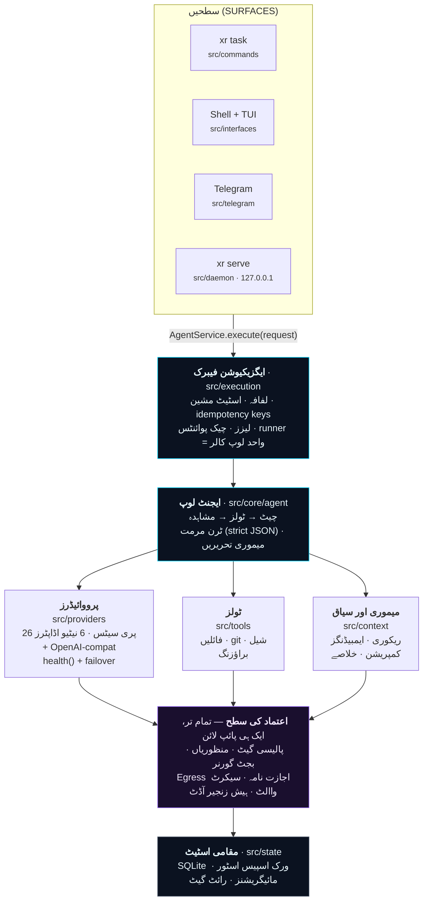
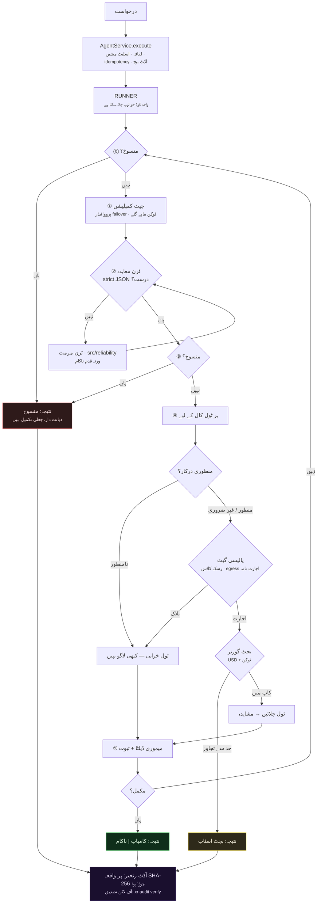

<div align="center">


# XR

**ایک AI ایجنٹ رن ٹائم جس کی آپ واقعی آڈٹ کر سکتے ہیں۔**

*اسے کوئی کام دیں۔ یہ منصوبہ بناتا ہے، ٹولز استعمال کرتا ہے، اور آپ کی مشین پر حقیقی چیزیں بدلتا
ہے — پالیسی گیٹ، آپ کی منظوری، خرچ کی حد، اور ہیش سے جوڑے گئے لاگ کے ساتھ جسے آپ آف لائن تصدیق
کر سکتے ہیں۔*

[](https://github.com/ahmadrrrtx/xr/actions/workflows/ci.yml)
[](https://www.npmjs.com/package/@rrrtx/xr)
[](LICENSE)
[](docs/release/SUPPORT_MATRIX.md)

📄 **زبانیں:** [English](README.md) (مایاخیز متن) · [اردو](README-ur.md) · [Español](README-es.md) · [Français](README-fr.md) · [Deutsch](README-de.md) · [Português](README-pt-BR.md) · [中文](README-zh-CN.md) · [日本語](README-ja.md) · [हिन्दी](README-hi.md)

[فوری آغاز](#فوری-آغاز) · [XR کیا ہے](#xr-کیا-ہے---اور-کیا-نہیں) · [طریقۂ کار](#xr-کیسے-کام-کرتا-ہے) · [فراہم کنندگان](#فراہم-کنندگان) · [سیکیورٹی](#سیکیورٹی---اعتماد-کی-سطح)

</div>

**ورژن:** `1.1.0 (Graphite)` · **پیکج:** [@rrrtx/xr](https://www.npmjs.com/package/@rrrtx/xr) · **لائسنس:** MIT

XR — ایک local-first، پرووائیڈر سے غیر جانب دار AI ایجنٹ رن ٹائم۔ BYOK، خرچ پر حدبندی،
چھیڑ چھاڑ سے محفوظ آڈٹ، اور plugin/MCP توسیع پذیری۔

**شامل اسکلز:** 65 (ریلیز کے وقت `skills/` سے گنی گئیں)۔

---

<div align="center">


**ڈیسک ٹاپ شیل — حقیقی بلڈ۔** ہر عمل اسی منظوری، پالیسی اور بجٹ گیٹ سے گزرتا ہے —
آپ جو بھی سطح استعمال کر رہے ہوں۔

</div>

---

## XR سادہ زبان میں کیا ہے؟

آپ ٹرمینل میں کوئی کام ٹائپ کرتے ہیں۔ XR اقدامات متعین کرتا ہے، لینگویج ماڈل کو بلاتا ہے، اور
ٹولز استعمال کرتا ہے — فائلیں پڑھنا اور لکھنا، کمانڈز چلانا، براؤز کرنا، API کالز — یہاں تک کہ
کام مکمل ہو جائے یا وہ دیانت داری سے ناکامی کی اطلاع دے۔

فرق اس چیز میں ہے **جو اس لوپ کے گرد ہوتی ہے**:

| | |
|---|---|
| 🔑 **کلید آپ لااتے ہیں** | XR کوئی API کلید یا کلاؤڈ اکاؤنٹ نہیں دیتا۔ یہ *آپ کی* پرووائیڈر کلید یا *آپ کی* مشین کے مقامی ماڈل پر چلتا ہے۔ |
| 🛑 **عمل سے پہلے پوچھتا ہے** | اہم اعمال رک کر آپ کی منظوری کا انتظار کرتے ہیں۔ انکار پر عمل درآمد تنفیذ کے راستے میں ہوتا ہے، پرامپٹ میں صرف مشورہ نہیں۔ |
| 💸 **خرچ اور حدود پر نظر رکھتا ہے** | USD/ٹوکن حدود لوپ کے دوران چیک ہوتی ہیں۔ USD کی لاگت تخمینی ہے: کوئی جواب درخواست کردہ حد سے بڑھ سکتا ہے، اور نامعلوم قیمت پر USD کیپ لاگو نہیں ہو سکتا۔ |
| 🔗 **جو کرتا ہے لکھ لیتا ہے** | ہر واقعہ SHA-256 سے مقامی زنجیر میں جُڑا ہوتا ہے جسے ایک ہی کمانڈ سے آف لائن تصدیق کیا جا سکتا ہے۔ |
| 💻 **آپ کی مشین پر چلتا ہے** | ایک SQLite ڈیٹابیس، کوئی ٹیلیمیٹری نہیں، کوئی لازمی نیٹ ورک نہیں۔ دس مقامی ماڈل رن ٹائمز اول درجے کے شہری ہیں۔ |
| 🆓 **ہر مقامی فیچر مفت ہے** | وائس، میموری، تھیمز، CLI، بوٹس، ایڈیٹر سرفیس، ریسرچ، ایجنٹس، اسکلز اور MCP ہمیشہ کے لیے مفت ہیں — [بغیر paywall، ٹیسٹ سے ثابت](#قیمتیں)۔ |

```bash
xr "اس ریپو کے کھلے TODOs کا خلاصہ کرو اور صفائی کا منصوبہ لکھو"
```

> **ڈیولپمنٹ پریویو سیکیورٹی حدود:** کوڈنگ CLI `--dry-run` کے تحت فائل کی تحریر اور شیل تنفیذ کی
> نقل اتارتا ہے، مگر ماڈل/ریڈ/نیٹ ورک درخواستیں اور آڈٹ/اسٹیٹ اپڈیٹ ہو سکتی ہیں۔ اسے غیر قابلِ
> اعتماد ریپوز کیلئے الگ تھلگ محیط یا مطلق بلنگ کیپ نہ سمجھیں۔

**کس کے لیے ہے؟** وہ ڈویلپرز جو اصل مشینز پر اصل کام خودکار بناتے ہیں؛ وہ ٹیمیں جنہیں ایجنٹ کے
اعمال بعد ازاں قابلِ نظرثانی چاہئیں؛ اور ہر وہ شخص جو مکمل آف لائن ایجنٹ چاہتا ہے۔

---

## XR کیا ہے — اور کیا نہیں

**XR ہے:** خود میزبان ایجنٹ رن ٹائم؛ پرووائیڈر سے غیر جانب دار (26 پری سیٹس)؛ قابو میں رکھا گیا
(پالیسی، منظوریاں، بجٹ اور آڈٹ تنفیذ کے راستے میں نافذ)؛ قابلِ توسیع (اسکلز، پلگ انز، MCP)؛
سپلائی چین میں دستخط شدہ؛ MIT اور سرتا پا پڑھنے کے قابل۔

**XR نہیں ہے:** SOC 2 / ISO 27001 / HIPAA / PCI-DSS کی تصدیق شدہ نہیں؛ کوئی سینڈ باکس نہیں
(ان پروسیس پالیسی، کرنل/VM الگ تھلگ نہیں)؛ کوئی لازمی سروس نہیں؛ اہم اعمال کی انسانی نظرثانی
کا بدل نہیں؛ اور مکمل بھی نہیں — اس کا [معلوم حدود کا رجسٹر](docs/security/KNOWN_LIMITATIONS.md)
اول درجے کا ریلیز آرٹیفیکٹ ہے۔

---

## فوری آغاز

### 1. انسٹال

| چینل | پلیٹ فارم | کمانڈ |
|---|---|---|
| **npm** (`latest` مستحکم) | Linux · macOS · Windows · Termux | `npm i -g @rrrtx/xr` |
| **بائنری** | Linux · macOS · Termux · WSL | `curl -fsSL https://raw.githubusercontent.com/ahmadrrrtx/xr/main/install.sh \| bash` |
| **بائنری** | Windows PowerShell 5.1 / 7+ | `iex (irm https://raw.githubusercontent.com/ahmadrrrtx/xr/main/install.ps1)` |
| **Homebrew** | macOS · Linux | `brew install ahmadrrrtx/tap/xr` |
| **WinGet** | Windows | `winget install ahmadrrrtx.XR` |
| **Scoop** | Windows | ریلیز سے `scoop/xr.json` ڈاؤن لوڈ کریں · `scoop install ./xr.json` |
| **.deb** | Debian · Ubuntu | `sudo dpkg -i xr_*_amd64.deb` |
| **Docker** | سب | `docker run ghcr.io/ahmadrrrtx/xr:latest` |
| **سورس سے** | سب | `git clone https://github.com/ahmadrrrtx/xr && cd xr && bun install` |

### 2. پہلی بار چلائیں

```bash
xr onboarding        # رہنما سیٹ اپ (پرووائیڈر + میموری + اختیاری وائس)
xr doctor            # صحت جانچ — اگر XR واقعی کام نہیں کر سکتا تو غیر صفر خروج
```

### 3. پہلا کام

```bash
xr "ہیلو XR"                    # ایک بار والا کام
xr                              # فل سکرین انٹرایکٹو شیل
xr serve                        # ڈیش بورڈ + چیٹ http://localhost:3141 پر (127.0.0.1، ٹوکن سمیت)
```

نئے ہیں؟ سنہری راستہ آغاز تا اختتام: [`docs/development/GETTING_STARTED.md`](docs/development/GETTING_STARTED.md)۔

### مکمل آف لائن

```bash
ollama serve && ollama pull qwen2.5:7b   # 10 مقامی رن ٹائمز میں سے کوئی بھی
xr providers set ollama qwen2.5:7b
xr "اس فنکشن کو refactor کرو"            # نیٹ ورک کی ضرورت نہیں
```

---

## XR کیسے کام کرتا ہے

ہر سطح — CLI، شیل، ٹیلیگرام، ڈیمن چیٹ — **ایک ہی کال** میں بہہ نکلتی ہے۔ کوئی لیٹی دوڑ
نہیں: پالیسی، منظوریاں، بجٹ، منسوخی اور آڈٹ پائپ لائن کی خصوصیات ہیں، اس لیے کوئی انٹرفیس انھیں
نہیں چھوڑ سکتا۔



### ایک کام کے ساتھ کیا ہوتا ہے



### ڈیزائن اصول

1. **ہر سوال کیلئے ایک ہی حسابی مرجع۔** جو آپ کے سوال کا جواب دیتا ہے وہی ہر سطح اور CI کی لیے
   دیتا ہے — doctor کا readiness انجن ہی onboarding capability scan ہے۔
2. **runner کے ارد گرد کوئی چور راستہ نہیں۔** ہر ٹرن لفافہ → runner → لوپ سے گزرتا ہے۔
3. **دیانت دار نتائج۔** کبھی جعلی تکمیل نہیں۔
4. **قابلِ معائنہ اسٹیٹ۔** ایک SQLite، ہیش زنجیر آڈٹ واقعات، ایکسپورٹ ایبل سیشنز، قابلِ اعادہ
   انوینٹری۔
5. **تیز راستہ تیز رہے۔** ہاٹ پاتھ صفر ہم زمانہ FS/پروسیس I/O (lint نافذ) اور بجٹ CI گیٹ شدہ۔

---

## فراہم کنندگان

**26 بلٹ اِن پری سیٹس — 16 میزبان اور 10 مقامی رن ٹائمز۔** چاہیں تبدیل کریں، نہ ری سٹارٹ، نہ
دوبارہ ترتیب۔

چھ میزبان پرووائیڈرز مخصوص نیٹیو اڈاپٹرز استعمال کرتے ہیں (Anthropic، Cerebras، Cohere، Google،
Mistral، AWS Bedrock — `src/providers/native/`)۔ باقی سب — دیگر میزبان اور دس مقامی رن ٹائمز —
ایک ہی ٹرانسپورٹ کے ذریعے OpenAI-compatible پروٹوکول بولتے ہیں، اور کسٹم پری سیٹ کسی بھی
OpenAI-compatible base URL کی طرف اشارہ کر سکتا ہے۔

```bash
xr providers list                    # 26 پری سیٹس · ڈیفالٹ ماڈل + صلاحیتیں
xr providers set openai gpt-4o-mini
xr providers add claude              # کلید مسک شدہ → OS keychain، ورنہ AES-256-GCM سیل شدہ فائل
xr providers test                    # تشکیل شدہ پرووائیڈرز کی لائیو جانچ
```

ماڈل تبدیلی **پری فلائٹ → کینری → تبدیلی → تصدیق** اسٹیٹ مشین سے ہوتی ہے جو نئے ماڈل کی عدم
رسائی پر خودکار واپسی کرتی ہے (`--force` جانچ نظر انداز کرتی ہے)۔

---

## سیکیورٹی — اعتماد کی سطح

### XR Shield — نفاذ کی سرحد

**XR Shield** ان سات اجزاء کا نام ہے جن سے ہر اہم عمل گزرتا ہے۔ نہ یہ پروڈکٹ ٹئیر ہے نہ سکیانر:
یہ وہ کوڈ ہے جو *نہیں* کہہ سکتا۔ ایک امپورٹ سے قابلِ شمار — `src/xr-shield/index.ts`۔

| # | جزو | کہاں | کون سا سوال کا جواب دیتا ہے | انکار ممکن؟ |
|---|---|---|---|---|
| 1 | **کیپابلیٹی پالیسی** | `src/capabilities/policy.ts` | کیا یہ صلاحیت اس ورک اسپیس اور موڈ میں جائز ہے؟ | ✅ |
| 2 | **ایکشن گارڈ** | `src/security/guard.ts` | مکمل ڈیکوڈ اور معیاری ہونے کے بعد کیا عمل خطرناک ہے؟ | ✅ |
| 3 | **ٹرسٹ نیٹ ورک + جگہ** | `src/runtime/trust/` | رسک کون سا درجہ ہے اور کہاں چل سکتا ہے؟ | ✅ |
| 4 | **رضامندی / منظوریاں** | `src/control/approval-store.ts` | کیا انسان نے منظور کیا؟ (دائمی، TTL ڈیفالٹ انکار) | ✅ |
| 5 | **نیٹ ورک ایگرس** | `src/security/egress-proxy.ts` | کیا یہ منزل اجازت شدہ ہے؟ | ✅ |
| 6 | **تنفیذ + آؤٹ پٹ سالمیت** | `src/security/exec-integrity.ts`, `tool-output.ts`, `secret-broker.ts` | کیا بائنری اجازت شدہ؟ ٹول آؤٹ پٹ ڈیٹا کے طور پر واپس آئی؟ سیکرٹ بروکریز سے دیے گئے نہ سونپے؟ | ✅ |
| 7 | **دستخط شدہ آڈٹ شواہد** | `src/security/audit-signer.ts`, `audit-verify.ts` | کیا بعد میں ثابت ہو سکتا ہے؟ چھیڑ چھاڑ نظر آئے گی؟ | ➖ ریکارڈ |

یہ جدول `XR_SHIELD_COMPONENTS` سے بنا ہے اور `test/architecture/xr-shield-facade.test.ts` کسی
درج ماڈیول کے غائب ہونے پر ناکام ہوتا ہے — دستاویزات کوڈ سے الگ نہیں ہو سکتی۔

> **ایمانداری کا خانہ:** XR **ان پروسیس پالیسی** نافذ کرتا ہے، کرنل/VM آئسولیشن نہیں — ایک حفاظتی
> ریل، نہ قید خانہ، نہ انسانی نظرثانی کا متبادل۔ خامییں لکھی ہوئی ہیں:
> [`docs/security/KNOWN_LIMITATIONS.md`](docs/security/KNOWN_LIMITATIONS.md)۔

سیکیورٹی فنِ تعمیر، تھریٹ ماڈل اور کمزوری انکشاف: [`SECURITY.md`](SECURITY.md)۔

---

## سپلائی چین — دستخط شدہ، ثبوت کے ساتھ، قابلِ تصدیق

ہر ٹیگ پش ایک ہی پائپ لائن سے گزرتا ہے جو بلڈ، دستخط، اشاعت اور خود تصدیق کرتی ہے۔ npm
اشاعت OIDC trusted publishing سے ہوتی ہے (کوئی دیرپا npm ٹوکن ریلیز پاتھ میں نہیں)۔

- **بائنری چینلز** (GitHub Releases، Homebrew، WinGet، Scoop، `.deb`، Docker): `SHA256SUMS`
  پر cosign keyless دستخط، CycloneDX SBOM اور SLSA3 provenance — تصدیق کی رہنمائی
  [`docs/release/VERIFYING_RELEASES.md`](docs/release/VERIFYING_RELEASES.md)۔ اثاثوں کا سیٹ
  ریلیز لین کے مطابق بدلتا ہے؛ جو بھی شائع ہو، ہمہ وقت دستخط شدہ۔
- **npm**: ریلیز ورک فلو سے **provenance attestation** کے ساتھ، ٹیگ کامٹ سے بندھی۔
- **CI صفائی:** `--ignore-scripts` انسٹال، osv-scanner + `bun audit`، gitleaks سکیریٹ اسکین،
  لائسنس اسکین اور SBOM ڈرفٹ گیٹ ہر چلائش پر۔
- **چینل پیچھے نہیں رہ سکتے:** کنفیگریشنز ریلیز مینی فیسٹ سے **جنریٹ** ہوتی ہیں اور ڈرفٹ گیٹ
  شدہ (`bun run channel:check`); tag ⇔ npm انویریئنٹ CI میں چیک ہوتا ہے۔

---

## صلاحیتیں

- **اسکلز** (`skills/`): 65 شامل (xr-skill.json مینی فیسٹس)۔
- **پلگ انز** (`src/plugins/`): واضح اجازتیں، ہیش تصدیق، مکمل لائف سائیکل۔
- **MCP** (`src/mcp/`): کلائنٹ + مینیجر + رجسٹری — stdio، SSE، HTTP، اجازت نامہ شدہ۔
- **میموری** (`src/context/`): رضامندی پر مبنی کیپچر، وضاحتی ریٹریول، TTL۔
- **ریسرچ** (`src/research/`): ڈیفالٹ آف لائن؛ عوامی ویب صرف opt-in۔
- **وائس** اور **کمپیوٹر کنٹرول**: مقامی-اول اڈاپٹرز، وہی منظوری گیٹ۔
- **ملٹی ایجنٹ ورک فلو**: deterministic پلان + محدود concurrency لینز + آرٹیفیکٹ ویرفائر؛
  ایک ہی روٹ فنڈڈ بجٹ درخت۔

---

## سطحیں

**ڈیسک ٹاپ شیل** (`desktop/`، Tauri v2 + React — وہی ایجنٹ کھڑکی کے ساتھ):

| | |
|---|---|
| 🛰 **ہمیشہ جاری** | کھڑکی بند ہونے پر ٹرے انجن، شارٹ کٹس اور منظوری بیج جاری رکھتی ہے۔ |
| ⌨️ **گلوبل، دیانت دارانہ** | HUD، پش ٹو ٹاک اور علاقہ کپچر بلاترتیب غیر فوکس میں کام کرتے ہیں؛ OS والوں کے حصے والے اکارڈ گرا کر بتاتا ہے۔ |
| 🔄 **دستخط شدہ خودکار اپڈیٹ** | Stable/Beta/Nightly چینلز، Ed25519 تصدیق شدہ پیلوڈز؛ ریلیز کلید نہ ہو تو اپڈیٹ انکار۔ |
| 🧯 **سچی کریش ریکوری** | مارکر فائل شناخت؛ ادھورے رن `killed` نشان زد — کبھی "مکمل" نہیں۔ |
| 🪟 **جہاں ضرور وہاں نیٹیو** | macOS HIG مینیو، Windows MSIX ڈیپ لنکس + ٹوسٹ ایکٹیویشن، Linux Flathub کے لیے تیار Flatpak۔ |

**موبائل ساتھی** (`mobile/`): آپ کے اپنا ویفائی — `xr serve --lan`، QR + 6 ہندسی ایک بار کا
پیئرنگ کوڈ، پہلے استعمال پر TLS پن (فنگر پرنٹ موازنہ)، موبائل سیشنز `/files`، `/terminal`،
`/git`، `/mcp` پر 403، آف لائن آؤٹ باکس جو سچ بتائے۔ [`docs/mobile/PWA.md`](docs/mobile/PWA.md)۔

**بوٹس (ٹیلیگرام، ڈسکارڈ، واٹس ایپ)**: بوٹ آپ کے ڈیمن کے اندر — کلاؤڈ ریلے کے بغیر — صرف
اجازت شدہ کام آگے بھیجتے ہیں۔ نامعلوم مرسل کو **کوئی جواب نہیں**۔ تفصیل:
[`docs/phases/26-bots-discord-whatsapp.md`](docs/phases/26-bots-discord-whatsapp.md)۔

**VS Code** (`extensions/vscode/`): وہی ایجنٹ ایڈیٹر میں، اسی گورن شدہ پائپ لائن کے ساتھ۔

---

## کارکردگی — بجٹ، نہ بڑھائی

ہر کارکردگی دعوی **شائع شدہ بجٹ + ناپی گئی بنیاد + CI ریگریشن گیٹ** کے ساتھ آتا ہے
(`docs/perf/PERF-BUDGETS.md`):

| سطح | بجٹ | ناپا گیا (1.0.0 بنیاد) |
|---|---|---|
| `--version` / `--help` وارم p95 | < 150 ms | 39.8 / 40.5 ms |
| `--version` / `--help` کولڈ p95 | < 300 ms | 40.8 / 42.5 ms |
| `doctor` | < 1 s | 586 ms p95 |
| روٹ فیصلہ | < 20 ms | ذیلی ملی سیکنڈ |
| ڈیش بورڈ پہلا رینڈر | < 1 s | 12.1 ms |

---

## XR خود کو کیسے ثابت کرتا ہے

فرق یہ ہے کہ دعوے ہر PR پر مشینیں چیک کرتی ہیں — مکمل سوٹ، ورژن شناخت گیٹس، کلیم گیٹس، بنیادی
انوینٹری، سطح بندی، درخت سائز، API اسکیمے، ریلیز چینلز اور سپلائی چین بیٹری۔ عین نمبر اور
جائیداد انگریزی README میں بنیادی پیمانہ کے ساتھ شائع ہوئے ہیں
([`docs/release/TEST-BASELINE.json`](docs/release/TEST-BASELINE.json))۔

---

## دستاویزی نقشہ

| Doc | مقصد |
|---|---|
| [`docs/CONSTITUTION.md`](docs/CONSTITUTION.md) | قانون جسے کوڈ حوالہ دیتا ہے (30 آرٹیکلز + کمانڈمنٹس) |
| [`AGENTS.md`](AGENTS.md) · [`CONTRIBUTING.md`](CONTRIBUTING.md) · [`SECURITY.md`](SECURITY.md) | آپریٹر بریفنگ · کنٹریبیوشن گائیڈ · سیکیورٹی پالیسی |
| [`docs/development/GETTING_STARTED.md`](docs/development/GETTING_STARTED.md) | سنہری راستہ آغاز تا اختتام |
| [`docs/security/KNOWN_LIMITATIONS.md`](docs/security/KNOWN_LIMITATIONS.md) | معلوم محدودیتوں کا میاخیز رجسٹر |
| [`docs/release/SUPPORT_MATRIX.md`](docs/release/SUPPORT_MATRIX.md) | پلیٹ فارم/چینل سپورٹ حقیقت |
| [`docs/HISTORY.md`](docs/HISTORY.md) | ورژن سیڑھی |
| [`docs/`](docs/README.md) | مکمل دستاویزی انڈیکس |

---

## تعاون

[`CONTRIBUTING.md`](CONTRIBUTING.md) اور [سیکیورٹی پالیسی](SECURITY.md) پہلے پڑھیں؛ ایجنٹس
[`AGENTS.md`](AGENTS.md) سے شروع کریں۔ معیار انسان اور ایجنٹ دونوں کیلئے ایک ہی ہے: ہر تبدیلی
ٹیسٹ کے ساتھ، مقامی گیٹ بیٹری ہری، اور دعوے ایماندار۔

```bash
git clone https://github.com/ahmadrrrtx/xr && cd xr
bun install --frozen-lockfile
bun run ci
```

کوئی غلط دعوی ملا؟ اس کا اپنا ٹیمپلیٹ ہے ([false claim](.github/ISSUE_TEMPLATE/false_claim.yml))۔

---

## قیمتیں

**XR Personal ہمیشہ مفت ہے، اس ریپو کے ہر فیچر سمیت۔** کوئی ٹیلیمیٹری نہیں، کوئی سیٹ نہیں، کوئی
وقت کی حد نہیں۔ صرف آٹھ *میزبان خدمات* لائسنس شدہ ہیں
([`src/cloud/license.ts`](src/cloud/license.ts) میں `BUSINESS_FEATURES`) اور ان میں کوئی بھی آپ
کی مشین پر نہیں چلتی۔ **XR Business: $15 فی صارف فی ماہ** (30 دن کا ٹرائل، کارڈ کے بغیر)؛
Enterprise معاہدے کے حساب سے۔ دو غیر قابلِ مذاکرات اصول ٹیسٹ سے نافذ: **کوئی مقامی فیچر کبھی
paywall نہیں** اور **BYOK ہمیشہ مفت اور براہِ راست رہتا ہے**۔

---

## لائسنس

[MIT](LICENSE) · XR — ایک local-first ایجنٹ رن ٹائم جس کی آپ آڈٹ کر سکتے ہیں۔

> *اردو ترجمہ؛ انگریزی README مایخیز متن ہے। کمانڈز، راستے اور کوڈ بلاکس کا ترجمہ نہیں کیا گیا۔*
