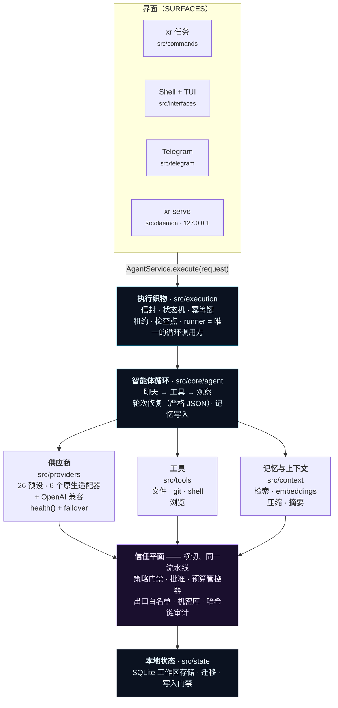
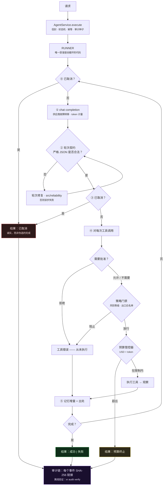

<div align="center">


# XR

**一个真正可审计的 AI 智能体运行时。**

*给它一个任务。它会规划、调用工具，并在你的机器上改真实的东西 —— 一切受策略门禁、你的批准、花费上限，以及可离线验证的哈希链日志约束。*

[](https://github.com/ahmadrrrtx/xr/actions/workflows/ci.yml)
[](https://www.npmjs.com/package/@rrrtx/xr)
[](LICENSE)
[](docs/release/SUPPORT_MATRIX.md)

📄 **语言：** [English](README.md)（规范文本）· [اردو](README-ur.md) · [Español](README-es.md) · [Français](README-fr.md) · [Deutsch](README-de.md) · [Português](README-pt-BR.md) · [中文](README-zh-CN.md) · [日本語](README-ja.md) · [हिन्दी](README-hi.md)

[快速上手](#快速上手) · [XR 是什么](#xr-是什么） · [工作原理](#xr-的工作原理) · [供应商](#供应商) · [安全](#安全--信任平面)

</div>

**版本：** `1.1.0 (Graphite)` · **包：** [@rrrtx/xr](https://www.npmjs.com/package/@rrrtx/xr) · **许可证：** MIT

XR —— 本地优先、供应商中立的 AI 智能体运行时。BYOK、费用封顶、防篡改审计、插件/MCP 可扩展。

**内置技能：** 65 个（发布时从 `skills/` 统计）。

---

<div align="center">


**桌面外壳的真实构建。** 无论你使用哪个界面，每个动作都要过同一套批准、策略与预算门禁。

</div>

---

## XR 用大白话说是什么？

你在终端里输入一个任务。XR 算出步骤、调用语言模型并使用工具 —— 读写文件、执行命令、浏览网页、调用 API —— 直到任务完成，或坦诚地报告失败。

不同之处在于**环绕这个循环的东西**：

| | |
|---|---|
| 🔑 **密钥由你提供** | XR 不附任何 API 密钥或云端账户。它用*你的*供应商密钥，或*你的*机器上的本地模型。 |
| 🛑 **行动前会先问** | 有后果的动作会停下并等待你的批准。拒绝在执行路径上强制生效，而不是在提示词里"建议"。 |
| 💸 **追踪开销与上限** | USD/token 上限在循环中实时检查。USD 成本是估算值：一次回答可能超出请求限制，未知定价下无法实施绝对 USD 封顶。 |
| 🔗 **把做过的事写下来** | 每个事件都用 SHA-256 链进本地账本，用一条命令即可离线验证。 |
| 💻 **跑在你的机器上** | 一个 SQLite 数据库，零遥测，无强制联网。十个本地模型运行时是一等公民。 |
| 🆓 **所有本地功能永久免费** | 语音、记忆、主题、CLI、机器人、编辑器界面、研究、智能体、技能与 MCP —— [无付费墙，由测试证明](#价格)。 |

```bash
xr "总结本仓库中所有待办的 TODO 并起草一份清理计划"
```

> **开发预览版的安全边界：** 编码 CLI 在 `--dry-run` 下模拟文件写入与 shell 执行，但模型/读取/网络请求及审计/状态更新仍可能发生。不要把它当作针对不可信仓库的隔离环境，也不要视为绝对账单上限。详见 [CLI 契约与已知限制](docs/cli/CODING_CONTRACTS.md)。

**适合谁：** 在真实机器上自动化真实工作的开发者；需要事后审计智能体行为的团队；希望完全离线运行智能体的任何人。

---

## XR 是什么 —— 以及不是什么

**XR 是：** 自托管智能体运行时；供应商中立（26 个预设）；受治理（策略、批准、预算、审计在执行路径上强制）；可扩展（技能、插件、MCP）；在供应链上签名；MIT 许可，端到端可读。

**XR 不是：** 未通过 SOC 2 / ISO 27001 / HIPAA / PCI-DSS 认证；不是沙箱（进程内策略，不是内核/虚拟机隔离）；不是必须使用的服务；不是审查有后果行为的人类替代品；也尚未完成 —— [已知限制登记册](docs/security/KNOWN_LIMITATIONS.md)是一类一等发布产物。

---

## 快速上手

### 1. 安装

| 渠道 | 平台 | 命令 |
|---|---|---|
| **npm**（稳定 `latest`） | Linux · macOS · Windows · Termux | `npm i -g @rrrtx/xr` |
| **二进制** | Linux · macOS · Termux · WSL | `curl -fsSL https://raw.githubusercontent.com/ahmadrrrtx/xr/main/install.sh \| bash` |
| **二进制** | Windows PowerShell 5.1 / 7+ | `iex (irm https://raw.githubusercontent.com/ahmadrrrtx/xr/main/install.ps1)` |
| **Homebrew** | macOS · Linux | `brew install ahmadrrrtx/tap/xr` |
| **WinGet** | Windows | `winget install ahmadrrrtx.XR` |
| **Scoop** | Windows | 从 release 下载 `scoop/xr.json` · `scoop install ./xr.json` |
| **.deb** | Debian · Ubuntu | `sudo dpkg -i xr_*_amd64.deb` |
| **Docker** | 任意 | `docker run ghcr.io/ahmadrrrtx/xr:latest` |
| **源码** | 任意 | `git clone https://github.com/ahmadrrrtx/xr && cd xr && bun install` |

### 2. 首次运行

```bash
xr onboarding        # 引导式设置（供应商 + 记忆 + 可选语音）
xr doctor            # 健康检查 —— XR 实际无法工作时以非零码退出
```

### 3. 你的第一个任务

```bash
xr "hello, XR"                 # 一次性任务
xr                             # 全屏交互外壳
xr serve                       # 面板 + 聊天位于 http://localhost:3141 (127.0.0.1，令牌认证)
```

新手？走完黄金路径：[`docs/development/GETTING_STARTED.md`](docs/development/GETTING_STARTED.md)。

### 完全离线运行

```bash
ollama serve && ollama pull qwen2.5:7b   # 10 个受支持的本地运行时之一
xr providers set ollama qwen2.5:7b
xr "重构这个函数"                          # 无需网络
```

---

## XR 的工作原理

每一个界面 —— CLI、外壳、Telegram、守护进程聊天 —— 都汇入**同一次调用**。没有旁门：策略、批准、预算、取消与审计都是流水线的属性，任何接口都无法绕过。



### 一个任务会发生什么



### 设计原则

1. **每个问题只有一个计算权威。** 回答你问题的模块，也对所有界面和 CI 回答 —— doctor 的 readiness 引擎就是 onboarding 的能力扫描；跨平台套件就是按 OS 执行的同一文件清单。
2. **不允许绕过 runner。** 每一轮都走 信封 → runner → 循环。
3. **诚实的结果。** 绝不伪造完成。
4. **可检查的状态。** 一个 SQLite、哈希链审计事件、可导出的会话、可复现的清单。
5. **快路径保持快。** 热路径零同步 FS/进程 I/O（lint 强制），预算由 CI 守护。

---

## 供应商

**26 个内置预设 —— 16 个托管与 10 个本地运行时。** 随时切换，无需重启。

6 个托管供应商使用专用原生适配器（Anthropic、Cerebras、Cohere、Google、Mistral、AWS Bedrock —— `src/providers/native/`）。其余 —— 其他托管供应商和全部 10 个本地运行时 —— 通过单一传输层讲 OpenAI 兼容协议，自定义预设可指向任何兼容的 base URL。

```bash
xr providers list                    # 26 个预设 · 默认模型 + 能力
xr providers set openai gpt-4o-mini
xr providers add claude              # 密钥掩码输入 → 系统钥匙串，否则 AES-256-GCM 密封文件
xr providers test                    # 对已配置供应商做存活探测
```

切换模型走 **预检 → 金丝雀 → 切换 → 验证** 状态机，新模型不可达时自动回滚（`--force` 跳过探测）。

---

## 安全 —— 信任平面

### XR Shield —— 执行边界

**XR Shield** 是七个组件的名字：每个有后果的动作都要经过它们。它不是产品层级，也不是扫描器：它是能说*不*的代码。一次导入即可枚举 —— `src/xr-shield/index.ts`。

| # | 组件 | 位置 | 回答的问题 | 能拒绝吗？ |
|---|---|---|---|---|
| 1 | **能力策略** | `src/capabilities/policy.ts` | 该能力在当前工作区与模式下被允许吗？ | ✅ |
| 2 | **动作守卫** | `src/security/guard.ts` | 动作经完整解码与规范化后是否危险？ | ✅ |
| 3 | **信任网格 + 放置** | `src/runtime/trust/` | 风险层级是什么，允许在哪运行？ | ✅ |
| 4 | **同意 / 批准** | `src/control/approval-store.ts` | 人类批准了吗？（持久，TTL 默认拒绝） | ✅ |
| 5 | **网络出口** | `src/security/egress-proxy.ts` | 目的地被允许吗？ | ✅ |
| 6 | **执行 + 输出完整性** | `src/security/exec-integrity.ts`、`tool-output.ts`、`secret-broker.ts` | 二进制被允许吗？工具输出是否作为数据回流？机密是中转而非交付吗？ | ✅ |
| 7 | **签名的审计证据** | `src/security/audit-signer.ts`、`audit-verify.ts` | 事后能否证明，篡改能被发现吗？ | ➖ 记录 |

该表由 `XR_SHIELD_COMPONENTS` 生成，`test/architecture/xr-shield-facade.test.ts` 会在任一列出的模块消失时失败 —— 文档无法与代码漂移。

> **诚实声明：** XR 实施的是**进程内策略**，不是内核/虚拟机隔离 —— 是护栏，不是监禁围栏，也不能替代人工审查。缺口有书面记录：[`docs/security/KNOWN_LIMITATIONS.md`](docs/security/KNOWN_LIMITATIONS.md)。

安全架构、威胁模型与漏洞披露：[`SECURITY.md`](SECURITY.md)。

---

## 供应链 —— 已签名、有出处、可验证

每次推送 tag，一条流水线完成构建、签名、发布与自验证。npm 通过 *OIDC trusted publishing* 发布（发布路径上没有长期 npm 令牌）。

- **二进制渠道**（GitHub Releases、Homebrew、WinGet、Scoop、`.deb`、Docker）：对 `SHA256SUMS` 做 cosign *keyless* 签名，附 CycloneDX SBOM 与 SLSA3 出处 —— 验证见 [`docs/release/VERIFYING_RELEASES.md`](docs/release/VERIFYING_RELEASES.md)。不同发布线的资产集合不同；发布什么，就在打 tag 时签名什么。
- **npm**：以 **provenance attestation** 发布，绑定到 tag 提交。
- **CI 卫生：** `--ignore-scripts` 安装、osv-scanner + `bun audit`、gitleaks 密钥扫描、许可证扫描与 SBOM 漂移门禁每次运行都执行。
- **渠道不会滞后：** 渠道配置由发布清单**生成**并漂移门禁（`bun run channel:check`）；tag ⇔ npm 不变量在 CI 中检查。

---

## 能力

- **技能**（`skills/`）：内置 65 个（`xr-skill.json` 清单）。
- **插件**（`src/plugins/`）：显式权限、哈希校验、完整生命周期。
- **MCP**（`src/mcp/`）：客户端 + 管理器 + 注册表 —— stdio、SSE、HTTP、白名单化。
- **记忆**（`src/context/`）：同意优先捕获、可解释检索、TTL。
- **研究**（`src/research/`）：默认离线；公共网络仅主动开启。
- **语音**与**计算机控制**：本地优先适配器，同样过批准门禁。
- **多智能体工作流**：确定性计划 + 受限并发通道 + 工件校验器；一棵由根资助的预算树。

---

## 各界面

**桌面外壳**（`desktop/`，Tauri v2 + React —— 同一个智能体，加上窗口）：

| | |
|---|---|
| 🛰 **常驻** | 关窗后托盘保留引擎、快捷键与批准角标 |
| ⌨️ **全局且诚实** | HUD、按住说话、截屏提问在失焦下可用；被 OS 占用的组合键会降级并明示 |
| 🔄 **签名自更新** | Stable/Beta/Nightly 通道，Ed25519 验证载荷；没有发布密钥则拒绝更新 |
| 🧯 **诚实崩溃恢复** | 标记文件检测；被截断的运行标记为 `killed`，绝不标"已完成" |
| 🪟 **关键处原生** | macOS HIG 菜单、Windows MSIX 深链 + 通知激活、Linux Flathub 就绪 Flatpak |

**移动伴侣**（`mobile/`）：仅在你自己的 Wi-Fi 上 —— `xr serve --lan`、QR + 6 位一次性配对码、首次使用固定 TLS（指纹比对）、移动会话在 `/files`、`/terminal`、`/git`、`/mcp` 被 403、诚实的离线程列。见 [`docs/mobile/PWA.md`](docs/mobile/PWA.md)。

**机器人（Telegram、Discord、WhatsApp）**：机器人运行在你的守护进程里 —— 无云中转 —— 只转发被允许的工作。未知发送者收不到**任何**回复。详见 [`docs/phases/26-bots-discord-whatsapp.md`](docs/phases/26-bots-discord-whatsapp.md)。

**VS Code**（`extensions/vscode/`）：同一智能体进入编辑器，同样的受治理流水线。

---

## 性能 —— 预算，而非吹嘘

每一项性能声明都是**公开预算 + 实测基线 + CI 回归门禁**（`docs/perf/PERF-BUDGETS.md`）：

| 界面 | 预算 | 实测（1.0.0 基线） |
|---|---|---|
| `--version` / `--help` 热 p95 | < 150 ms | 39.8 / 40.5 ms |
| `--version` / `--help` 冷 p95 | < 300 ms | 40.8 / 42.5 ms |
| `doctor` | < 1 s | 586 ms p95 |
| 路由决策 | < 20 ms | 亚毫秒 |
| 面板首屏渲染 | < 1 s | 12.1 ms |

---

## XR 如何自证

差异化在于：申明由机器在每个 PR 上检查 —— 完整测试套件、版本一致性门禁、claim 门禁、基线清单、分层、代码库体积、API 模式、发布渠道与供应链电池。确切数值与 LOC 上限公布在规范（英文）README 中，附实测基线（[`docs/release/TEST-BASELINE.json`](docs/release/TEST-BASELINE.json)）。

---

## 文档地图

| 文档 | 用途 |
|---|---|
| [`docs/CONSTITUTION.md`](docs/CONSTITUTION.md) | 代码引用的"法律"（30 条 + 诫律） |
| [`AGENTS.md`](AGENTS.md) · [`CONTRIBUTING.md`](CONTRIBUTING.md) · [`SECURITY.md`](SECURITY.md) | 操作员简报 · 贡献指南 · 安全策略 |
| [`docs/development/GETTING_STARTED.md`](docs/development/GETTING_STARTED.md) | 端到端黄金路径 |
| [`docs/security/KNOWN_LIMITATIONS.md`](docs/security/KNOWN_LIMITATIONS.md) | 规范的已知限制登记册 |
| [`docs/release/SUPPORT_MATRIX.md`](docs/release/SUPPORT_MATRIX.md) | 平台/渠道支持真相 |
| [`docs/HISTORY.md`](docs/HISTORY.md) | 版本阶梯 |
| [`docs/`](docs/README.md) | 完整文档索引 |

---

## 贡献

请先阅读 [`CONTRIBUTING.md`](CONTRIBUTING.md) 与 [安全策略](SECURITY.md)；智能体从 [`AGENTS.md`](AGENTS.md) 开始。标准对人类与智能体一致：每次改动自带测试、通过本地门禁电池、claims 保持诚实。

```bash
git clone https://github.com/ahmadrrrtx/xr && cd xr
bun install --frozen-lockfile
bun run ci
```

发现不准确的声明？有专门的问题模板（[false claim](.github/ISSUE_TEMPLATE/false_claim.yml)）。

---

## 价格

**XR Personal 永久免费，包含本仓库的全部功能。** 无遥测、无席位、无时间限制。只有八个*托管服务*受许可约束（[`src/cloud/license.ts`](src/cloud/license.ts) 中的 `BUSINESS_FEATURES`），它们不在你的机器上运行。**XR Business：每用户每月 $15**（30 天试用，无需信用卡）；Enterprise 按合同报价。两条由测试强制的铁律：**任何本地功能永不上付费墙**，**BYOK 永远免费且直连**。

---

## 许可证

[MIT](LICENSE) · XR —— 一个你可以审计的本地优先智能体运行时。

> *简体中文译本；规范文本以英文 README 为准。命令、路径与代码块不翻译。*
