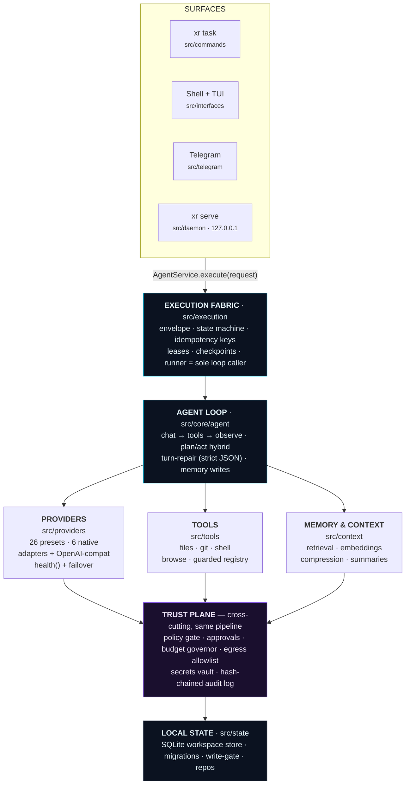
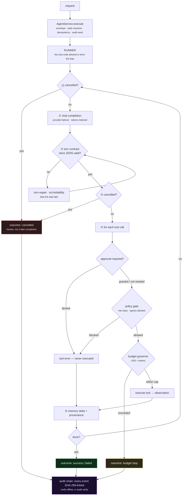
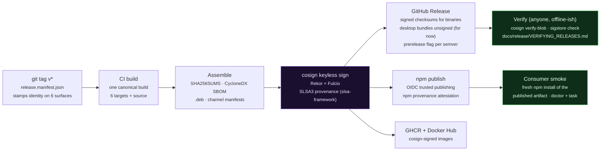
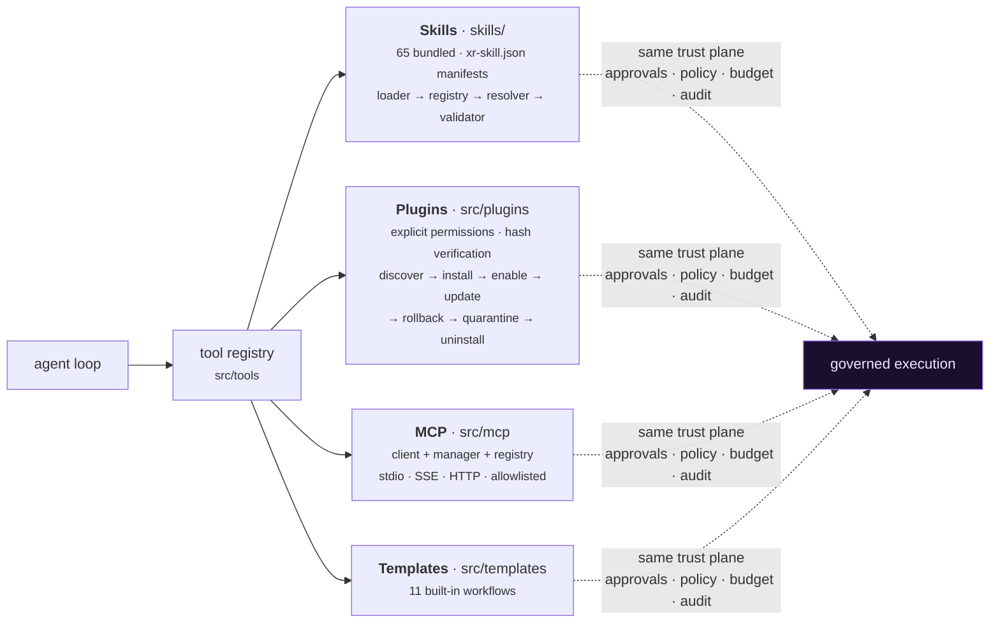

<div align="center">


# XR

**An AI agent runtime you can actually audit.**

*Give it a task. It plans, uses tools, and changes real things on your machine — under a policy
gate, your approval, estimated-spend admission checks, and a hash-chained log you can verify offline.*

[](https://github.com/ahmadrrrtx/xr/actions/workflows/ci.yml)
[](https://github.com/ahmadrrrtx/xr/actions/workflows/cross-platform.yml)
[](https://github.com/ahmadrrrtx/xr/actions/workflows/supply-chain.yml)
[](https://www.npmjs.com/package/@rrrtx/xr)
[](LICENSE)
[](tsconfig.json)
[](https://bun.sh/)
[](docs/release/SUPPORT_MATRIX.md)

📄 **Languages:** [English](README.md) · [اردو](README-ur.md) · [Español](README-es.md) · [Français](README-fr.md) · [Deutsch](README-de.md) · [Português](README-pt-BR.md) · [中文](README-zh-CN.md) · [日本語](README-ja.md) · [हिन्दी](README-hi.md) — *English is the source of truth.*

[Quick start](#quick-start) · [What XR is](#what-xr-is--and-what-it-is-not) · [How it works](#how-xr-works) · [Providers](#providers) · [Security](#security--the-trust-plane) · [Supply chain](#supply-chain--signed-provenanced-verified) · [Docs](#documentation-map) · [Contributing](#contributing)

</div>

<!-- XR:RELEASE-IDENTITY:BEGIN -->
<!-- GENERATED from release.manifest.json — do not edit by hand. Run: bun run release:stamp -->

**Version:** `1.1.1-rc.1 (Graphite)` · **Package:** [`@rrrtx/xr`](https://www.npmjs.com/package/@rrrtx/xr) · **License:** MIT

> **Status: Developer preview.** APIs and behavior may change without a deprecation cycle. Check the [known-limitations register](docs/release/1.1.1-rc.1/known-limitations.md) and [candidate evidence](docs/release/RELEASE_CANDIDATE_REPORT.md); a preview label does not imply native-platform or signing validation.

> **Version source of truth:** [`release.manifest.json`](release.manifest.json). Every surface —
> `src/core/version.ts`, `package.json`, this README, `install.sh`, `install.ps1` and the website —
> is stamped from that one file, and CI fails the build if any of them drift
> (Constitution Article XXII.1).

XR — a local-first, provider-neutral AI agent runtime. BYOK, budget-governed, tamper-evident audit, plugin/MCP extensibility.

**Bundled skills:** 65 (counted from `skills/` at release time.)

> **Install channels currently serve `1.0.0`.** `1.1.1-rc.1` is the in-development line on
> `main`: it is not published to npm, Homebrew, WinGet, Scoop or Docker, and the installers below
> install `1.0.0`. See [docs/release/CHANNELS.md](docs/release/CHANNELS.md#public-version).
<!-- XR:RELEASE-IDENTITY:END -->

---

<div align="center">


**The desktop shell, real build.** Every action below passes the same approval, policy and
budget gates — no matter which surface you are on.
[Historical desktop packaging evidence](docs/release/DESKTOP-SUPPORT-MATRIX.md) does not validate this modified candidate. Native platform/signing results are blocked or not run; see the [candidate report](docs/release/RELEASE_CANDIDATE_REPORT.md).

</div>

---

## What is XR, in plain language?

You type a task in your terminal. XR figures out the steps, calls a language model, and uses
tools — reading and writing files, running commands, browsing, calling APIs — until the task is
done or it honestly reports that it failed.

The difference is **what surrounds that loop**:

| | |
|---|---|
| 🔑 **You bring the key** | XR ships no API key and no cloud account. It runs on *your* provider key or a model running on *your* machine. |
| 🛑 **It asks before it acts** | Consequential actions stop and wait for your approval. Denial is enforced in the execution path, not suggested in a prompt. |
| 💸 **It tracks spending and checks task limits** | USD/token limits are checked during the loop. USD costs are estimates: a response can exceed the requested limit, and unknown pricing cannot enforce a USD cap. |
| 🔗 **It writes down what it did** | Every event is SHA-256-linked into a local chain you can verify offline with one command. |
| 💻 **It runs on your machine** | One SQLite database, no telemetry, no mandatory network. Ten local model runtimes are first-class. |
| 🆓 **Every local feature is free** | Voice, memory, themes, CLI, bots, the editor surface, research, agents, skills and MCP are on the free tier permanently — [no paywall, by test](#pricing). |

```bash
xr "summarize the open TODOs in this repo and draft a cleanup plan"
```

> **Development-preview safety limits:** the coding CLI simulates file writes and shell execution
> under `--dry-run`, but model/read/network requests and audit/state updates can still occur.
> Coder `--resume` and non-agent `--mode` requests are explicitly refused rather than ignored;
> the legacy `xr run` checkpoint/mode paths remain available. Workspace symlink confinement,
> strict USD-cap guarantees, and desktop-wide emergency pause remain release-blocking work.
> Do not treat this snapshot as safe isolation for untrusted repositories or as an absolute billing cap.
> See [coding CLI contracts and known limits](docs/cli/CODING_CONTRACTS.md).

**Who it's for:** developers automating real work on real machines; teams that need an agent's
actions to be reviewable after the fact; anyone who wants an agent that runs fully offline.

---

## Quick start

### 1. Install

Every public channel serves the same canonical **v1.0.0** build (`channels.publicVersion` in
[`release.manifest.json`](release.manifest.json)). Status is checked against the live registries
by `bun run channel:live`; see [`docs/release/CHANNELS.md`](docs/release/CHANNELS.md#public-version).

| Channel | Platform | Command | Status |
|---|---|---|---|
| **Installer** (verified binary) | Linux · macOS · WSL · Termux¹ | `curl -fsSL https://raw.githubusercontent.com/ahmadrrrtx/xr/main/install.sh \| bash` | ✅ live |
| **Installer** (verified binary) | Windows PowerShell 5.1 / 7+ | `iex (irm https://raw.githubusercontent.com/ahmadrrrtx/xr/main/install.ps1)` | ✅ live |
| **npm** (`latest`) | Linux · macOS · Windows | `npm i -g @rrrtx/xr` (needs [Bun](https://bun.sh) ≥ 1.3 on `PATH`) | ✅ live |
| **Docker** | linux/amd64 · arm64 | `docker run ghcr.io/ahmadrrrtx/xr:1.0.0` | ✅ live |
| **Scoop** | Windows x64 | download `xr.json` from the [v1.0.0 release](https://github.com/ahmadrrrtx/xr/releases/tag/v1.0.0) · `scoop install ./xr.json` | ✅ live |
| **.deb** | Debian · Ubuntu (amd64) | download `xr_1.0.0_amd64.deb` from the release · `sudo dpkg -i xr_1.0.0_amd64.deb` | ✅ live |
| **Homebrew** | macOS · Linux | `brew install ahmadrrrtx/tap/xr` | ⏳ tap publish pending |
| **WinGet** | Windows x64 | `winget install ahmadrrrtx.XR` | ⏳ community-repo review pending |
| **From source** | any | `git clone --branch v1.0.0 https://github.com/ahmadrrrtx/xr && cd xr && bun install --frozen-lockfile` | ✅ |

¹ Platforms without a compiled binary (Termux, Windows ARM64, Alpine/musl) get the same
release's checksum-verified source archive, which needs Bun. Pin a release with
`… | bash -s -- --version=1.0.0` (PowerShell: `-ReleaseVersion 1.0.0` when running the file).
The installers never fall back to an unreleased branch: if the release or its checksums are
missing, they stop and install nothing. Windows ARM64 is **unverified**: XR's file tools need
`bun:ffi`, which the pinned Bun disables on native Windows ARM64, so they refuse to run there
for now ([support matrix](docs/release/SUPPORT_MATRIX.md)). Alpine/musl source installs are
limited the same way: the file tools load glibc's `libc.so.6` and refuse to run without it.
The Docker image is Debian-based (glibc) for that reason. **Linux arm64** (including the
`linux/arm64` image) is limited too: XR installs and runs, but the file tools fail closed
(`blocked:filesystem-unsupported`), so reading and writing workspace files needs Linux x64,
macOS or Windows x64 for now. Its CI journeys are reported, not gating.

Where things go: the installers put XR's program files in `~/.xr-agent` (Windows:
`%USERPROFILE%\.xr-agent`); set `XR_INSTALL_DIR` to an absolute path to choose another
directory. `XR_HOME` is XR's **data** home (config, databases, vault; default `~/.xr`) and never
receives program files. Installers before this change used `XR_HOME` as the install directory
when it was set; a re-run leaves those files where they are and tells you how to remove them.
The installers refuse to run without a real, writable home directory (`HOME=/` or unset stops
them), and they refuse an install directory that is your home, a drive root, or the data home.

Per-platform support tiers: [`docs/release/SUPPORT_MATRIX.md`](docs/release/SUPPORT_MATRIX.md).

**Unpublished npm candidate:** its primary user surface is the coding agent;
the separate desktop application remains the full app. The in-development npm
package is designed to install its pinned Bun 1.4.2 platform package
automatically alongside Node 20+; it does not need an install script. Leave
optional dependencies enabled. If the runtime is missing and no system Bun is
available, XR reports how to reinstall; an independently installed Bun on
`PATH` is still a warned fallback. The Linux x64 runtime adds about 76 MiB
unpacked. Bun 1.4 x64 requires SSE4.2. This candidate is not yet released or verified on
all OS/CPU/libc combinations; the file-tool limitations above still apply.
Upstream Bun notices and the outstanding license-review gate are in
[`licenses/`](licenses/README.md).

### 2. First run

```bash
xr onboarding        # guided setup (provider + memory + optional voice)
xr doctor            # health check — exits non-zero if XR cannot actually work
```

`xr doctor` answers exactly one question: **can XR run a task right now?** It exits non-zero
when no provider is reachable and tells you the single next action. It never prints `ok` for a
system that cannot do work.

### 3. Your first task

```bash
xr "hello, XR"                  # one-shot task
xr                              # fullscreen interactive shell
xr serve                        # dashboard + chat at http://localhost:3141 (127.0.0.1, token-authed)
```

New here? Follow the golden path end to end:
[`docs/development/GETTING_STARTED.md`](docs/development/GETTING_STARTED.md).

### Run it fully offline

```bash
ollama serve && ollama pull qwen2.5:7b   # any of 10 supported local runtimes
xr providers set ollama qwen2.5:7b
xr "refactor this function"              # no network required
```

---

## How XR works

Every surface — the CLI, the shell, Telegram, the daemon's chat — funnels into **one call**.
There is no side door: policy, approvals, budget, cancellation and audit are properties of the
pipeline, so an interface cannot skip them.



### What happens to one task



A run ends `success`, `failed`, or `cancelled` — **never a fake completion**. Cancellation is
cooperative and real: in the Shell, `Ctrl+C`/`Esc` stop the current run (a pending approval is
denied fail-closed first); `xr run` maps the first `SIGINT` to a cooperative wrap and exits
`130`, a second forces exit. When an action genuinely cannot be interrupted, XR stamps the
honest outcome instead of claiming it stopped cleanly.

### Design principles

1. **One computation authority per question.** Whatever answers a question for you answers it
   for every surface and for CI — doctor's readiness engine is the onboarding capability scan;
   the cross-platform suite is one file list (`scripts/platform-parity.ts`) executed per OS;
   channel configs are generated, never handwritten.
2. **No bypass around the runner.** Every turn flows through one envelope → runner → loop
   pipeline, so governance cannot be skipped by an interface.
3. **Honest outcomes.** Never a fake completion.
4. **State you can inspect.** One SQLite database, hash-chained audit events, exportable
   sessions, reproducible inventory.
5. **Fast path stays fast.** Commands boot only the subsystems they need, the hot path performs
   zero synchronous FS/process I/O (lint-enforced), and budgets are CI-gated.

---

## Providers

**26 built-in presets — 16 hosted and 10 local runtimes.** Swap anytime, no restart, no re-config.

Six hosted providers use dedicated native API adapters (Anthropic, Cerebras, Cohere, Google,
Mistral, AWS Bedrock — `src/providers/native/`). Every other preset — remaining hosted providers
and all ten local runtimes — speaks the OpenAI-compatible protocol through one transport, and a
custom preset can point at any OpenAI-compatible base URL.

```bash
xr providers list                    # 26 presets · per-provider default model + capabilities
xr providers set openai gpt-4o-mini
xr providers add claude              # key entered masked → OS keychain, else AES-256-GCM sealed file
xr providers test                    # probe configured providers live
```

Switching models runs a **preflight → canary → swap → verify** state machine that rolls back
automatically if the new model cannot be reached (`--force` skips the probe). Counted from the
`PRESETS` map in `src/providers/presets.ts`.

<details>
<summary><b>Full provider table with default models</b></summary>

| Provider | Type | Default model |
|---|---|---|
| **Ollama** | Local | `qwen2.5:7b` — auto-detect, model pull, free |
| **LM Studio, llama.cpp, Jan, LocalAI, vLLM, GPT4All, KoboldCPP, Text-Generation-WebUI, SGLang** | Local | picked per install |
| **Claude** (Anthropic) | Hosted · native adapter | `claude-3-5-sonnet-20241022` |
| **Gemini** (Google) | Hosted · native adapter | `gemini-1.5-flash` |
| **Mistral** | Hosted · native adapter | `mistral-small-latest` |
| **Cerebras** | Hosted · native adapter | `cerebras/csm-8b` |
| **Cohere** | Hosted · native adapter | `command-r-plus-08-2024` |
| **AWS Bedrock** | Hosted · native adapter | `claude-3-sonnet` |
| **OpenAI** | Hosted | `gpt-4o-mini` |
| **Groq** | Hosted | `llama-3.3-70b-versatile` |
| **DeepSeek** | Hosted | `deepseek-chat` |
| **Together AI** | Hosted | `Llama-3.3-70B-Instruct-Turbo` |
| **Fireworks** | Hosted | `llama-v3p1-70b-instruct` |
| **SambaNova** | Hosted | `Llama-3.1-70B-Instruct` |
| **Hugging Face** | Hosted | `Llama-3.1-8B-Instruct` |
| **OpenRouter** | Hosted | `anthropic/claude-3.5-sonnet` |
| **xAI** | Hosted | `grok-2-latest` |
| **Perplexity** | Hosted | `llama-3.1-sonar-large-128k-online` |
| + any OpenAI-compatible endpoint | Local/Hosted | your base URL |

Default models are the presets' launch defaults (`defaultModel`), not ceilings.

</details>

---

## Security — the trust plane

### XR Shield — the enforcement boundary

**XR Shield** is the name for the seven components every consequential action passes
through. It is not a product tier and not a scanner: it is the code that can say *no*.
Enumerable in one import — `src/xr-shield/index.ts` — so it can be audited as a unit.

| # | Component | Where | Question it answers | Can refuse? |
|---|---|---|---|---|
| 1 | **Capability policy** | `src/capabilities/policy.ts` | Is this capability permitted for this workspace and mode? | ✅ |
| 2 | **Action guard** | `src/security/guard.ts` | Is the action dangerous once fully decoded and canonicalized? | ✅ |
| 3 | **Trust lattice + placement** | `src/runtime/trust/` | What risk tier is this, and where may it run? | ✅ |
| 4 | **Consent / approvals** | `src/control/approval-store.ts` | Has a human approved this? (durable, TTL default-deny) | ✅ |
| 5 | **Network egress** | `src/security/egress-proxy.ts`, `private-ip.ts` | Is this destination allowed? | ✅ |
| 6 | **Execution + output integrity** | `src/security/exec-integrity.ts`, `tool-output.ts`, `secret-broker.ts` | Is this binary allowlisted? Is tool output framed as data before re-entering the prompt? Are secrets brokered, not handed over? | ✅ |
| 7 | **Signed audit evidence** | `src/security/audit-signer.ts`, `audit-verify.ts` | Can this be proven afterwards, and would tampering show? | ➖ records |

This table is generated from `XR_SHIELD_COMPONENTS`, and
`test/architecture/xr-shield-facade.test.ts` fails if a listed module stops existing —
the docs cannot drift from the code.

Alongside the boundary, two mechanisms constrain cost and supply chain:

| Mechanism | Where | What it enforces |
|---|---|---|
| Budget governor | `src/cost/governor.ts` | USD + token ceilings per task, checked before and during steps |
| Secrets at rest | `src/security/secrets.ts` | OS keychain where available; else AES-256-GCM sealed file (auto-migrates plaintext); redacted from all status output |
| Plugin trust | `src/plugins/` | Manifest permissions, tree hashes, static scan, health checks, disable/remove |
| Prompt injection | `src/core/agent.ts` | Tool output is treated as untrusted **data**, never as instructions |

> **Naming note (Phase 5):** `xr shield` used to be a *host scanner* — processes, startup
> items, privacy settings. It never governed agent actions, so it is now `xr hygiene`, and
> "XR Shield" names the boundary above. `xr shield` still works with a deprecation notice
> until 2.0.0. See [ADR-0027](docs/adr/0027-xr-shield-is-the-enforcement-boundary.md).

> **Honesty box:** XR enforces **in-process policy**, not kernel/VM isolation — a guard rail, not
> a confinement boundary, and not a substitute for reviewing consequential actions. The gaps are
> written down, not hidden: [`docs/security/KNOWN_LIMITATIONS.md`](docs/security/KNOWN_LIMITATIONS.md).
> Not certified against SOC 2, ISO 27001, HIPAA, PCI-DSS or FedRAMP.

Security architecture, threat model and vulnerability disclosure: [`SECURITY.md`](SECURITY.md).

---

## Supply chain — signed, provenanced, verified

Every tag push runs one pipeline that builds, signs, publishes and self-verifies. No step is
manual, and no long-lived npm token exists in the release path — npm publishing uses OIDC
trusted publishing.



- **Binary channels** (GitHub Releases, Homebrew, WinGet, Scoop, `.deb`, Docker): cosign keyless
  signatures over `SHA256SUMS`, a CycloneDX SBOM and SLSA3 provenance — verify with
  [`docs/release/VERIFYING_RELEASES.md`](docs/release/VERIFYING_RELEASES.md). The asset set differs
  per release lane (CLI channels and desktop bundles ship on their own tag lanes); whatever ships
  is signed at tag time.
- **npm**: published from the release workflow with npm **provenance attestation** bound to the
  release tag commit.
- **CI hygiene:** dependency installation with `--ignore-scripts`, osv-scanner + `bun audit`,
  gitleaks secret scan, license scan and SBOM drift gates on every run.
- **Channels can't lag:** channel configs are **generated** from the release manifest and
  drift-gated (`bun run channel:check`), and the tag ⇔ npm invariant is checked in CI.

---

## Capabilities

<details open>
<summary><b>Extensibility — skills, plugins, MCP</b></summary>



All four are reachable identically from every surface, and all four are governed by the same
trust plane — an MCP server gets no more privilege than a bundled tool.

</details>

<details>
<summary><b>Memory, research, voice, computer control</b></summary>

- **Memory** (`src/context/`): consent-first capture (only what you ask it to remember),
  categorized + scoped entries, TTL/expiry via `xr memory prune`, explainable retrieval
  (`xr memory recall "…"` shows match % and why), optional session summaries.
- **Research** (`src/research/`): offline by default; `xr research deep --allow-public-web` opts
  into live fetching with egress rules and per-run budgets; results carry source provenance.
- **Voice** (`src/voice/`): optional, local-first adapters; voice can trigger capabilities
  through the same governed pipeline — approvals still apply.
- **Computer control** (`src/control/`, `src/computer/`): guarded desktop actions behind the
  approval plane; the vision agent is opt-in; platform support and limits documented per OS.

</details>

<details>
<summary><b>Multi-agent workflows</b></summary>

`src/services/multi-agent-service.ts` + `src/agents/` compile a **deterministic plan** per
goal kind, then execute it as **bounded-concurrency lanes** — planner → parallel
worker lanes → reviewer → synthesizer, with a deterministic security gate between
stages and a read-only **artifact verifier** after synthesis:

- One funded tree: a workflow's root budget envelope is partitioned across workers in a single
  ledger transaction; it can never spend more than the root plus one in-flight step.
- Verifiers earn completion: claimed artifacts are re-checked against the workspace
  (hashes, missing files); the verdict must be strict-JSON — prose, garbage or a reject **fail
  the task**.
- Delegation is depth-capped at 1: workers carry minted identities, cannot spawn sub-workers,
  attempted grandchild spawns are refused and audited.
- Crashes are recoverable, honestly: per-step checkpoints carry a hash chain and the consumed
  meter; a tampered chain **refuses** to resume rather than pretending.
- Cancellation is workload-aware: stopping aborts the in-flight worker via a live run map;
  remaining work is marked, never silently dropped.

```bash
xr agents list
xr agents run "compare the three vendor pricing plans"
xr run "start a long task"          # journaled; crash-safe
xr run --resume <sessionId>
```

</details>

<details>
<summary><b>Phone &amp; social remotes — Telegram, Discord, WhatsApp</b></summary>

XR is remote-controllable from the phone you already carry, without a cloud relay: the bot
runs inside your daemon, on your machine, and only routes work it is explicitly allowed to.

**One framework, three adapters** (`src/bots/`): per-chat rate limits and budgets, one task per
chat with real cancellation, the 20-turn reply context, typing pulses, voice-note
transcription, and the **durable approval bridge** — the same approval record is shown on every
surface and the first answer wins, from the desktop, Telegram, Discord or WhatsApp.

- **Telegram**: 6-digit pairing code, DM-only, `/approve` inline buttons.
- **Discord**: `/xr pair`, DM + allow-listed channels, Message Content intent required, buttons
  for approvals, egress = `discord.com` + gateway + CDN only.
- **WhatsApp (most conservative surface)**: unofficial client (Baileys) — against WhatsApp's
  automated-use terms; opt-in and never bundled (GPL-3.0 dependency, XR ships permissive
  licenses only). QR companion link; empty allow-list after pairing; AES-256-GCM sealed session;
  no history scraping.
- **Fail-closed everywhere:** an unknown sender gets **no reply at all**.

Full decision record, tests, deviations: [`docs/phases/26-bots-discord-whatsapp.md`](docs/phases/26-bots-discord-whatsapp.md).

</details>

<details>
<summary><b>Business OS extension (optional, default-off)</b></summary>

A **default-off**, effect-verified extension over local-first records — no hosted service, no
SLA, no paid tier. Since Phase 5 it lives outside core ([ADR-0028](docs/adr/0028-satellite-extraction.md)):

```bash
bun add -g @rrrtx/business-os     # business operating layer
bun add -g @rrrtx/xr-enterprise   # org policy, audit export, SLOs, DR, evaluation harness
```

See [`docs/business-os-extension.md`](docs/business-os-extension.md) and the
[migration guide](docs/migration/PHASE-5-SATELLITES.md).

</details>

---

## The surfaces

**Desktop shell** (`desktop/`, Tauri v2 + React — the same agent with a window):

| | |
|---|---|
| 🛰 **Always alive** | Tray keeps the engine, shortcuts and approvals badge working when the window closes; menu shows today's spend and pending approvals in the platform's own idiom. |
| ⌨️ **Global, honestly** | HUD, push-to-talk and screenshot-a-region-and-ask work while unfocused; chords fall back when the OS owns them, and the Settings screen shows what the machine actually holds. |
| 🔄 **Signed auto-update** | Stable/Beta/Nightly channels, Ed25519-verified payloads, background download, one-click restart; no release key → refuses to update rather than updating unverified. **Not provisioned yet:** current desktop builds have no update feed ([signing runbook](docs/release/DESKTOP_SIGNING.md)). |
| 🧯 **Truthful crash recovery** | Marker-file detection; cut-off runs are marked `killed`, never "completed"; optional redacted report you choose to send. No telemetry anywhere. |
| 🪟 **Native where it counts** | macOS HIG application menu, Windows MSIX with deep links + toast activation, Linux Flathub-ready Flatpak. |

```bash
cd desktop && bun install && bun run dev:tauri        # compile the sidecar, run the shell
```

Verification status per platform, including what has *not* been run on real hardware:
[`docs/release/DESKTOP-SUPPORT-MATRIX.md`](docs/release/DESKTOP-SUPPORT-MATRIX.md).

<details>
<summary><b>Mobile companion (PWA), VS Code extension, scripting &amp; exit codes</b></summary>

**Mobile** (`mobile/`): same agent, window that never leaves your network — `xr serve --lan`,
QR + 6-digit single-use pairing code, TLS pinned on first use (fingerprint compare), mobile
sessions refused at `/files`, `/terminal`, `/git`, `/mcp` (403), Web Push sealed twice under a
key only the paired phone holds, honest offline outbox. Wire format and threat model:
[`docs/mobile/PWA.md`](docs/mobile/PWA.md) · [`docs/mobile/SECURITY.md`](docs/mobile/SECURITY.md).

**VS Code extension** (`extensions/vscode/`, preview — install the `.vsix` from [GitHub Releases](https://github.com/ahmadrrrtx/xr/releases)): the agent inside your editor, same governed pipeline.
It is not yet listed on the Visual Studio Marketplace or Open VSX. Install with
`code --install-extension xr-vscode-<version>.vsix`; a `.vsix` is attached to a release only once
the owner-run `publish-vscode` workflow has run for it, otherwise build one with
`cd extensions/vscode && npm ci && npm run build:vsix`. It pairs with the local daemon by
re-reading `xr serve`'s owner-only token file (`~/.xr/daemon/token`), so a daemon restart
reconnects without pasting a new token.

**Scripting:** `xr doctor --json` is the stable machine-readable entrypoint (redacted config,
provider readiness, `summary.runnable`; secrets never printed). Exit codes:

| Code | Meaning |
|---|---|
| `0` `1` `2` `3` `4` `5` `130` | ok · runtime/task failure · usage error · network · denied · not found · interrupted |

</details>

---

## Performance — budgets, not boasts

Every performance claim is a **published budget with a measured baseline and a CI regression
gate** (`docs/perf/PERF-BUDGETS.md`; baseline `docs/perf/baseline-1.0.0-source.json`):

| Surface | Budget | Measured (1.0.0 baseline) |
|---|---|---|
| `--version` / `--help` warm p95 | < 150 ms | 39.8 / 40.5 ms |
| `--version` / `--help` cold p95 | < 300 ms | 40.8 / 42.5 ms |
| `doctor` | < 1 s measured (gate ceiling 2500 ms on shared runners) | 586 ms p95 |
| route decision | < 20 ms | sub-ms |
| dashboard first render | < 1 s | 12.1 ms |
| retrieval @100k items | gate ceiling 250 ms | 24–29 ms |

The fast path performs **zero synchronous FS/process I/O** (lint-enforced), and a command boots
only the subsystems it needs (boot profiles).

---

## How XR proves itself

XR's differentiator is that its claims are checked by machines on every PR.

| Gate | What it pins |
|---|---|
| `bun test` + parity suite | **4,972 pass / 29 skip / 0 fail across 450 files** (root `bun test` scope; measured locally on Linux x64 with bun 1.4.2 at `a2b6a735`, 2026-10-22 — see [docs/release/TEST-BASELINE.json](docs/release/TEST-BASELINE.json); refresh step: [RELEASING.md §1g](docs/release/RELEASING.md)); one computation authority (`scripts/platform-parity.ts`) executed per OS on Linux/macOS/Windows via segmented runs with crash-class retry and file-level culprit attribution |
| `release:check` + `claim-lint` | version identity stamped everywhere; every public claim has evidence; prohibited/supervised terms fail the build |
| `baseline:inventory` | source-derived repository inventory regenerated and compared |
| `boundaries` + `ownership:check` + `size-gate` | layering, area ownership, per-file size discipline (waivers explicit) **and a <!-- XR:TREE-CEILING -->174,500<!-- /XR:TREE-CEILING -->-LOC ceiling on the whole tree** |
| `claim-lint` constitution gate | every `Article N` cited anywhere in `src/`, `test/`, `scripts/`, `.github/` exists in [`docs/CONSTITUTION.md`](docs/CONSTITUTION.md) |
| `api:schema:check` + `client:check` + `api:compat` | daemon OpenAPI schema, generated client, compatibility |
| `channel:check` | channel configs match the release manifest |
| supply chain | osv-scanner + bun audit, gitleaks, license scan, SBOM drift, `--ignore-scripts` hygiene, container scan; release artifacts cosign-signed with SLSA3 provenance and npm provenance attestation |
| Quality Gate | single required aggregation check over all of the above |

The evaluation harness moved to `@rrrtx/xr-enterprise` in Phase 5 ([ADR-0028](docs/adr/0028-satellite-extraction.md)):

```bash
bun add -g @rrrtx/xr-enterprise
xr-enterprise evaluate run --offline   # 14 suites, 38 scenarios, no network required
xr-enterprise evaluate claims          # every public claim mapped to its evidence
```

It is outcome-based: a scenario passes only when reality is inspected — an artifact on disk, a
durable record, a state transition, an audit-chain entry.

---

## Repository structure

```
xr/
├─ bin/xr                    compiled-binary-first launcher (falls back to source)
├─ src/                      core runtime — cli·commands·execution·core·services·providers·tools·
│                            security·xr-shield·state·context·daemon·bots·mcp·plugins·voice·…
├─ desktop/                  Tauri v2 + React shell (src-tauri = Rust)
├─ mobile/                   mobile companion PWA (independent version)
├─ cloud/                    optional hosted control plane (independent version)
├─ extensions/vscode/        VS Code surface
├─ satellites/               extracted packages, released separately (ADR-0028)
├─ skills/                   65 bundled skill manifests
├─ plugins/ scripts/ test/   bundled plugins · gates & release machinery · suite
├─ packaging/                homebrew · winget · scoop manifests (generated)
├─ docs/                     product, development, release, security, audits, historical
└─ website/                  docs/marketing site (Next.js; scanned by claim-lint)
```

Layering is enforced in CI: the `boundaries` gate + `test/architecture/*` pin allowed dependency
directions, and `bun run ownership:check` requires every source area to have an owning document.
Core imports **nothing** from `satellites/` — enforced three ways (dependency-cruiser rule,
boundary test, isolation test) — and `bun run size-gate` holds the whole tree under its
published ceiling ([register row #20](docs/security/KNOWN_LIMITATIONS.md)) so the 23,376 LOC
Phase 5 removed cannot quietly grow back.

---

## Uninstall & data

`xr uninstall` removes the binary, the PATH block the installer added and (with `--purge`) the data
directory; the exact matrix is in [`docs/development/GETTING_STARTED.md`](docs/development/GETTING_STARTED.md).
In shell startup files it removes only the marked `# >>> XR launcher >>>` … `# <<< XR launcher <<<`
block the installer wrote (and the single line older installers wrote); every other line,
including your own `PATH` edits, is left byte-for-byte as it was.

Updates follow the channel you installed from (`brew upgrade xr`, `winget upgrade ahmadrrrtx.XR`,
`apt-get install --only-upgrade xr`, `scoop update xr`). `xr update --check` shows the running and
published versions without changing anything. `xr update` on a binary or git install swaps
atomically with a health canary and automatic rollback; on an npm/bun global install it delegates to
`npm i -g` / `bun add -g`, verifies the installed version and re-installs the previous version if the
check fails. **npm users on 1.0.0:** that release's `xr update` cannot update itself (it looks for a
file the npm package did not ship) — run `npm i -g @rrrtx/xr@latest` once.

---

## Documentation map

| Doc | Purpose |
|---|---|
| [**`docs/CONSTITUTION.md`**](docs/CONSTITUTION.md) | **The law the codebase cites** — 30 Articles + the Commandments. Enforced: `claim-lint` fails if code cites an Article that isn't there |
| [`AGENTS.md`](AGENTS.md) · [`CONTRIBUTING.md`](CONTRIBUTING.md) · [`SECURITY.md`](SECURITY.md) · [`CODE_OF_CONDUCT.md`](CODE_OF_CONDUCT.md) | Operator briefing · contributor guide · security policy & disclosure · conduct |
| [`docs/development/GETTING_STARTED.md`](docs/development/GETTING_STARTED.md) | The golden path: install → onboarding → provider → first task → restart/resume → uninstall |
| [`docs/guides/cli-compat.md`](docs/guides/cli-compat.md) | Exit codes, global flags, `--yes` semantics, scripting envs |
| [`docs/security/KNOWN_LIMITATIONS.md`](docs/security/KNOWN_LIMITATIONS.md) | Canonical known-limitations register (living) |
| [`docs/release/SUPPORT_MATRIX.md`](docs/release/SUPPORT_MATRIX.md) · [`DESKTOP-SUPPORT-MATRIX.md`](docs/release/DESKTOP-SUPPORT-MATRIX.md) | Platform/channel support truth per release, desktop verification state per OS |
| [`docs/HISTORY.md`](docs/HISTORY.md) | Version ladder (0.2 → 3.x → 4.x → 7.x → 1.x) + the structural ladder |
| [`docs/migration/PHASE-5-SATELLITES.md`](docs/migration/PHASE-5-SATELLITES.md) | Phase 5: `xr shield`→`xr hygiene`, satellites, deprecation timeline |
| [`docs/release/RELEASING.md`](docs/release/RELEASING.md) · [`VERIFYING_RELEASES.md`](docs/release/VERIFYING_RELEASES.md) | Release runbook · cosign/SBOM/SLSA verification walkthrough |
| [`docs/launch/XR_LAUNCH_FINDINGS.md`](docs/launch/XR_LAUNCH_FINDINGS.md) | Launch audit, findings, fix log and release-readiness verdict |
| [`docs/REPO-HYGIENE-2026-10.md`](docs/REPO-HYGIENE-2026-10.md) | This repository's cleanup/hygiene pass — every delete/move with evidence |
| [`docs/`](docs/README.md) | Full documentation index |

---

## Contributing

Contributions are welcome — read [`CONTRIBUTING.md`](CONTRIBUTING.md) and the
[security policy](SECURITY.md) first; agents start at [`AGENTS.md`](AGENTS.md). The quality bar
is identical for humans and agents: every change ships with tests, passes the local gate
battery, and keeps claims honest.

```bash
git clone https://github.com/ahmadrrrtx/xr && cd xr
bun install --frozen-lockfile
bun run ci        # typecheck + tests + release:check + claim-lint + inventory + gates
```

Found an inaccurate claim in this README or the docs? That is a bug with its own issue template
([false claim](.github/ISSUE_TEMPLATE/false_claim.yml)) — please file it.

---

## Pricing

**XR Personal is free, forever, with every feature in this repository included.** Voice, local
memory, themes, the CLI, bots, the VS Code surface, the mobile PWA, research, agents, skills and
MCP are free, unlimited, and identical whether you are signed in or not. There is no seat
count, no time limit, no watermark, no nag screen, no telemetry, and no feature that a licence can
turn off — because the entire list of what a licence gates is eight *hosted* services
(`BUSINESS_FEATURES` in [`src/cloud/license.ts`](src/cloud/license.ts)) and not one of them runs on
your machine.

**XR Business is $15 per user per month** (or $12 equivalent, billed yearly) and adds the things
a hosted service can do that a local install cannot: team roles/invitations, shared team
workspaces, SSO administration, pooled managed models with a per-user quota, sensitivity-scanned
team memory sync, signed audit export, an admin console, and an opt-in cloud relay. A 30-day
trial needs no card; Enterprise is quoted per contract. Self-hosting the control plane is
documented in [`docs/business/SELF-HOST.md`](docs/business/SELF-HOST.md).

Two rules are enforced by tests, not by copy:

1. **No local feature is paywalled, ever.** `test/cloud/license.test.ts` fails the build if a
   local capability appears in the licence's feature list.
2. **BYOK stays free and direct.** Your own provider key goes from your machine to the provider;
   XR neither proxies nor meters it.

Cancelling leaves every local install untouched — permanently.

---

## License

[MIT](LICENSE) · XR — a local-first agent runtime you can audit.
