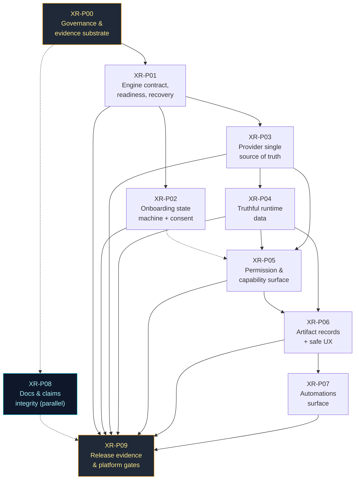

# XR v1 — Master Implementation Plan

**Plan revision:** R1 (initial verified revision)
**Plan Owner:** Principal Architecture / Release Gatekeeper (this agent)
**Verified baseline commit:** `6b9cb599aebbe8d8de8b100370c3a6434c3240e0` (`main`, 2026-11-01)
**Repository:** https://github.com/ahmadrrrtx/xr
**Status of this document:** authoritative for sequencing and scope. Supersedes no prior
document by deletion — see `DECISIONS.md` D-005 for the precedence rule over the four
pre-existing planning regimes (`XRD-009`).

**Companion documents (all required reading before any phase prompt):**

| Document | Purpose |
|---|---|
| [`AUDIT_VERIFICATION.md`](AUDIT_VERIFICATION.md) | Per-finding verdicts (`AUD-nnn`) + independently discovered defects (`XRD-nnn`) |
| [`PHASE_STATUS.md`](PHASE_STATUS.md) | Durable per-phase state table |
| [`PHASE_LEDGER.md`](PHASE_LEDGER.md) | Compact sequence/eligibility index |
| [`DECISIONS.md`](DECISIONS.md) | Dated decision log with options and trade-offs |
| [`EVIDENCE_LOG.md`](EVIDENCE_LOG.md) | Chronological commands, exit codes, environment limits |
| [`phase-prompts/`](phase-prompts/) | Versioned implementation prompts (generated on request only) |
| [`phase-reports/`](phase-reports/) | Per-attempt execution reports (success, failure, abandonment) |

---

## A. Executive summary

**XR at `6b9cb599` is a substantially more capable and more honest codebase than the
supplied audit describes — and it is not releasable, for reasons the audit mostly
missed.**

What is verified working at this commit: the engine boots and fails closed (401 without
a token, `E-05`); it serves **26 providers** with credential/authentication/health as
three separate states (`E-06`); the desktop derives its provider **catalog** from the
engine and that is pinned by passing tests (`E-08`); the agent loop's streaming, tool
events, cancellation and error truthfulness are pinned by 15 passing tests (`E-12`);
approval denial is enforced **below the UI** and audited (`E-23`); unknown model pricing
is `unavailable`, never zero (`E-23`); budget reservation/settlement is real
(`E-23`); the Linux suite is **5,119 pass / 0 fail / 41 skip across 473 files**;
root and desktop typechecks pass; the production renderer bundle contains **zero** seed
probes.

What the audit got wrong: the "~4 providers" symptom is **disproven** as a catalog
defect (26 presets, engine-derived, tested) — though a narrower provider defect is real;
the "fake budget/logs/brain-cell data" symptom is **disproven at this commit** (debug
gating + a clean production bundle) — though the *upgrade* path deserves a pinned
regression; and the audit's CI claim is **stale** — Supply Chain is now green, while
**two workflows it never mentions are red on the integration commit**.

**The real release blockers are different, and five of them are structural:**

1. **`main` is unprotected with zero required checks** (`E-16`). Every "we will not
   weaken a gate" promise in `AGENTS.md`, the Constitution and the previous ledgers is
   currently unenforceable by the platform. This is why `XR-P00` precedes everything.
2. **Two red native CI lanes at the integration commit** — macOS full parity and the
   Linux desktop journey (`E-14`) — with causes **unknown** because job logs require
   admin (`E-15`).
3. **No client↔engine contract negotiation** (`XRD-001`). The desktop has an
   *independent* engine home by design, so app/engine version skew across an upgrade is
   normal, and it currently degrades silently.
4. **Onboarding has no success predicate and no consent record** (`XRD-004`,
   `XRD-012`). A user with a dead engine completes the wizard, and no terms/privacy
   acceptance exists anywhere in the codebase (`E-21`).
5. **Two competing provider sources of truth** and **two independent ~630-line Models
   screens write the same settings key** (`XRD-002`, `XRD-003`) — the precise
   duplicate-authority failure mode the audit warns about, which its own text did not
   detect.

Plus three product-level absences that the audit correctly identified: **no artifact
record or artifact UI at all** (`AUD-007`, zero matches in `desktop/src/screens/Chat/`);
**no automations surface** despite a real engine scheduler (`AUD-008`); and **no
capability/permission surface** over an enforcement plane that already works
(`AUD-006`).

**Recommended path:** do not add features. Execute one governance phase, then five
truthfulness phases that make the desktop an honest window onto the engine, then two
capability phases that expose what already exists, then a documentation-integrity phase,
then a release-evidence phase where every platform claim is earned by a native run at
the tagged candidate. Ship a **limited developer preview for Linux-x64 only** until
Windows and macOS have native evidence; claim nothing else.

---

## B. Verified current-state architecture

Traced from code, not from documentation. Node names are the real module paths.

```
                          ┌──────────────────────────────────────────┐
  desktop (Tauri v2)      │ desktop/src-tauri/src/                   │
  ┌───────────────────────┤  engine.rs        spawn sidecar, --port 0│
  │ React renderer        │                   --parent-pid, parse    │
  │ desktop/src/          │                   "Listening on"/"Token:"│
  │  screens/ (16)        │  engine_state.rs  banner+probe cache     │
  │  stores/ (zustand)    │  desktop_home.rs  ~/.xr-desktop (NO CLI  │
  │  engine/ (wire)       │                   import; XR_HOME forced)│
  │  budget/ brain/ runs/ │  win.rs / unix.rs containment (Job Obj / │
  └──────────┬────────────┤                   PDEATHSIG)             │
             │ HTTP + SSE │  data_safety.rs   integrity, VACUUM INTO │
             │ token:48hex│                   export, import backup │
             ▼            └──────────────────────────────────────────┘
  ┌───────────────────────────────────────────────────────────────────┐
  │ engine: src/daemon/server.ts  (ONE daemon; `xr serve`)            │
  │   routes/  80+ route files · contract.ts = OpenAPI source of truth │
  │   session-auth.ts (bearer) · security-headers.ts · api/v1/*        │
  └───────┬───────────────────────────────────────────────────────────┘
          │
  ┌───────▼───────────────────────────────────────────────────────────┐
  │ ONE execution spine                                               │
  │  src/execution/service.ts   policy gate → prepare → adapter invoke │
  │                             → observation → outcome/cost/audit     │
  │  src/execution/{state-machine,checkpoint,repository,lease,         │
  │                 recovery,retry-classification,lane}.ts             │
  │  src/core/{agent,app,kernel,event-bus,model-accounting}.ts         │
  └───┬──────────┬───────────┬────────────┬──────────────┬────────────┘
      │          │           │            │              │
  ┌───▼───┐ ┌────▼─────┐ ┌───▼──────┐ ┌───▼────────┐ ┌──▼───────────┐
  │provid-│ │security/ │ │cost/     │ │services/   │ │automation/   │
  │ers/   │ │guard,fs, │ │governor, │ │multi-agent-│ │triggers.ts   │
  │presets│ │shield,   │ │manager,  │ │orchestr.,  │ │(setInterval  │
  │(26) + │ │secret-   │ │pricing   │ │graph, task-│ │ 15s, pauseAll│
  │native │ │broker,   │ │(unknown≠0)│ │support     │ │ durable flag)│
  │adapters│ │audit-*  │ │reserve/   │ │(budget     │ │routes+contract│
  │+custom│ │tool-out- │ │settle     │ │ partition, │ │BUT desktop   │
  │       │ │put       │ │           │ │verifier)  │ │cannot reach  │
  └───┬───┘ └──────────┘ └───────────┘ └────────────┘ └──────────────┘
      │
  ┌───▼────────────────────────────────────────────────────────────────┐
  │ state: src/state/{store,migrations.ts(799 lines, versioned),…}     │
  │ SQLite + hash-chained audit · capabilities/ policy plane           │
  └────────────────────────────────────────────────────────────────────┘
```

### Responsibilities that are correct and must not be redesigned

- **One daemon, one runner.** `src/cli/router.ts` deliberately avoids statically
  importing the daemon; `src/execution/service.ts` is the only place that drives the
  agent loop. `AGENTS.md` rule 3 and `bun run boundaries` enforce this.
- **Fail-closed trust plane.** `execution/service.ts:1046-1103` denies when it cannot ask;
  `cost/pricing.ts:2-8` refuses to price the unknown; `reveal_policy.rs` will not launch
  a non-inert file.
- **Independent desktop home.** `desktop_home.rs` is a *deliberate* privacy boundary, not
  a bug. It is the reason the provider-settings symptom appeared, and the fix is to make
  the divergence explicit and engine-authoritative — **not** to merge homes.
- **Sidecar containment.** Three platform mechanisms plus a parent watch. Keep.
- **Engine-side artifacts verifier.** `multi-agent-orchestration.ts:210-284` already
  verifies claimed files against disk with hashes. It is the right foundation for the
  artifact *record* — do not write a second verifier.
- **Contract generation.** `docs/api/openapi.json` ↔ `contract.ts` is drift-gated by
  `test/api/openapi.test.ts` and `api:schema:check`. Any new route goes through it.

### Broken or duplicated boundaries (verified)

| # | Boundary | Evidence | Consequence |
|---|---|---|---|
| B1 | Desktop ⇄ engine **version/compat** | `transport.ts` has no handshake; only `apiVersion:"v1"` exists engine-side (`E-20`) | Silent degradation on upgrade |
| B2 | `provider catalog` (engine-derived) vs `configured providers` (desktop store) | `ModelsTab.tsx:299` reads `settingsStore.models.providers`; only 2 dialogs write it (`E-22`) | A provider configured engine-side is invisible; a desktop row can claim a provider the engine lacks |
| B3 | Two Models screens write one settings key | `screens/Settings/tabs/ModelsTab.tsx` + `screens/Budget/components/ModelsTab.tsx` (`E-22`) | Drift, double truth, future regression surface |
| B4 | Onboarding completion vs engine health | `StepAllSet.tsx` asserts nothing; `OnboardingGate` gates on a boolean (`E-21`) | "Set up" ≠ usable |
| B5 | Consent | no terms/privacy document, no acceptance record (`E-21`) | Not shippable; privacy promise unenforceable |
| B6 | `engineKnowsProvider` fail-open | `engine/providers.ts:33-36` | A credential write path defaults to "yes" when it cannot know |
| B7 | Artifact vocabulary | verifier exists; **no** `ArtifactRecord`, **no** generic API (`E-24`) | The product cannot show what it made |
| B8 | Automation plane vs surface | scheduler + 4 routes exist; zero desktop call-sites (`E-24`) | A shipped capability is unreachable |
| B9 | Permission plane vs surface | enforcement real; no consolidated capability surface (`E-23`) | Trust exists but is not demonstrable |
| B10 | Governance substrate | `protected: {enabled: false}` (`E-16`) | All other gates are advisory |
| B11 | Documentation integrity | 8+ docs with fused number/word tokens; stale README baseline (`E-18`, `E-19`) | Release artifacts are defective and claims drift |
| B12 | Declared gate list vs. enforced gate list | 22 gates in `bun run ci`, 5 run by no workflow; battery red at HEAD (`E-27`, `E-29`) | "CI-enforced" rules are not universally enforced |

### Areas that should remain unchanged

Provider adapter internals (`src/providers/native/*`, `openai-compat.ts`), the SSE
protocol, the SQLite schema except for **additive** migrations, the sidecar containment
code, the audit chain, the capability *policy* engine, `reveal_policy`, and every
existing gate. New behavior attaches to existing seams; it does not replace them.

---

## C. Verified findings and release blockers

Ranked. "User symptom" is what was reported; "verified cause" is what the code proves.

### Tier 0 — Blocking, structural (must be closed before any release claim)

| ID | Finding | Verified? | Why it blocks | Phase |
|---|---|---|---|---|
| `XRD-006` | `main` unprotected, zero required checks | ✅ `E-16` | Every other gate is unenforceable; a red suite can merge | `XR-P00` |
| `AUD-009` | macOS parity + Linux desktop journey red at `6b9cb599` | ✅ `E-14` | A red native lane at the integration commit is disqualifying | `XR-P09` (investigate in `XR-P01` where the readiness path is in scope) |
| `XRD-001` | No desktop⇄engine contract negotiation | ✅ `E-20` | Independent homes make version skew normal; failure is silent | `XR-P01` |
| `XRD-004` | Onboarding completes with no working engine/provider | ✅ `E-21` | First-run promise is unmet at the last step | `XR-P02` |
| `XRD-002` | Two provider sources of truth; fail-open credential check | ✅ `E-22` | Provider setup is the product's core; a wrong answer here is a wrong-answer class bug | `XR-P03` |
| `XRD-012` | No privacy/terms document exists | ✅ `E-21` | Consent cannot be implemented honestly without one; owner decision required | `XR-P02` (D-004) |
| `XRD-013` | 5 documented "CI-enforced" gates run in **no** workflow, and the documented battery (`bun run ci`) is **red at HEAD** on `changelog:check` | ✅ `E-27`, `E-29` | The gate list and the enforced list disagree; `AGENTS.md`'s "must be green before a PR" is not runnable | `XR-P00` (wire gates) + `XR-P08` (changelog sequencing) |

### Tier 1 — High (blocks a *trustworthy* v1, closable in one phase each)

| ID | Finding | Verified? | Phase |
|---|---|---|---|
| `AUD-007` | No artifact record / artifact UI / generic artifact API | ✅ `E-24` | `XR-P06` |
| `AUD-004` | No consent persistence; voice preview plays a different voice than it configures; not resumable | ✅ `E-21` | `XR-P02` |
| `XRD-003` | Duplicate Models screens | ✅ `E-22` | `XR-P03` |
| `XRD-005` | Onboarding not resumable; single boolean | ✅ `E-21` | `XR-P02` |
| `XRD-007` | Corrupted release documents (8+ files) | ✅ `E-18` | `XR-P08` |
| `AUD-006` | No consolidated capability/permission surface | Partial `E-23` | `XR-P05` |
| `AUD-005` (residual) | Seeded-DB upgrade path has no end-to-end regression | ✅ code / ⚪ test | `XR-P04` |
| `AUD-001` (code half) | No per-step onboarding boundary; `null` render while checking | ✅ `E-21` | `XR-P02` |

### Tier 2 — Medium (correctness/honesty, not blocking)

| ID | Finding | Verified? | Phase |
|---|---|---|---|
| `XRD-008` | README publishes a stale test baseline (4,972/450 vs 5,119/473) | ✅ `E-19` | `XR-P08` |
| `XRD-010` | Automation engine lacks restart/DST/duplicate-delivery tests | ✅ `E-24` | `XR-P07` |
| `AUD-011` (rest) | Claim surfaces otherwise honest and machine-gated | ✅ `E-10`, `E-13`, `E-17` | `XR-P08` |
| `XRD-009` | Four competing planning regimes | ✅ `E-25` | `XR-P00` (this document) |
| `E-10` note | `placeholder-lint` scans `website/src` only, not the renderer | ✅ `E-10` | `XR-P04` |

### Tier 3 — Deferred / not blocking v1 (explicitly out of scope)

- Native ARM64 parity claims, WSL/container parity claims (tier them, do not claim).
- Live provider quality benchmarks and competitor comparisons.
- Multi-agent UX redesign (the engine's bounded lanes, root budget partition, verifier and
  depth cap are already real and tested — `test/multi-agent-e2e.test.ts` 7 pass).
- Memory "self-learning" proposal pipeline (memory inspection/edit/delete/export already
  exists in `screens/Memory/*`; the *learning* pipeline is a feature, not a v1 gate).
- Mobile PWA device matrix (needs real devices).

### User symptoms → confirmed causes (what the user actually experienced)

| Reported symptom | Verified cause | Note |
|---|---|---|
| "Only ~4 providers shown" | **Not** the catalog (26, engine-derived, tested). Most consistent with an **engine-down** render: desktop fallback list = 10, onboarding fallback = **5** (`StepModelSetup.tsx:31-38`), plus the configured list being desktop-local (`XRD-002`) | The audit's headline provider finding is a *downstream* symptom of the readiness/config findings |
| "Linux: engine not connected" | Lifecycle sound; **no version negotiation** and no actionable incompatibility state (`XRD-001`); banner copy overstates a transient miss | Cause `UNVERIFIED` for the specific install; the *defect class* is confirmed |
| "Windows: black during onboarding" | **Cause unknown** (no Windows host). Confirmed: no per-step error boundary, and `null` returned while the completion check is pending | Must be closed with native evidence, not a patch-and-hope |
| "Fake budget/logs/brain data" | **Disproven at this commit** (debug-gated, bundle proven clean); residual risk only for upgrades from pre-fix builds | Regression needed, not a fix |
| "No terms/privacy, voice sample inaudible" | Consent **absent** (`XRD-012`); voice preview really is a **different** voice (Web Speech vs Piper) (`XRD-011`); "inaudible" `UNVERIFIED` (no audio device) | The honest defect is the substitution, not necessarily silence |
| "No chat progress / artifact shelf / open files" | Artifacts **absent**; progress events exist and are tested but lack a stage affordance | Fix = expose what exists + add the record |

---

## D. Target architecture

The target keeps **one** engine and **moves shared contracts down**, adding exactly three
new things. Everything else is correction of existing seams.

### New/changed authoritative contracts

1. **`EngineHandshake`** *(new, additive)* — `{ engineVersion, schemaVersion,
   contractVersion, capabilities[], startedAt }` exchanged at link time; the desktop
   refuses to enter `Ready` on an unsupported `contractVersion` and offers
   *Restart engine / Reinstall engine / Open diagnostics*. Lives in the existing
   `GET /api/v1/health` payload (extended, not replaced) + `src/daemon/routes/meta.routes.ts`.
2. **`ProviderConnection`** *(promoted)* — the engine becomes the **single owner** of
   "which providers are configured for this install": id, base URL, auth *reference*
   (never the secret), validation status, last test result, discovered models. The desktop
   renders this; presentation metadata stays local. The desktop settings
   `models.providers` array is reduced to **defaults only** (capability → model), with a
   one-way migration.
3. **`ArtifactRecord`** *(new, additive)* — id, session/run/agent, workspace-relative
   path, MIME, size, content hash, created/updated, verification state
   (`verified|missing|mismatch|unverified`). Produced by the **existing** file-tool
   outcome path and verified by the **existing** manifest/hash logic; exposed by a new
   versioned read API registered through `contract.ts` so OpenAPI/client drift gates
   apply automatically.

### Invariants the target architecture must preserve

- One runner (`execution/service.ts`), one policy plane (`capabilities/` +
  `security/guard.ts`), one ledger (`cost/governor.ts`), one audit chain, one OpenAPI
  source (`contract.ts`), one provider registry (`providers/registry.ts`).
- The desktop **never** computes a business decision (budget admission, policy, routing,
  verification) locally. It renders engine state and forwards user intent.
- Any new persisted data is an **additive** migration; destructive migration requires a
  documented backup/rollback (D-007).
- Fail-closed everywhere a credential, permission, price or approval is involved.

### Explicitly rejected alternatives

| Alternative | Why rejected |
|---|---|
| Merge desktop and CLI data homes | Destroys a deliberate privacy boundary (`desktop_home.rs`) and silently imports CLI secrets — the audit itself forbids this |
| Add a second provider registry / new router service | Duplicates `providers/registry.ts` + `capabilities/capability-resolver.ts`; violates AGENTS.md rule 3 |
| Rewrite the onboarding wizard on a new state-machine library | The defect is *missing predicates and records*, not the state library; a rewrite would lose 16 passing a11y/UI tests |
| Replace SQLite/state layer | No evidence of failure; `data_safety.rs` already provides integrity, export and backup |
| Build a UI-only permission system | The engine already enforces; a parallel system would create the exact bypass the audit warns about |
| Introduce LangGraph/Agents-SDK wholesale | XR already has durable checkpoints, bounded lanes, budget partition and a verifier; adopting an external runtime would replace a working spine (see §K) |

---

## E. Explicit scope

**In v1 (must ship):** clean-install first run on **Linux x64**; engine readiness with a
versioned handshake and a truthful failure taxonomy; provider truth (engine-owned
configured set, 26 presets visible, custom endpoint); consent + privacy notice;
resumable onboarding; real permissions surface; artifact records + safe preview in Chat
and a library; truthful empty states and dashboard numbers; repaired release documents
and a documentation-integrity gate; and a release-evidence pack whose platform claims are
earned per platform.

**Required for safety, not negotiable, may land inside the above phases:** fail-closed
provider identity, no consent bypass, no permission bypass, no price-unknown-as-zero, no
destructive migration, no secret in logs/previews.

**Enhancement (post-v1 unless a phase slot is free):** automations surface (`XR-P07` —
scheduled last), memory learning-proposal pipeline, multi-agent team-builder UX
polish, Windows/macOS code signing, ARM64 tiers, mobile device matrix, provider quality
benchmarks.

**Out of scope for v1 (explicitly, so no agent wanders into it):** new provider
protocols; a second agent loop; cloud control-plane changes (`cloud/`); mobile PWA
feature work; website marketing changes beyond `claim-lint`; plugins/MCP runtime changes;
`satellites/` packages; any performance "optimization" without a measured baseline;
any change to `AGENTS.md`, `docs/CONSTITUTION.md`, `docs/security/**`, `src/xr-shield/**`,
`.github/workflows/**` or `scripts/release-*` that is not an explicit, owner-approved
phase deliverable.

---

## F. Ordered implementation phases

Ten phases. Each is independently executable by a fresh agent, has one coherent
ownership boundary, and is small enough to review. Sizes are deliberately unequal where
risk is unequal.

> **Global rules for every phase** (restated in each prompt, non-negotiable):
> reproduce first; root-cause before code; failing test before fix; smallest sound
> correction; no unrelated cleanup; no gate/test weakening; no governance edit without
> D-001 approval; evidence returned as commands + exit codes + platform; the executor
> never marks its own phase accepted.

---

### XR-P00 — Governance and evidence substrate *(no product code)*

1. **Purpose.** Make every later guarantee enforceable. Establish this plan as the
   single authority and turn `AGENTS.md`'s rules into repository settings.
2. **Addresses.** `XRD-006` / `AUD-010` (branch protection), `XRD-009` (competing plans),
   the missing platform evidence index (`AUD-012` precondition).
3. **Why first.** Without required checks, every "tests must pass" exit criterion below
   is advisory. Sequencing anything else first would build on an unenforced promise —
   and `XRD-013` proves the gap is real today: five "CI-enforced" gates are not run by
   any workflow, and the documented battery cannot pass at HEAD.
4. **Prerequisites.** None. **Decisions required:** D-001 (branch protection — owner
   approval), D-005 (plan precedence), D-006 (required-check set).
5. **In scope.** `.github/` repository settings (via API/UI action by the owner);
   **wiring the five unenforced gates into `ci.yml`** (`placeholder-lint`,
   `desktop:sink-lint`, `ci-capability-gate`, `website:marketplace:check`, and — per
   D-020 — `changelog:check`);
   `docs/implementation/v1-release/**` (this doc set); a precedence banner added to the
   four prior planning docs (one-line pointer, no content deletion); an evidence index
   file listing what each platform may claim.
6. **Out of scope.** Any change to workflow *content*, test files, product code, or
   `AGENTS.md`/`CONSTITUTION.md` text.
7. **Files to inspect.** `.github/workflows/{ci,cross-platform,desktop-app,journey}.yml`,
   `CODEOWNERS`, `test/quarantine.json`, `docs/IMPLEMENTATION-PLAN.md`,
   `docs/IMPLEMENTATION_PLAN.md`, `docs/release/V1-RELEASE-LEDGER-2026-10-28.md`.
8. **Tests.** A **gate-inventory test** (`test/architecture/`) asserting every script
   named in the `ci` script string is invoked by at least one workflow (the gate list
   and the enforced list cannot drift again). Plus a recorded API read proving
   `protected.enabled=true` with a named required-check list, and a negative proof that
   a red PR cannot merge (a scratch branch with a deliberately failing commit, closed
   without merge).
9. **Functional acceptance.** `main` requires: the CI/Core, Cross-Platform, Desktop-App
   and Supply-Chain gate jobs; at least one review on `CODEOWNERS` paths; no bypass.
   Plan precedence banner present in all four prior docs.
10. **Security/privacy acceptance.** Protection must include the governance paths
    (`AGENTS.md`, `docs/CONSTITUTION.md`, `docs/security/**`, `src/xr-shield/**`,
    `scripts/release-*`, `.github/workflows/**`) as require-review.
11. **Reliability.** n/a. **Cross-platform.** n/a.
12. **Verification.** API read + screenshot/id of settings + the negative merge test.
13. **Failure recovery.** If protection breaks a legitimate workflow, record the exact
    blocked operation and amend D-006 — never disable protection to unblock.
14. **Risks.** Owner may not have admin; then the phase is `BLOCKED` with the exact
    permission needed, and **no later phase may claim enforceability**.
15. **Definition of done.** Protection on; required checks named; precedence rule merged;
    evidence index exists.
16. **Evidence returned.** API response, screenshot, negative-test record, files changed.
17. **Unlocks.** Every other phase (eligibility, not dependency of content).
18. **Next eligible.** `XR-P01` and `XR-P08` (independent workstream, see §G).

---

### XR-P01 — Engine contract, readiness and recovery truth *(runtime seam)*

1. **Purpose.** A desktop that cannot silently be wrong about its engine: explicit
   contract version, bounded readiness states, actionable failure taxonomy, honest
   diagnostics.
2. **Addresses.** `XRD-001` (no negotiation), `AUD-002` (partially — the actionable
   failure path), `AUD-001`'s cause (c) (sidecar failure leaving a blank document),
   precondition for `XR-P03`/`XR-P06`.
3. **Why here.** Every UI truth claim downstream needs a trustworthy "is the engine
   usable, and which engine is it?" answer. Nothing else can be verified without it.
4. **Prerequisites.** `XR-P00` `ACCEPTED`. **Decisions:** D-003 (contract-version policy),
   D-008 (readiness state vocabulary).
5. **In scope.** Extend `GET /api/v1/health` with engine/schema/contract versions +
   capability list (additive, via `contract.ts` so OpenAPI/client gates apply);
   `desktop/src/engine/transport.ts` handshake + typed incompatibility error;
   `desktop/src/stores/engineStore.ts` readiness state machine
   (`starting|ready|degraded|disconnected|failed(reason)`) with bounded timeouts;
   `EngineDownBanner` copy/actions aligned to the taxonomy; diagnostics export
   (redacted) surfacing the sidecar stderr tail that `engine_state.rs` already keeps.
6. **Out of scope.** Provider list semantics (`XR-P03`); onboarding flow (`XR-P02`);
   sidecar containment logic; anything that changes `engine.rs` spawn arguments;
   changing the SSE protocol.
7. **Files.** `src/daemon/routes/meta.routes.ts`, `src/daemon/routes/contract.ts`,
   `docs/api/openapi.json` (+ generator), `src/clients/daemon-client.generated.ts`,
   `desktop/src/engine/{transport,wire,types}.ts`, `desktop/src/stores/engineStore.ts`,
   `desktop/src/components/engine/EngineDownBanner.tsx`,
   `desktop/src-tauri/src/{engine,engine_state}.rs` (read-only unless a real gap is
   proven), `test/desktop/`, `test/daemon/`.
8. **Tests to create.** Contract: a health payload without `contractVersion` is treated as
   legacy and produces `degraded` + an actionable message (not `ready`). Store: each of
   the five states is reachable and no state is entered without an observed probe.
   Timeout: a sidecar that never prints a banner yields `failed` within a bounded window
   with the captured stderr tail, never an infinite `starting`. Redaction: the diagnostic
   export contains no token/key (specimen test).
9. **Functional.** A user can distinguish *engine still starting*, *engine incompatible*,
   *engine crashed*, and *engine rejected the session*, and each offers a working action.
10. **Security.** Diagnostics are redacted **by construction** (allow-list of fields, not
    a deny-list); the token is never placed in the export, logs, or error text.
11. **Reliability.** No unbounded wait; every readiness transition has a deadline;
    repeated respawns are bounded and surfaced.
12. **Cross-platform.** Logic is renderer/engine (all platforms); the native spawn path is
    untouched. Windows/macOS behavior remains `Not run`.
13. **Verification.** `bun test` for the new and adjacent tests; `bun run api:schema:check`,
    `client:check`, `api:compat`, `boundaries`, `typecheck`; a live local run of
    `xr serve` + desktop dev against it if a display is available.
14. **Failure recovery.** Additive health fields and a new store state are backwards
    compatible; revert = drop the fields/state, no migration.
15. **Risks.** Over-eager `degraded` could mask a healthy engine (mitigate: single source
    of truth for the state, tests for the happy path); a handshake could break dev-mode
    Vite proxy (mitigate: `via: 'sidecar'|'vite-proxy'` is already modelled in
    `EngineDownBanner.tsx:31`).
16. **Definition of done.** Five states reachable and tested; incompatibility is
    actionable and blocking; diagnostics redacted-by-construction; all listed gates green;
    OpenAPI/client regenerated by generator (never hand-edited).
17. **Evidence returned.** Diffs, commands+exit codes, the state-transition test output,
    a redaction specimen, and an explicit statement of what remains `Not run` (native
    Windows/macOS/display).
18. **Unlocks.** `XR-P02`, `XR-P03` (both consume readiness), `XR-P05`/`XR-P06` later.
19. **Next eligible.** `XR-P02` **and** `XR-P03` (disjoint files — see §G; parallel only
    with owner authorization).

---

### XR-P02 — Onboarding as a resumable, truthful state machine *(first-run trust)*

1. **Purpose.** A first run that cannot lie: versioned consent, real success predicates,
   resumability, honest voice preview, recoverable failures.
2. **Addresses.** `XRD-004` (no success predicate), `XRD-012` (no privacy doc),
   `AUD-004` (consent/voice), `XRD-005` (resumability), `XRD-011` (voice identity),
   `AUD-001` code half (per-step boundary + `null` render).
3. **Why here.** It is the first thing a new user meets and the phase where every other
   readiness/provider truth becomes visible. It must follow `XR-P01` (needs the readiness
   contract) and depends on D-004 for consent text.
4. **Prerequisites.** `XR-P01` `ACCEPTED`. **Decisions:** D-004 (consent documents —
   owner), D-009 (resumability scope), D-010 (voice preview policy).
5. **In scope.** `desktop/src/screens/Onboarding/*` (13 files), `stores/onboarding.ts`
   (per-step checkpoint; migrate the legacy boolean forward without losing completion),
   `screens/Settings` (re-open consent + data-flow notice), a new consent record
   `{docVersion, acceptedAt, surfaceScope}` persisted through the existing
   persistent-store, a per-step `ErrorBoundary`, replacing `null` renders with a real
   starting surface, an explicit **completion predicate** (engine `ready` **and**
   (provider configured **or** a consciously chosen limited mode)), voice preview that
   either plays the engine TTS path or is labelled as an approximation with a working
   failure state.
6. **Out of scope.** Provider catalog contents (`XR-P03`); permission surfaces
   (`XR-P05`); changing the 10-step narrative order beyond what the predicate requires;
   adding account/telemetry; legal *opinions* (the owner supplies D-004 text).
7. **Files.** `desktop/src/screens/Onboarding/{index.tsx,OnboardingScreen.tsx,
   StepPromise,StepVoice,StepAllSet,StepModelSetup,StepSystemCheck,parts}.tsx`,
   `desktop/src/stores/onboarding.ts`, `desktop/src/lib/persistent-store.ts`,
   `desktop/src/lib/detect.ts`, `src/voice/models.ts` (ids only),
   `docs/privacy/**` (new documents per D-004), `test/desktop/`.
8. **Tests.** Consent: refusing acceptance blocks completion; accepting persists a
   versioned record; changing the doc version forces re-acceptance. Predicate: an
   unhealthy engine cannot reach "done"; a healthy engine with a configured provider can.
   Resume: a crash between step N and N+1 resumes at N (not 1) and does not re-download.
   Boundary: a step that throws renders a recoverable card and the wizard stays alive.
   Voice: the preview path is asserted to be either engine-voiced or explicitly labelled.
9. **Functional.** A user can finish setup offline/unconfigured **only** into a clearly
   limited mode that says so; a user with a broken engine gets a recoverable state, never
   a blank window.
10. **Security/privacy.** Consent is recorded before any consequential action; no key is
    ever written into non-engine storage during onboarding; the data-flow notice states
    plainly that cloud providers receive the prompt/context sent to them.
11. **Reliability.** Every step has a bounded timeout and a retry; partial state is
    durable; no step advances because a timer expired.
12. **Cross-platform.** Renderer logic all platforms; mic/voice permission behavior is
    platform-specific and must be recorded as `Not run` on untested OSes.
13. **Verification.** New desktop tests + `bun run ci -lane` for renderer
    (`bun test test/desktop`, `tsc -p desktop`, eslint, `desktop:sink-lint`,
    `placeholder-lint`), plus a native/renderer walkthrough with screenshots if a display
    is available.
14. **Failure recovery.** Onboarding state migration must be additive: an existing
    `onboardingComplete` maps to "complete at current doc version = unknown" and prompts
    once, never re-runs the whole wizard. Rollback = keep the boolean and ignore the new
    record.
15. **Risks.** Blocking completion on engine health could trap users behind a broken
    engine (mitigate: the limited mode is always reachable and says what it cannot do);
    consent friction (mitigate: one screen, re-openable, not repeated).
16. **Definition of done.** Consent record visible in Settings with version+time;
    completion predicate tested both ways; resume tested; per-step boundary tested; voice
    honesty test; no `null` render path left in the wizard.
17. **Evidence returned.** As §F-global + `Not run` list for mic/audio/native.
18. **Unlocks.** `XR-P05`, `XR-P06` (a user can now reach a working shell).
19. **Next eligible.** `XR-P03` (if not already done in parallel), then `XR-P04`.

---

### XR-P03 — Provider single source of truth *(provider seam)*

1. **Purpose.** One authoritative answer to "which providers/models can this install use,
   and what is each one's state?" — engine-owned, desktop-rendered.
2. **Addresses.** `XRD-002` (two sources), `XRD-003` (duplicate Models screens),
   `AUD-003` residual (configured list), the fail-open `engineKnowsProvider`.
3. **Why here.** Provider setup is the product's core; it must be truthful before
   artifacts/automations build on model selection.
4. **Prerequisites.** `XR-P01` `ACCEPTED`. **Decisions:** D-011 (ownership of configured
   set), D-012 (merge strategy for the two Models screens).
5. **In scope.** Engine: expose **configured** connections (id, baseUrl, auth presence,
   validation status, discovered models, last test) — extend the existing
   `GET /api/v1/providers` shape additively; custom-endpoint CRUD already exists
   (`src/providers/custom.ts`) — verify and, if missing, expose through `contract.ts`.
   Desktop: render the configured list from engine state; keep presentation metadata
   (`providerCatalog.ts`) as-is; reduce `settingsStore.models.providers` to defaults with
   a one-way migration; extract the shared provider/model core out of the two Models
   screens and have `Settings` and `Budget` consume it; make `engineKnowsProvider`
   fail **closed**.
6. **Out of scope.** Adding presets; changing `presets.ts` metadata; routing policy
   (post-v1); secret storage backend; model pricing.
7. **Files.** `src/providers/{presets,registry,custom,health,capabilities}.ts`,
   `src/daemon/routes/providers.routes.ts`, `src/daemon/routes/contract.ts`,
   `docs/api/openapi.json`, `src/clients/daemon-client.generated.ts`,
   `desktop/src/engine/{providerCatalog,providers,types,wire}.ts`,
   `desktop/src/stores/settingsStore.ts`,
   `desktop/src/screens/Settings/tabs/ModelsTab.tsx`,
   `desktop/src/screens/Budget/components/ModelsTab.tsx`, `test/providers/`,
   `test/desktop/`.
8. **Tests.** Engine-configured provider appears in the desktop list with **no desktop
   write**. A desktop row whose id the engine does not know is rendered as `unavailable`
   and cannot be selected. `engineKnowsProvider` returns `false` (never `true`) when the
   list is absent. Migration: an existing settings payload with `providers[]` converges to
   defaults + engine truth without losing the user's chosen default model. The extracted
   shared core renders identically from both screens (snapshot/behaviour test).
9. **Functional.** 26 presets + custom endpoint + configured connections, each with
   distinct states (`available` / `not configured` / `credentials saved` /
   `auth failed` / `reachable` / `models discovered` / `validated for tools`).
10. **Security.** Secrets never leave the engine broker; the desktop holds only
    "credential present" booleans; a provider id from a renderer is validated engine-side
    before any secret write.
11. **Reliability.** Engine-down renders an explicitly degraded view, never a fabricated
    list; the `degraded` flag must be visible in **both** screens.
12. **Cross-platform.** Pure logic; all platforms.
13. **Verification.** `bun test test/providers test/desktop`; `api:schema:check`,
    `client:check`, `api:compat`, `boundaries`, `typecheck`; live `xr serve` +
    provider listing diff before/after.
14. **Failure recovery.** Settings migration is additive and reversible (keep the old
    array behind a version check for one release). No engine schema change; no
    destructive migration.
15. **Risks.** Extracting the shared core touches two 600+ line screens (highest blast
    radius in this plan) — mitigate with behaviour tests written **before** extraction and
    a strict no-visual-change rule; deleting either screen is forbidden.
16. **Definition of done.** One writer for configured providers (the engine); one shared
    renderer core; all listed gates green; the 26-provider and catalog tests still pass
    unchanged.
17. **Evidence returned.** As global + before/after provider listing JSON + the migration
    test output.
18. **Unlocks.** `XR-P04`, `XR-P05`, `XR-P07`.
19. **Next eligible.** `XR-P04`.

---

### XR-P04 — Truthful runtime data *(no fabrication, real empty states)*

1. **Purpose.** Every number, log row and empty state on every screen derives from a real
   source, or says `unavailable`.
2. **Addresses.** `AUD-005` residual (seeded-upgrade regression), the `placeholder-lint`
   coverage gap, and the audit's "genuinely empty first-run" requirement.
3. **Why here.** Only meaningful once provider/engine truth exists (P01/P03) and before
   artifacts (P06) add new numbers.
4. **Prerequisites.** `XR-P03` `ACCEPTED`. **Decisions:** D-013 (demo data policy).
5. **In scope.** Extend the seed gate from probes → a **built-bundle audit** that also
   fails on renderer fixture markers; widen `placeholder-lint` (or add a sibling gate) to
   cover `desktop/src` with an explicit allow-list for the two legitimate debug seams;
   audit each screen's data source (`Budget`, `Brain`, `Runs`, `Shield`, `Memory`,
   `Research`, `Agents`) and convert any fixture fallback into an explicit
   `unknown/unavailable` state; add a seeded-DB → real startup → empty-dashboard
   regression.
6. **Out of scope.** Redesigning dashboards; changing budget math; new metrics.
7. **Files.** `scripts/desktop-seed-gate.ts`, `scripts/placeholder-lint.ts`,
   `desktop/src-tauri/src/seed_purge.rs` (+ its tests),
   `desktop/src/{budget,brain,runs,data}/**`, `desktop/src/stores/*Store.ts`,
   `test/desktop/`.
8. **Tests.** Seeded database → startup → zero seeded rows and no fabricated numbers.
   A screen with an unreachable engine renders `unavailable`, not `0`. The bundle audit
   fails on a deliberately injected fixture marker and passes on the real build.
   `brain/demo.ts` still degrades to the **labelled** demo run only.
9. **Functional.** A brand-new home shows genuinely empty usage/history with a call to
   action; no metric is invented.
10. **Security.** No fixture may carry a real-looking secret or path; the audit chain is
    never seeded in a release build.
11. **Reliability.** Seed purge stays idempotent and runs on every open.
12. **Cross-platform.** All.
13. **Verification.** `bun test test/desktop test/daemon`; `bun run ci` gate subset;
    desktop build + seed gate.
14. **Failure recovery.** Gate changes are additive; if a new gate blocks legitimate code,
    record a waiver in the existing waiver mechanism — never silence the gate.
15. **Risks.** Widening the lint may flag legitimate debug seams (mitigate: explicit,
    reviewed allow-list entries with reasons, mirroring the existing
    `sink-allow:` convention).
16. **Definition of done.** Seeded-upgrade regression green; every audited screen has a
    named data source or an explicit `unavailable` state; gates cover the renderer.
17. **Evidence returned.** As global + the screen→source table + gate outputs.
18. **Unlocks.** `XR-P06` (numbers it will add), `XR-P07`.
19. **Next eligible.** `XR-P05`.

---

### XR-P05 — Permission and capability surface over the real policy engine

1. **Purpose.** Make the trust plane visible and steerable without creating a second one.
2. **Addresses.** `AUD-006` (partially confirmed).
3. **Why here.** Enforcement exists; surfacing it needs engine truth (P01) and provider
   truth (P03) so scope decisions are meaningful.
4. **Prerequisites.** `XR-P03` `ACCEPTED`. **Decisions:** D-014 (capability UX scope).
5. **In scope.** One consolidated surface (extend `screens/Shield` or `Settings`) driven
   by `GET /api/v1/capabilities`; show effective policy per capability, current scope
   (workspace / session / global), and the **last decision** from the audit chain; grant
   and revoke write through `src/capabilities/grant.ts`; approval history with exact
   action/target/expiry; an emergency stop that pauses tool execution.
6. **Out of scope.** New capabilities; changing the policy engine's rules; OS sandboxing
   changes; `reveal_policy` widening.
7. **Files.** `src/capabilities/{authorize,grant,policy,inventory,service}.ts`,
   `src/daemon/routes/{capabilities,approvals}.routes.ts`, `contract.ts`,
   `desktop/src/screens/Shield/**`, `desktop/src/components/approvals/ApprovalModal.tsx`,
   `test/capabilities/`, `test/security/`.
8. **Tests.** Grant through the UI changes the engine decision for the exact action only.
   Revoke denies with an audit row. An approval expired by time cannot be replayed.
   A denied action produces **no** side effect (negative test against a real temp file).
9. **Functional.** A user can answer "what can XR do to my machine right now, and why?"
   from one screen.
10. **Security.** Denials enforced below the UI (unchanged); no blanket grant from a
    similar-looking action text; revoke does not destroy unrelated data.
11. **Reliability.** The surface degrades to read-only with a reason when the engine is
    unreachable.
12. **Cross-platform.** Policy is portable; OS-specific effects (reveal, mic, screen) are
    labelled per platform and `Not run` where unverified.
13. **Verification.** `bun test test/capabilities test/security test/trust`; gate subset;
    a recorded live deny/allow pair.
14. **Failure recovery.** Additive UI over existing APIs; revert is a UI revert.
15. **Risks.** Presenting a *derived* policy could wrongly imply authority (mitigate: the
    screen displays engine-returned values verbatim and marks anything it computed).
16. **Definition of done.** One surface; grant/revoke proven end-to-end; denials audited;
    emergency stop works.
17. **Evidence returned.** Global + the live allow/deny transcript + audit rows.
18. **Unlocks.** `XR-P06`.
19. **Next eligible.** `XR-P06`.

---

### XR-P06 — Artifact records and safe artifact UX

1. **Purpose.** The product can show, verify and open what it actually created.
2. **Addresses.** `AUD-007` (confirmed).
3. **Why here.** Needs readiness (P01), truthful data (P04) and safe preview/permissions
   (P05) before it can render and open files.
4. **Prerequisites.** `XR-P05` `ACCEPTED`. **Decisions:** D-015 (artifact storage/naming),
   D-016 (preview safety policy).
5. **In scope.** `ArtifactRecord` type + **additive** migration; record creation from the
   existing file-tool outcome path; **reuse** `buildArtifactManifest()` hashing for
   verification state; a versioned read API registered in `contract.ts`; Chat per-turn
   artifact rail + a global Artifacts view; sandboxed preview for inert types; open/reveal
   routed through the existing `reveal_policy`; copy path; export.
6. **Out of scope.** A second verifier; executing generated HTML/JS; artifact editing;
   cloud sync; changing `reveal_policy`'s allow-list.
7. **Files.** `src/state/migrations.ts` (new version), `src/services/multi-agent-
   orchestration.ts` (read-only reuse), `src/execution/service.ts` (outcome hook),
   `src/daemon/routes/*` (new route + `contract.ts`), `docs/api/openapi.json`,
   generated client, `desktop/src/screens/Chat/**`, a new
   `desktop/src/screens/Artifacts/**`, `desktop/src-tauri/src/reveal_policy.rs`
   (read-only), `test/state/`, `test/desktop/`.
8. **Tests.** One write → exactly one `verified` record with a matching hash. Missing
   file → `missing` (never success). Hash mismatch → `mismatch`. Path traversal,
   symlink escape and MIME spoof are refused. After restart the record and its preview
   resolve. Markdown/HTML injection in a preview cannot execute.
9. **Functional.** A user can see, preview, open, copy and export every file a run
   produced, and reopen them after a restart.
10. **Security.** Workspace-relative paths only; canonicalised against workspace root;
    MIME from content sniff + extension allow-list, never trusted from the model;
    no `eval`/raw HTML sink (`desktop:sink-lint` must stay green).
11. **Reliability.** Records are durable and reconciled on open; an unreachable file is
    downgraded, not deleted.
12. **Cross-platform.** Path canonicalisation tested for both `/` and `\`; Windows
    drive-letter/long-path cases recorded and tested where possible.
13. **Verification.** New tests + `bun test test/state test/execution`; `api:schema:check`,
    `client:check`, `api:compat`, `boundaries`, `typecheck`, `desktop:sink-lint`.
14. **Failure recovery.** Migration is additive and re-runnable; no destructive change; a
    rollback leaves orphan rows (harmless) rather than losing files.
15. **Risks.** Recording every file write could bloat the DB (mitigate: cap per run,
    documented); preview of large files (mitigate: size ceiling with explicit message).
16. **Definition of done.** Record lifecycle proven; verification honest; unsafe previews
    impossible; both Chat rail and global library work; gates green.
17. **Evidence returned.** Global + the record lifecycle transcript + injection/traversal
    negative tests.
18. **Unlocks.** `XR-P07` (automation outputs).
19. **Next eligible.** `XR-P07`.

---

### XR-P07 — Automations surface over the existing scheduler

1. **Purpose.** Make the shipped scheduler usable, observable and bounded.
2. **Addresses.** `AUD-008`, `XRD-010`.
3. **Why last of the product phases.** It composes every prior phase (readiness, provider
   truth, permissions, budget, artifacts) and has the least release leverage.
4. **Prerequisites.** `XR-P06` `ACCEPTED`. **Decisions:** D-017 (automation scope).
5. **In scope.** An Automations screen over `triggers.*` (list/create/pause-all/get +
   history); explicit timezone; next/last run from persisted state; global stop; each fire
   goes through the **same** runner/policy/budget path; per-run budget ceiling enforced by
   the shared governor; approval required for external side effects.
6. **Out of scope.** A new scheduler; cron syntax expansion beyond `cron.ts`; notification
   transports; cloud triggering.
7. **Files.** `src/automation/{triggers,cron,trigger-spec}.ts`,
   `src/daemon/routes/{triggers,control}.routes.ts`, `contract.ts`,
   `desktop/src/router.tsx`, `desktop/src/stores/*`, `test/automation/`.
8. **Tests.** Create → persists → appears after restart. Pause-all stops fires.
   Duplicate trigger delivery does not double-execute (idempotency key). A fire exceeding
   the budget is refused by the governor. Timezone/DST boundary cases are deterministic
   via the injected clock (`TriggerServiceOptions.now`). Engine restart mid-schedule
   resumes without a missed-run storm.
9. **Functional.** A user can schedule, observe, pause and revoke work with honest last/next
   run.
10. **Security.** Automations inherit the trust plane; an automation cannot grant itself
    capabilities; external side effects need approval.
11. **Reliability.** Bounded retries/backoff; overlap policy; no billable call from a
    dashboard view.
12. **Cross-platform.** Scheduler is portable; OS-sleep/reboot behavior recorded per
    platform.
13. **Verification.** `bun test test/automation` + the new desktop tests + gate subset.
14. **Failure recovery.** Additive only; disabling the surface leaves the scheduler as-is.
15. **Risks.** A scheduled agent action with real side effects — mitigate with
    default-off, conservative default budget, and approval gating; do not enable
    autonomously by default.
16. **Definition of done.** All listed tests green; global stop proven; budget refusal
    proven.
17. **Evidence returned.** Global + the schedule transcript.
18. **Unlocks.** `XR-P09`.
19. **Next eligible.** `XR-P08` (if not already complete) then `XR-P09`.

---

### XR-P08 — Documentation and claims integrity *(independent workstream)*

1. **Purpose.** Release artifacts must be readable, accurate and non-drifting.
2. **Addresses.** `XRD-007` (corrupt docs), `XRD-008` (stale baseline), `AUD-011`.
3. **Why parallel-eligible.** Touches only `docs/` + one gate script; no product code, no
   shared contracts. Safe to run concurrently with `XR-P01`–`XR-P07` (see §G, with owner
   authorization).
4. **Prerequisites.** `XR-P00` `ACCEPTED`. **Decisions:** D-018 (baseline stamping).
5. **In scope.** Repair every corrupted document (content-preserving, record each in a
   repair table); add a **documentation-integrity gate** (fails on `[a-z]{2,}\d{1,3}[a-z]{2,}`
   fusions and on `remain1.0.0`-style joins) with an allow-list for legitimate tokens
   (e.g. `Http2`, `utf8`, `v1`, `xr-desktop`); wire the README test-baseline line to
   `docs/release/TEST-BASELINE.json` and make the refresh part of the documented gate
   sequence; re-state the honest platform matrix language from `known-limitations.md`.
6. **Out of scope.** Rewriting strategy docs; changing `AGENTS.md`/`CONSTITUTION.md`
   text (governance — requires separate approval); marketing copy beyond claim accuracy.
7. **Files.** `docs/release/RELEASE_CANDIDATE_REPORT.md`, `docs/release/PROGRESS.md`,
   `docs/release/V1-RELEASE-LEDGER-2026-10-28.md`, `docs/release/{RELEASING,
   VERIFICATION_COMMANDS,RELEASE_CANDIDATE_NOTES,V1-RELEASE-CHECKLIST-2026-10-28,
   SUPPORT_MATRIX,DESKTOP-SUPPORT-MATRIX,GITHUB_HANDOFF,V1-FEATURE-MATRIX-2026-10-28}.md`,
   `docs/IMPLEMENTATION_PLAN.md`, `README.md` (stamped region via `release:stamp` —
   never by hand), `docs/release/TEST-BASELINE.json`, `scripts/claim-lint.ts` (or a new
   `scripts/doc-integrity.ts`), `package.json` (gate wiring).
8. **Tests.** The gate fails a corrupted specimen and passes a clean one; legitimate
   tokens are allow-listed with reasons; the README baseline equals
   `TEST-BASELINE.json`; `claim-lint` still passes; `release:check` still passes.
9. **Functional.** No corrupted prose in `docs/release/**`; no stale claim.
10. **Security.** A repaired document must not gain a claim it lacked; repairs are
    semantics-preserving (a diff review by the owner is required for the candidate
    report).
11. **Reliability.** The gate runs in `bun run ci`.
12. **Cross-platform.** n/a.
13. **Verification.** `bun run deps... gate outputs + `bun run claim-lint`,
    `release:check`, `changelog:check`.
14. **Failure recovery.** Pure-document edits are revertible; the gate is additive.
15. **Risks.** A naive gate may flag legitimate tokens (mitigate: allow-list with reasons,
    reviewed); repairing prose could change meaning (mitigate: repair table + owner review
    of the candidate report).
16. **Definition of done.** Zero fused tokens outside the allow-list; baseline stamped;
    gate in CI; `E-18`/`E-19` re-measured to zero.
17. **Evidence returned.** Before/after counts, the repair table, gate output.
18. **Unlocks.** `XR-P09` (release docs must be clean before an evidence pack is published).
19. **Next eligible.** `XR-P09`.

---

### XR-P09 — Release evidence and platform gates *(final gate)*

1. **Purpose.** Earn every release claim with a recorded run at the tagged candidate.
2. **Addresses.** `AUD-009` (red native lanes), `AUD-012` (signing/install/upgrade), `I` below.
3. **Why final.** It measures everything above; running it earlier would produce an
   evidence pack for a system that is about to change.
4. **Prerequisites.** `XR-P01`–`XR-P08` `ACCEPTED`. **Decisions:** D-002 (platform tiering),
   D-003 (release channel), D-019 (preview vs stable publication).
5. **In scope.** Diagnose and close the macOS-parity and Linux-desktop-journey failures at
   the candidate SHA (their causes are currently **unknown** — `E-15`); produce the
   platform matrix with per-surface status; run clean-install/first-run on an actual
   Linux x64 machine + a Windows VM/runner if obtainable; upgrade + uninstall + data
   preservation; signing/provenance **only** if the owner supplies material; SBOM/checksums
   at the exact tag; a bounded, consented live-provider canary if credentials are provided.
6. **Out of scope.** Publishing to channels; promoting `publicVersion`; tagging — all
   owner actions after this phase passes.
7. **Files.** `.github/workflows/{cross-platform,desktop-app,release}.yml` (only after the
   cause is known), `docs/release/evidence/**`, `docs/release/SUPPORT_MATRIX.md`,
   `release.manifest.json` (**owner-approved** change only), `docs/release/*known-limitations*`.
8. **Tests.** The repo's full battery at the candidate SHA: `bun run ci`,
   `release:verify --strict`, native lanes, journey tests, `scripts/journey/*`.
9. **Functional.** Clean install → launch → onboarding → real engine → provider → a real
   task on Linux x64, with the transcript recorded.
10. **Security.** `release:verify --strict` must pass or the platform is downgraded, never
    rounded up. No unsigned binary may be described as verified.
11. **Reliability.** Cold-start, engine-ready and cancel-latency measurements recorded
    (targets set **after** measurement, not invented).
12. **Cross-platform.** Windows x64 / Linux x64 / macOS: each surface marked
    `Verified / Limited / Experimental / Not run / Blocked` with an evidence link.
13. **Verification.** The evidence pack itself, plus a re-read of branch protection (D-001)
    confirming the gates were enforced at the tag.
14. **Failure recovery.** If a lane cannot be made green, the release scope shrinks
    (platform downgrade) — the plan never shrinks a gate.
15. **Risks.** Owner credentials may be unavailable (mitigate: ship a **Linux-only limited
    preview** and say so); native runners may be flaky (mitigate: quarantine only with the
    owner's expiry policy).
16. **Definition of done.** Every claimed platform has native evidence at the candidate
    SHA; every unverified surface is labelled; the evidence index is complete.
17. **Evidence returned.** The release evidence pack + the platform matrix + explicit
    `Not run`/`Blocked` inventory.
18. **Unlocks.** Owner release decision (tag/publish/promote).
19. **Next eligible.** None — this is the v1 gate.

---

## G. Dependency graph

Solid arrows are **true dependencies** (a phase cannot start correctly without the prior
one accepted). Dashed arrows are **ordering preferences** only. `XR-P08` is a genuinely
independent workstream.



**Parallelism policy (default: serial).**
| Candidate pair | Disjoint files? | Allowed? |
|---|---|---|
| `XR-P08` ∥ `XR-P01` | yes — docs + one gate script vs. engine/desktop runtime | ✅ with owner authorization |
| `XR-P02` ∥ `XR-P03` | **partially** — both touch `desktop/src/screens/Onboarding/StepModelSetup.tsx` and the settings store | ⚠️ **not recommended**; default serial |
| `XR-P04` ∥ `XR-P05` | no — both touch `desktop/src/stores/*` and `test/desktop/` | ❌ |
| anything ∥ `XR-P09` | no — P09 measures the final tree | ❌ |

---

## H. Global acceptance matrix

Requirement → phase → concrete acceptance test → platform → evidence → status.

Status key: `PLANNED` · `COVERED-BY-EXISTING-TEST` · `GAP`.

### H.1 Engine, installation and onboarding

| Req ID | Requirement | Phase | Acceptance test | Platform | Evidence | Status |
|---|---|---|---|---|---|---|
| R-ENG-01 | Engine starts, binds a port, and refuses unauthenticated API access | — | `curl` unauthenticated → 401 | Linux | `E-05` | COVERED-BY-EXISTING-TEST |
| R-ENG-02 | Desktop shows `starting/ready/degraded/disconnected/failed(reason)` | P01 | store transition test × 5 states | all | unit output | GAP |
| R-ENG-03 | Incompatible engine contract blocks with an actionable state | P01 | mismatched-version fixture → blocked UI | all | unit output | GAP |
| R-ENG-04 | Sidecar crash/restart recovers without duplicate runs | P01 | kill child → state → respawn → single run | Linux | integration log | GAP |
| R-ENG-05 | Diagnostics export contains no secret | P01 | specimen assertion | all | test | GAP |
| R-ONB-01 | Consent recorded with doc version + timestamp before consequential use | P02 | refuse → blocked; accept → persisted | all | test | GAP |
| R-ONB-02 | Wizard cannot reach "done" with an unusable engine | P02 | unhealthy-engine run | all | test | GAP |
| R-ONB-03 | Interrupted onboarding resumes at the last completed step | P02 | crash-point matrix | all | test | GAP |
| R-ONB-04 | A throwing step renders a recoverable card, never a blank window | P02 | inject throw per step | all | test | GAP |
| R-ONB-05 | Voice preview plays the configured voice or says it is an approximation | P02 | path assertion | all | test | GAP |
| R-ONB-06 | Genuinely empty first-run state (no seeded rows) | P04 | seeded DB → purge → empty | all | test | GAP |

### H.2 Providers and routing

| Req ID | Requirement | Phase | Acceptance test | Platform | Evidence | Status |
|---|---|---|---|---|---|---|
| R-PRV-01 | All 26 presets visible with metadata | — | `offline-listing.test.ts` (3 pass) | all | `E-08` | COVERED-BY-EXISTING-TEST |
| R-PRV-02 | Catalog derived from engine, custom endpoint included | — | `provider-catalog.test.ts` (6 pass) | all | `E-08` | COVERED-BY-EXISTING-TEST |
| R-PRV-03 | Configured providers are engine-owned; desktop writes none | P03 | configure engine-side → appears in UI with no write | all | test | GAP |
| R-PRV-04 | Unknown provider id is refused, never fails open | P03 | `engineKnowsProvider` with absent list → `false` | all | test | GAP |
| R-PRV-05 | One shared provider/model UI core across Settings and Budget | P03 | behaviour parity test | all | test | GAP |
| R-PRV-06 | Credential presence ≠ authentication ≠ health (7 distinct states) | P03 | state matrix test | all | `E-06` + test | COVERED-BY-EXISTING-TEST (engine) / GAP (UI) |
| R-PRV-07 | Custom OpenAI-compatible endpoint persists across restart/upgrade | P03 | restart test | all | test | GAP |

### H.3 Chat, progress, artifacts

| Req ID | Requirement | Phase | Acceptance test | Platform | Evidence | Status |
|---|---|---|---|---|---|---|
| R-CHT-01 | Ordered token streaming + one terminal frame | — | `test/api/chat-stream.test.ts` (15 pass) | all | `E-12` | COVERED-BY-EXISTING-TEST |
| R-CHT-02 | Cancellation stops the run and the final state is honest | — | mid-turn abort test | all | `E-12` | COVERED-BY-EXISTING-TEST |
| R-CHT-03 | Tool activity visible (call/result/error) | — | `ToolCallCard` + stream test | all | `E-12` | COVERED-BY-EXISTING-TEST |
| R-ART-01 | File-producing run creates exactly one `ArtifactRecord` with a matching hash | P06 | end-to-end run | all | test | GAP |
| R-ART-02 | Missing/mismatched file is shown as such, never success | P06 | delete/mutate the file | all | test | GAP |
| R-ART-03 | Traversal/symlink/MIME spoof refused | P06 | negative matrix | all | test | GAP |
| R-ART-04 | Artifacts survive restart and reopen | P06 | restart test | all | test | GAP |
| R-ART-05 | Preview cannot execute script | P06 | injection specimen + `sink-lint` | all | test | GAP |

### H.4 Permissions, security, observability

| Req ID | Requirement | Phase | Acceptance test | Platform | Evidence | Status |
|---|---|---|---|---|---|---|
| R-PRM-01 | Approval denial enforced below the UI with no side effect | — | `execution/service.ts:1046` + security suite | all | `E-12`, `E-23` | COVERED-BY-EXISTING-TEST |
| R-PRM-02 | Grant/revoke from the UI changes the exact decision only | P05 | allow/deny pair + audit rows | all | test | GAP |
| R-PRM-03 | Expired approval cannot be replayed | P05 | clock advance | all | test | GAP |
| R-PRM-04 | Emergency stop halts tool execution | P05 | stop → next tool denied | all | test | GAP |
| R-PRM-05 | Unknown price never treated as zero | — | `cost/pricing.ts` + suite | all | `E-23` | COVERED-BY-EXISTING-TEST |
| R-PRM-06 | Budget reserve/settle exactly once across retries | — | governor tests | all | `E-12`, `E-23` | COVERED-BY-EXISTING-TEST |
| R-PRM-07 | Secrets never in logs/diagnostics | P01 | redaction specimen | all | test | GAP |

### H.5 Memory, automation, multi-agent

| Req ID | Requirement | Phase | Acceptance test | Platform | Evidence | Status |
|---|---|---|---|---|---|---|
| R-MEM-01 | Inspect/search/edit/delete/export memory | — | `test/memory*` + `screens/Memory` | all | `E-12` | COVERED-BY-EXISTING-TEST |
| R-AUT-01 | Schedule persists and survives restart | P07 | restart test | all | test | GAP |
| R-AUT-02 | Global pause stops fires | P07 | pause → no fire | all | test | GAP |
| R-AUT-03 | Duplicate delivery cannot double-execute | P07 | idempotency test | all | test | GAP |
| R-AUT-04 | Automation obeys the shared budget ceiling | P07 | over-budget fire refused | all | test | GAP |
| R-MAG-01 | Multi-agent completes end-to-end; empty turn fails; resume works | — | `test/multi-agent-e2e.test.ts` (7 pass) | all | `E-12` | COVERED-BY-EXISTING-TEST |
| R-MAG-02 | Depth cap + no unbounded spawning | — | `test/multi-agent*` | all | `E-12` | COVERED-BY-EXISTING-TEST |

### H.6 Engineering and release

| Req ID | Requirement | Phase | Acceptance test | Platform | Evidence | Status |
|---|---|---|---|---|---|---|
| R-GOV-01 | `main` protected; required checks enforced; no bypass | P00 | API read + red-PR negative test | repo | `E-16` → inverted | GAP |
| R-GOV-02 | Docs free of number/word fusion; gate in CI | P08 | gate on specimen + real docs | repo | `E-18` | GAP |
| R-GOV-03 | Published test baseline matches the measured run | P08 | README == `TEST-BASELINE.json` | repo | `E-19` | GAP |
| R-REL-01 | Full battery green at candidate SHA | P09 | `bun run ci` + native lanes | per OS | evidence pack | GAP |
| R-REL-02 | macOS/Windows/Linux lanes green at candidate | P09 | workflow runs | each OS | `E-14` → green | GAP (2 red now) |
| R-REL-03 | Clean install → onboarding → real task | P09 | recorded journey | Linux x64 (+others if available) | transcript | GAP |
| R-REL-04 | Upgrade preserves data; uninstall honors preservation choice | P09 | upgrade/uninstall journey | Linux (+Windows if available) | transcript | GAP |
| R-REL-05 | Signing/SBOM/checksums verified or platform downgraded | P09 | `release:verify --strict` | owner | verifier output | BLOCKED (no material) |
| R-REL-06 | No platform claim without native evidence | P09 | matrix review | all | matrix | GAP |

---

## I. Definition of "XR v1 release-ready"

A claim of readiness is **per platform** and **per surface**. It is forbidden to write
"Windows/Linux/macOS supported" as one statement.

### I.1 Universal conditions (all platforms)

1. `main` protected with required checks; the tagged candidate SHA is the one that passed.
2. `bun run ci` green at the candidate SHA, plus `release:verify` in its strict mode where
   material exists.
3. A fresh user with a clean profile completes: install → launch → consent → engine ready →
   provider configured (or explicitly limited mode) → one real task that produces a real
   artifact — with no terminal intervention.
4. Consent recorded; privacy/data-flow notice reachable from Settings.
5. Engine readiness is a state machine with a versioned handshake; an incompatible engine
   is impossible to mistake for a working one.
6. Provider truth: presets + configured + custom, with distinct credential/auth/health
   states; the configured set is engine-owned.
7. Permissions: one surface, real grants/revokes, denials audited, emergency stop works.
8. Budget: unknown price ≠ free; reserve/settle exactly once; a hard stop exists.
9. Artifacts: records match disk; verification is earned; preview is safe; restart-safe.
10. Memory: inspectable, editable, deletable, exportable, and disabled means disabled.
11. Multi-agent + automations: bounded, budgeted, cancellable, idempotent.
12. No fabricated data anywhere; empty means empty; `unavailable` means unavailable.
13. Release documents are intact, and every public number is linked to its measurement.
14. Known limitations are published in plain language, with no P0 defect hidden behind
    "developer preview" wording.

### I.2 Per-platform readiness

| Platform | v1 status target | What must be proven before the word "supported" |
|---|---|---|
| **Linux x64** | **Verified** (primary target) | install (.deb and AppImage) → launch → first run → real engine → real provider → real artifact; upgrade from the previous supported build with data preserved; uninstall with an explicit preservation choice; desktop-journey CI green at the candidate SHA |
| **Windows x64** | **Limited** unless all prove | black-screen class closed with a native recording; sidecar spawn/containment (Job Object) observed; MSI install/upgrade version policy reviewed (see `known-limitations.md` note that RCs compare equal); Authenticode status stated exactly; Windows `findFreePort`/`Bun.serve` issue #183 resolved or the affected feature marked `Experimental` |
| **macOS** | **Limited** unless all prove | macOS parity lane green at the candidate; arm64 + x64 bundles built on a real runner; Gatekeeper/notarization status stated exactly (`BLOCKED` if no Developer ID); keychain path exercised; microphone permission prompt observed |
| **Windows ARM64, Linux ARM64, WSL, container** | **Experimental / Not supported** | must be *stated*, not implied; no parity claim without a run |

**Nothing in this plan authorizes publishing.** Tagging, channel promotion and
`publicVersion` changes remain owner actions after `XR-P09` passes.

---

## J. Known limitations and deferred work

1. **No native GUI was exercised during this audit.** Every desktop-screen statement is
   static inspection; phases that change a screen must return renderer-under-test or
   native evidence.
2. **Two CI lanes are red at the verified SHA with unknown causes** (`E-14`, `E-15`).
   Until they are diagnosed on the real runners, no phase may assert a green native lane.
3. **No Windows or macOS evidence exists in this environment.** The Windows black-screen
   claim stays `UNVERIFIED` until a native recording exists; patching it without a cause
   is forbidden.
4. **Voice/audio is unverified** (no device). The confirmed defect is the *substitution*,
   not necessarily silence.
5. **Live provider behavior, cost accuracy and model quality are unverified.** Fixtures
   and metadata are not account compatibility.
6. **Signing, notarization, updater keys, package-registry accounts** are owner
   prerequisites. Without them the platform is `Blocked`, not `Limited`.
7. **`1.1.0` remains a withdrawn tag that GitHub still serves as an unmarked release with
   5 assets** (`E-17`). Repairing that channel is an owner action and is **out of scope**
   for this plan's code phases (D-003).
8. **Bun version deviation** in this environment (1.4.4 vs pinned 1.4.2). CI uses the pin;
   local evidence is same-line only.
9. **Deferred, deliberately:** provider quality benchmarks, competitor comparisons,
   ARM64/WSL tiers, mobile device matrix, cloud control-plane work, plugin/MCP runtime
   changes, memory learning-proposal pipeline, routing policy v2, multi-agent UI redesign.
10. **Carried forward honestly:** the audit's own closing advice — do not claim XR
    outperforms other systems — is adopted as a plan rule. No phase may add a comparative
    claim.

---

## K. External pattern review (only where a decision depended on it)

Reviewed because the plan had to decide whether to **adopt** an outside runtime pattern or
**repair** what exists. XR already implements most of what these projects are cited for,
which is why the plan rejects wholesale adoption.

| Reference pattern | Concrete problem it would solve | Does XR already have it? | Cost to integrate | Decision |
|---|---|---|---|---|
| Durable execution with checkpoints/resume (LangGraph-style) | Interrupted long tasks | **Yes** — `src/execution/{checkpoint,recovery,lease,repository}.ts`; README:465 states checkpoints carry a hash chain and a tampered chain refuses to resume; `test/multi-agent-e2e.test.ts` proves resume | Replacing a working spine; would invalidate 5k tests | **Reject adoption**; use the existing checkpoint path for `XR-P06`/`XR-P07` durability requirements |
| Explicit trace of model/tool/handoff spans (Agents-SDK-style) | User oversight of what happened | **Partly** — event bus + audit chain + `Brain` run traces exist; there is no user-facing stage timeline | Low for the *UI* part | **Borrow the presentation idea only** — `XR-P01` diagnostics and `XR-P06` artifact rail; no new tracing runtime |
| Provider-neutral routing with *explicit* picker and separate auxiliary models | Transparent auto-routing | **Partly** — `providers/registry.ts`, `capability-resolver.ts`, `intelligence/*`; routing *policy* UX is not in v1 scope | Medium | **Defer** to post-v1; documented as deferred (§J.9), not silently dropped |
| Runtime boundary that owns model discovery + tools + delivery | Consistency across surfaces | **Yes, by design** — one daemon + one runner, enforced by `boundaries` | — | **Keep**; it is XR's strongest asset and the plan's invariant |
| Setup flows with real states/retry/recovery | The onboarding gap | **No** (this is the gap) | Within scope of `XR-P02` | **Adopt the discipline, not a framework** — no state-machine library |

**Rule adopted from the audit and endorsed:** no comparative performance claim without a
disclosed benchmark (settings, versions, costs, baselines). No phase may add one.

---

## L. Document self-check (before the plan was frozen)

| Check | Result |
|---|---|
| Every Tier-0/1 finding is mapped to exactly one owning phase | ✅ P00×1, P01×1, P02×4, P03×2, P04×2, P05×1, P06×1, P07×2, P08×2, P09×2 |
| No phase depends on an unaccepted later phase | ✅ graph is acyclic; P08's parallel edge is to P00/P09 only |
| Each phase has an observable definition of done | ✅ each uses tests/API reads, not adjectives |
| No acceptance criterion relies on a platform not available here | ✅ native-only criteria are explicitly `Not run`/`Blocked` with the required evidence named |
| No phase authorizes weakening a gate, test, budget or policy | ✅ stated global rule; `XR-P00`/`XR-P08` are the only governance-adjacent phases and both require owner approval |
| Confirmed defects ≠ audit claims are separable | ✅ `AUD-*` vs `XRD-*` IDs, no overlap |
| Plan does not promise a fix for an unverified claim | ✅ Windows black screen is a *diagnose-then-fix* obligation with an evidence requirement |
| Duplicate authorities are named, not multiplied | ✅ B1–B11 table; no new registry/ledger/runner introduced |

---

## M. Next action

**Next eligible phase:** `XR-P00` — Governance and evidence substrate.

**Status:** `READY` (no prerequisites).

**Required before a prompt can be generated:** owner approval of **D-001** (branch
protection + required checks), because `XR-P00` changes protected engineering governance.
`XR-P08` is the only phase eligible in parallel.

**Command to issue:**

```
GENERATE PHASE PROMPT XR-P00
```

*(After `XR-P00` is `ACCEPTED`: `GENERATE PHASE PROMPT XR-P01`. `XR-P08` may be requested
at any time after `XR-P00` is accepted, with owner authorization for parallel execution.)*

---

*Revision history: R1 — initial verified plan at `6b9cb599`. Prior revisions: none.
Subsequent changes require a `DECISIONS.md` entry and a preserved copy of this revision.*
