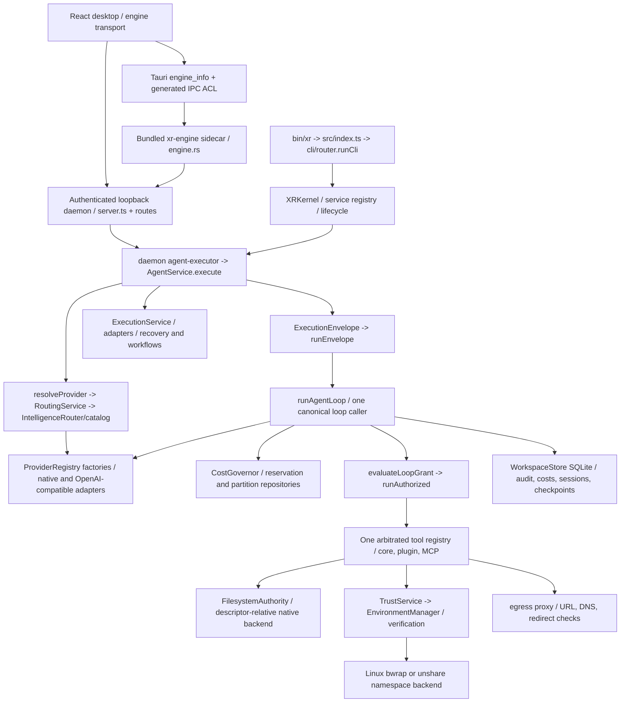

# XR release-candidate architecture audit

Audit date: **2026-10-26**. Baseline: `e25afd362e80485340a322e60a97a04d41b6bd51`, `main`, remote `https://github.com/ahmadrrrtx/xr.git`. Fresh clone; no pre-existing local edits or untracked user files. This is a source-backed map, not a replacement architecture. Existing historical audits are context, **not validation of this working tree**.

## Scope and method

Read `AGENTS.md`, the Constitution, manifests/locks, current launch register and release/security runbooks; trace the active CLI, service, envelope, agent, trust, provider, persistence and desktop/daemon boundaries. Inventory: 752 runtime TypeScript files and 451 test files at baseline, plus React/Rust and independent satellite/mobile/cloud/website packages. Prioritize executable paths over obsolete plans. This audit does **not** claim a line-by-line security certification of every optional integration or satellite. Findings and acceptance tests are in [IMPLEMENTATION_PLAN.md](IMPLEMENTATION_PLAN.md).

## Actual execution graph

The execution fabric and agent envelope have different responsibilities, not two independent agent engines: `src/core/execution/runner.ts:runEnvelope` is the sole production caller of `runAgentLoop`; `src/execution/service.ts:ExecutionService` governs typed capability execution/recovery. `test/core/no-bypass.test.ts` and architecture suites constrain this.

## Component map

| Concern | Source of authority and entry points | Configuration / dependencies | Existing verification and failure modes |
|---|---|---|---|
| 1. Desktop lifecycle | `desktop/src/main.tsx`, app/router/stores; `src-tauri/src/lib.rs:run`, `engine.rs:spawn_sidecar/stop_sidecar`, `main.rs` | Tauri 2, React 18, Vite 8; main/hud/orb/theater windows; Rust state managed before setup (recent Windows fix) | `test/desktop/`, Rust inline tests. Missing sidecar is reported, not a working engine; native launch requires platform evidence. |
| 2. CLI lifecycle | `bin/xr`, `src/index.ts:main`, `cli/router.ts:runCli`, `core/kernel.ts:bootstrap/start` | Bun 1.4.2 pin; npm launcher requires Bun; lazy boot profiles | `test/cli/`, black-box and journey scripts. Noninteractive flags/exit codes distinct from GUI. |
| 3. Shared core | `services/agent-service.ts:execute`, `core/execution/{envelope,runner}.ts`, `core/agent.ts:runAgentLoop` | Service registry/tokens, one tool registry, common stores | `test/core`, `test/architecture`, `test/one-agent`, effect tests. Policy/approval must remain common to surfaces. |
| 4. Adapters | `providers/factory.ts` registrations, `registry.ts:createProvider`, `openai-compat.ts`, `native/*.ts` | Presets, broker-resolved keys, `request-guard.ts`; no vendor SDK requirement | `test/providers/` mocks and opt-in canaries. A single successful response is not a multi-turn tool compatibility test. |
| 5. Selection/tools | `providers/resolver.ts:resolveProvider`, `intelligence/{routing-service,router,catalog,capability,scorer}.ts` | `providerEngine`, `intelligencePlane`, defaults, local runtime cache | Existing automatic routing, locality gates and explanation records already exist. Model lifecycle/validation metadata and legacy fallback have gaps; do not add a second router. |
| 6. Tool invocation | `tools/{registry,registry-service,registry-builder}.ts`, `capabilities/loop-grant.ts:evaluateLoopGrant`, `capabilities/authorize.ts:runAuthorized`, `capabilities/grant.ts` | Modes, qualified IDs, allow/deny sets; plugin/MCP contributions | `test/capabilities`, collision/no-bypass tests. Unoffered tools must not resolve. Arguments/model output remain untrusted. |
| 7. Policy/approvals | `capabilities/policy.ts`, loop grant evaluation; `control/{approval-store,approvals,typed-confirm}.ts`, `services/agent-service.ts` approval wiring; tool-local approvals | Denied permissions, durable approval scopes/hashes, headless confirmation | `test/security`, `test/control`, `test/phase0/policy-gate-adversarial.test.ts`. Missing approver denies consequential operations. Approval is not OS confinement. |
| 8. Processes | `tools/system.ts:shellTool`, `util/process.ts`, `runtime/trust/tool-support.ts`, environment backends | Shell semantics explicit for shell tool; structured argv in process utilities; time/output limits and stripped trust env | `test/util/process.test.ts`, shell isolation and cancellation suites. **Confirmed read-only remount escape in unshare baseline**, not in direct file authority. |
| 9. Filesystem | `security/filesystem.ts:FilesystemAuthority`, `security/fs-native.ts:anchoredOpen`, `runtime/trust/filesystem.ts` | Linux openat2, Darwin descriptor APIs, Windows NtCreateFile backend; root handles, identity checks, leases | `test/security/filesystem-authority*`, native platform tests. Unsupported backend fails closed; symlink/hardlink/swap protections are not just realpath checks. |
| 10. Secrets/config | `config/config.ts:loadConfig/saveConfig`, `security/{secret-broker,secrets,secret-backends}.ts` | XR_HOME; OS keychain/Secret Service/DPAPI, AES-GCM local fallback, key stored beside ciphertext | Secret suites. Fallback resists accidental plaintext disclosure, **not same-user/disk compromise**. No credentials supplied to this audit. |
| 11. Budgets | `cost/{governor,manager,pricing}.ts`, reservation/partition repos, loop usage recording | Estimated USD, token caps, global/task reservations, explicit budget raises | Budget/partition tests pass at baseline. Unknown hosted rates can become zero; empty-turn retry drops first usage; estimates are **not a provider-side absolute USD ceiling**. |
| 12. Audit/state | `state/workspace-store.ts:audit/verifyChain`, repos, write gate, migrations; security audit signer/anchor modules | SQLite single-writer/WAL, hash chain, optional external anchors | Restart/crash/chain tests. Local chain detects edits relative to retained history; a local writer able to rewrite the whole chain needs external anchoring to detect that rewrite. |
| 13. Sidecar/local runtime | `desktop/src-tauri/src/engine.rs`, `scripts/compile-sidecar.ts`, `local/runtimes.ts`, daemon parent watch | Tauri externalBin; actual Bun target per Rust triple; optional Ollama etc. | Compiled Linux engine and authenticated boot smoke executed at baseline. Browser automation remains external/unavailable in standalone sidecar; no model weights bundled. |
| 14. IPC/API | `desktop/src/engine/{transport,chat,providers}.ts`; generated capability ACL; `daemon/server.ts`, session auth, route schemas | Random bearer, loopback, host/origin checks, bounded bodies, explicit LAN mode | Daemon, CSRF, token, IPC-ACL tests. Browser dev proxy is a development surface; native IPC permissions do not authorize arbitrary remote frames. |
| 15. Packaging/update | Tauri config, `scripts/{desktop-signing-plan,make-updater-manifest,verify-updater-signatures}.ts`, `update/`, platform packaging | CLI independent of Tauri; desktop bundles engine; updater pubkey empty/endpoints empty at baseline | Builds alone are not installer tests. Updater intentionally inactive until provisioned. Existing tag attachment path can publish before all gates; fix rather than add a competing release system. |
| 16. CI/channels | `.github/workflows/{ci,release,desktop-app,supply-chain,journey,cross-platform}.yml`, release/channel scripts | Canonical CLI artifacts, signed sums, SBOM/provenance; desktop platform matrices; independent satellites/mobile/cloud versions | Many current gates exist. New source/workflows cannot count as executed macOS/Windows evidence. Public GitHub run summaries for baseline are recorded separately. |

## Coupling to retain / change

Retain the Bun kernel, service registry, one runner, native descriptor file authority, policy/consent, provider registry/intelligence plane, SQLite stores and Tauri shell. No framework rewrite or new database is warranted.

Actual desktop/CLI coupling: `engine.rs:spawn_sidecar` inherits the default XR_HOME, so a desktop provider/workspace mutation can change the CLI's global runtime settings. Renderer settings/chat SQLite are separately under app data. Plan an explicitly documented independent desktop engine home without moving/deleting old shared data. Desktop already bundles a sidecar; requiring a global CLI install would be a regression, not a separation fix.

## Baseline (executed Linux x86_64)

Full logs: `evidence/rc-2026-10-26/baseline-*.log`; exact command/exit records: `commands.jsonl` there.

* Identity/channel/claims: all exit 0; eight stamped surfaces consistent. Desktop JS package and Cargo lock package identity are not declared stamp targets.
* Core parity runner: **4,164 pass / 24 skip / 0 fail**, 367/367 files, 50 sequential segments, 146.9 s.
* Security/trust/capabilities: **615 pass / 16 skip / 1 fail**, 58 files. The TMPDIR assertion conflates private scratch with a host write; separate effect probe finds host sibling unchanged. A distinct read-only-root remount probe **does change host bytes**.
* Provider/intelligence/release subset: **533 pass / 11 skip / 0 fail**, 45 files (overlaps core; do not sum as unique coverage).
* Unit tier: 271 pass, 17 files, 1.3 s.
* Typecheck: Node with explicit 768 MB heap fails 134; **same two tsconfigs pass under `bun --bun .../tsc`**, 35.4 s. Resource/tool-runtime issue, not a demonstrated type error.
* Desktop ESLint and production renderer build: exit 0. Existing Prettier check: exit 1, 375 files. No root-wide formatter is configured.
* Linux standalone sidecar compile and authenticated serve smoke: exit 0 each.
* Dependency audit: exit 1; production Zod advisory GHSA-mrhx-c7xc-m3w5.
* Native Rust/Tauri build: not executed at baseline; Rust and GTK/WebKit dev libraries absent. Install only the justified minimum, one stage at a time.

## Implemented Phase 4 delta (2026-10-26 22:53 UTC)

The original coupling above is historical evidence. Desktop now launches an independent absolute `XR_DESKTOP_HOME`/`~/.xr-desktop` engine, ignores CLI `XR_HOME`, and selects per-home hashed macOS/Linux OS-store service names. CLI legacy service remains unchanged. No implicit import/delete occurs. Shared-root policy/meter/schema/provider adapters remain the one authority; desktop native/browser governors are stricter advisory layers and cannot substitute provider/model pins. Actual-attempt SSE carries rate/source/usage; interrupted/unknown values remain unavailable. Catalog startup is offline and last-good state is retained with an error, while discovery/probe/Auto acceptance are explicit actions. Credential cleanup/removal requires acknowledgment; generic settings reject structured/JSON-encoded credentials, native arbitrary service/account addressing is refused, and legacy native secret writes are disabled. See PROGRESS for executed contracts and native/GUI limitations, not an implied cross-platform PASS.

## Final candidate delta — 2026-10-27 (1.1.1-rc.1)

The execution architecture above was retained, not replaced. Coding entry,
legacy run, daemon and desktop use AgentService/envelope/canonical tools.
Final blackbox tests exercise the actual CLI process, not a replacement loop.

* Canonical immutable facts now live at `src/core/model-facts.json` and the
  browser-safe `src/core/model-registry.ts`; intelligence retains a compatibility
  facade. Root pricing, renderer and shipped Rust governor read the same facts.
  Shared cancellation errors moved to `src/core/provider-abort.ts`, re-exported
  by the transport guard. No upward kernel imports or runtime cycles remain in
  executed boundary gates. New model metadata does not mutate saved config.
* `model-accounting.ts` binds actual attempts to Governor admission, persistence
  and audit before retries/hops. Telemetry forwards managed-attempt ownership
  and dynamic identity; its failure cannot cause paid replay or double charge.
  A real consented loopback fallback emits exactly one failed-primary and one
  fallback receipt; a canonical SQLite integration verifies those same two
  identities/rows. Unknown/non-finite tariffs cannot become free requests even
  when USD thresholds are disabled. Invoice ceilings are not claimed.
* Existing BudgetService owns new manager/governor construction for API/probes;
  no second budget decision authority was introduced. Desktop engine caps are
  authoritative; automatic UI synchronization tightens only, while an explicit
  owner update can change limits. Cross-storage atomicity is not inferred.
* Desktop engine home is independent and namespaced; bundled sidecar and dev
  launch do not require a global CLI. Scope-limited acknowledged credential
  migration/deletion replaces generic settings/localStorage copies and unscoped
  legacy IPC. Actual OS keychain/native GUI evidence remains unavailable.
* Existing provider command selection and measurement handlers were extracted
  to `providers-selection.ts` / `providers-measure.ts`; the original dispatcher
  is below the unchanged800LOC threshold and its stale waiver was removed.
  Force selection really sends no probes; ordinary probes keep state-machine
  cleared deadlines. New setup/Auto states never fabricate authentication,
  installed models or agent-quality recommendations.
* Existing workflows now stage privately, authenticate exact artifact/tag/ref/
  source identities, defer desktop attachment until native validation and
  require explicit owner public/default promotion. Signed stable metadata is
  an artifact projection; canonical stable templates remain public1.0.0.
* Security verification is executable, with streamed bounded subprocesses and
  an actual process-group watchdog. Full mode uses the existing segmented
  parity authority; blackbox/quarantine scope is explicit. No separate suite,
  provider or publishing framework was created. Resource/failure history is
  retained in PROGRESS, including the rejected monolithic attempt.

The final report/evidence index, not historical support badges or a source
inspection, is the candidate's validation authority. This is not a line-by-line
certification of every optional satellite/integration or a non-Linux runtime pass.
